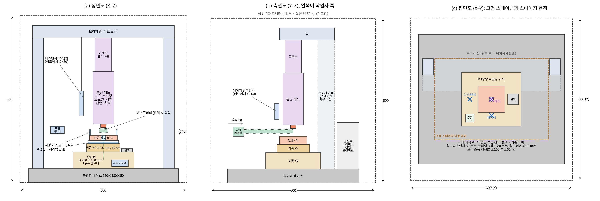
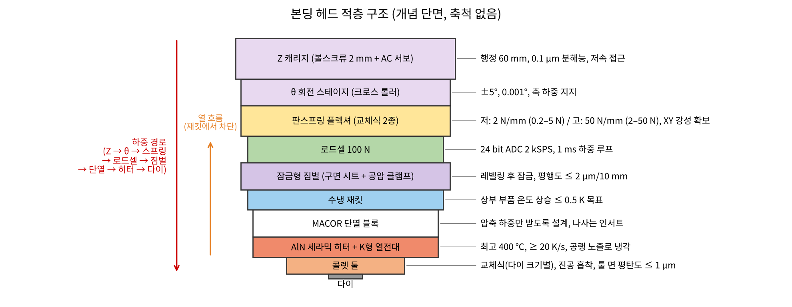

# 3. 시스템 구성 (System Architecture)

**중간 대비 바뀐 점**

- 고정 헤드·이동 기판과 조동·미동 정렬 구조를 계승했다.
- 적층·리플로우 척, 가압 충전 지그·플런저, 수지·NCF 공급과 하부 관찰을 추가했다.
- 두 적층 모드의 시퀀스와 두 히터 순차 전원 절차를 구체화했다.
- STM32H743 공통 C 펌웨어·웹 HMI를 연결하고 소프트웨어 상세는 16장으로 넘겼다.

## 3.1 실제 R&D 본더 조사와 설계 위치

설계 수치의 근거를 확보하기 위해 대학 연구실에서 쓰는 데스크톱 다이본더·플립칩 본더의 공개 사양과 운전 지침을 조사했다.

| 항목 | Finetech FINEPLACER lambda | Finetech FINEPLACER sigma | Tresky T-3000-FC3 | SET FC150 | **본 설계** |
|---|---|---|---|---|---|
| 배치 정확도 | ±0.5 μm | ±0.5 μm | 2 μm | ±1 μm | **±1 μm (3σ)** |
| 하중 | 0.1–200 N (수동 암 0.1–20 N) | 0.2–40 N / 1–500 N | 0.2–490 N | — | **0.2–5 N / 2–50 N** |
| 가열 | 칩·기판 400 ℃, 승온 6 K/s(칩)·20 K/s(기판) | 450 ℃ | 툴·기판 400 ℃ | — | **헤드 400 ℃ ≥ 20 K/s, 척 200 ℃** |
| 정렬 | 고정 빔스플리터 오버레이, 카메라 트랙 이동 | FOV 3.8×2.7 mm, 1 μm/px | 빔스플리터, 23× 줌 | 자체 비전 | **빔스플리터 슬라이드, 1.73 μm/px** |
| 이동 | Z 10 mm, θ ±5° | XY 미세 2.5 mm, θ ±15° | XY 200 mm, Z 95 mm | — | **조동 200×100 + 미동 ±0.5 mm, Z 60, θ ±5°** |
| 공정 보조 | 포밍가스·포름산, 디스펜서, 다이 플립, 측면 영상 | — | 디스펜서·스탬핑, 젤팩, 공정 카메라 | 평행도 제어, 포름산 | **N₂ 쉴드, 디스펜서·스탬핑, 측면·하부 카메라, 레이저 높이** |

조사에서 얻은 설계 원칙은 네 가지다.

1. **하중은 두 레인지로 나눈다.** 하나의 센서·스프링으로 0.2 N과 50 N을 모두 정밀하게 다루기 어렵다.
2. **정밀도와 행정을 분리한다.** sigma는 수 mm 미동 축으로 정밀도를 내고, 넓은 작업 영역은 따로 처리한다.
3. **승온 속도는 수~20 K/s급이다.** 이 이상은 열해석으로 확인해야 한다.
4. **운전 순서가 표준화되어 있다.** Finetech 운전 지침의 순서는 정렬 → 카메라 후퇴 → 미세 포지셔너로 천천히 접촉 → "승온 K/s · 유지 ℃ · 시간 s" 구간 프로파일 → 자동 냉각이다. 본 장비의 동작 순서(3.6절)와 레시피 형식은 이 방식을 따른다.

본 장비의 목표 정확도 ±1 μm는 상용 R&D 장비 범위(±0.5~2 μm) 안에 있다. 차별점은 교육 기능이다. 공정 중 관찰(측면·하부 카메라), 측정(레이저 높이, 하중·온도 로그), 수동·자동 비교를 한 장비 안에서 할 수 있다.

## 3.2 설계 개념과 주요 결정

**고정 헤드 + 이동 기판** 구조를 유지한다. 화강암 베이스 위 대칭 브리지에 Z·θ 헤드를 고정하고, 기판은 조동+미동 XY 스테이지로 옮긴다. 중간 구조 해석으로 고친 대칭 레일·기둥과 거셋을 기준으로 한다. 정렬 광로·힘 전달 경로·열 차단 경로를 분리한 기본 설계는 적층에도 유효하다(중간 원고 3·8장, `cad/stacker/out/summary.json`).

| 결정 | 계승·변경 내용 | 근거·구분 |
|---|---|---|
| 운동 분배 | 헤드 Z·θ, 기판 XY | 중간 3장 설계 |
| XY 스테이지 | 조동 200×100 mm + 미동 ±0.5 mm, 분해능 10 nm | 설계값, 중간 3장·`calc/midterm/drive_calc.json` |
| 하중 | 서보 + 교체식 2 / 50 N/mm 판스프링 + 로드셀 | 설계값, 같은 근거·6장 |
| 가열 | 헤드 AlN 20×20×5 mm·400 W 유지, 척 150 W 리플로우 모듈 추가 | 설계값, `calc/midterm/thermal.json`, `calc/hardware/reflow_heater.json` |
| 척 | 적층 척과 리플로우 척의 기능을 구분하며, 공정 운전은 적층 척=리플로우 척의 온도 고정 절차 적용 | `calc/hardware/README.md` |
| 경화·충전 | TC-NCF 층별 접합, MR-MUF 일괄 리플로우 뒤 가압 충전·경화 | `docs/requirements.md` 6절 |

기존 CAD의 두 척은 교환 장착 설명용 배치다. 두 형상을 동시에 가열·이송하는 실제 운전 궤적까지 검증했다는 뜻은 아니다. 적층 척=리플로우 척 구성에서는 정렬 온도를 고정하고 온도 도달 후 90 s 안정화한 뒤 정렬한다(설계 절차, `calc/hardware/thermal_expansion.json`).

## 3.3 배치와 추가 모듈

*그림 3-1. 중간 장비의 기본 배치와 조동·미동 구조(초기 배치안). 기말 추가 부품과 최종 CAD는 11장을 따른다. 이 그림은 신규 리플로우·충전 지그의 최종 배치를 나타내지 않는다.*

| 모듈 | 역할 | 설계 근거 |
|---|---|---|
| 적층 척·더미 다이 | 층별 하중 지지, 진공 고정, 층 수·두께 비교 | `cad/stacker/spec_stacker.py`, `calc/hardware/load_path.json` |
| 리플로우 척 | 전체 스택 온도 프로파일, 단열·강제 냉각 | `calc/hardware/reflow_heater.json` |
| 가압 충전 지그·플런저 | 금형 독립 체결, 수지 가압 이송·벤트 | `calc/hardware/mold_jig.json` |
| 수지 공급·디스펜서 | MR-MUF 충전 전 수지 공급 | `docs/PLAN.md` 8절, `cad/stacker/spec_stacker.py` |
| NCF 트레이 | 필름 부착 다이를 뒤집힌 공급 상태로 준비 | 같은 파일 |
| 하부 관찰 | 관통 광로·석영 창·미러·하부 카메라로 유동 선단 관찰 | 중간 3장, `cad/stacker/spec_stacker.py` |

하부 관찰의 투명 시편은 실제 불투명 Si 적층체의 내부를 그대로 볼 수 있다는 뜻이 아니다. 실물 장비에서는 투명 교육 시편과 외부 검사를 구분하며, 현재 디지털 트윈은 계산된 충전 선단과 층별 상태를 시각화한다. 가압 지그의 기밀·내압과 탑재 상태 열프로파일은 제작 후 시험 항목이다(`calc/hardware/README.md`).

## 3.4 본딩 헤드와 하중 경로

*그림 3-2. 계승한 본딩 헤드의 힘 전달·단열 구조. 상세 치수는 6·7장과 최종 CAD를 따른다.*

판스프링은 Z 방향에 유연하고 XY 방향에는 단단하다. 잠금형 짐벌은 기준 평면에서 레벨링 후 고정하며, MACOR는 압축 하중을 받도록 금속 인서트와 함께 배치한다. 하중은 헤드→다이 스택→전면 석영 지지→척→스테이지→베이스·브리지로 전달된다. 각 계면이 직렬로 하중을 전달하므로 층 수만큼 범프 접촉 면적을 곱하지 않는다(`calc/hardware/load_path.json`).

툴 열전대 온도와 접합부 온도는 다르다. 중간의 더미 다이 온도 보정 개념을 유지하고, 기말에서는 접촉 열저항을 포함한 층별 온도 계산과 헤드 설정 보정 옵션으로 차이를 드러낸다. 실물 센서 보정을 마친 값으로 표현하지 않는다(7장 7.9~7.10절).

## 3.5 센서–제어기–구동기와 순차 전원

| 계층 | 담당 | 주기·범위 | 근거·구분 |
|---|---|---|---|
| 상위 웹 HMI | 레시피·합성 비전·시나리오·결과 비교·3D 재생 | 비실시간 UI | `README.md` 2·3절 |
| 공통 C 제어기 | 하중 PI·온도 PI·시퀀서·인터락 | 하중 1 ms / 온도 10 ms | 설계값 / 원문 10 ms 피드백 요구 대응, `firmware/README.md` |
| MCU 대상 | STM32H743, 센서·서보·히터 HAL | 보드용 바이너리 생성, 실제 I/O bring-up 전 | 같은 파일 |
| 웹 SIL | 같은 C 코드를 wasm으로 실행, JS 플랜트와 수치 대조 | 독립 SIL·고장 주입 | `README.md` 2절 |
| 안전 | 52 N·410 ℃ 경고, 55 N·420 ℃ 차단 모사 | 안전 설계값, 원문 운전 상한과 별도 | `firmware/README.md` |

실물 설계의 하중·온도 센서 경로는 계승하지만 MCU HAL의 실제 센서·PWM은 미구현 틀이다. 웹 하중 그래프는 JS 플랜트와 wasm REFERENCE의 독립 SIL이며, 적층 열 사슬을 같은 폐루프로 직접 구동하는 것이 아니다. 고장 주입에는 별도 FIRMWARE 인스턴스를 쓴다. 소프트웨어 API·빌드·배포·검증 상세는 **16장 16.1~16.5절**로 넘긴다.

**순차 전원.** 헤드 400 W와 척 150 W를 동시에 통전하지 않는다. 보조 100 W라는 가정 예약을 포함한 헤드 단계 500 W, 척 단계 250 W는 48 V 600 W 설계 전원 안에 있다(`calc/hardware/reflow_heater.json:results`, `calc/hardware/README.md`). 펌웨어는 직전 통전 히터를 우선하고, 전환 시 두 출력이 모두 0인 주기를 거친다. 두 출력이 꺼진 상태에서 동시 요청하면 헤드가 우선이며, 래치 때는 두 출력 모두 차단한다. 여기서 통전 판정은 실측 전류가 아닌 HAL 수락 지령이다(`firmware/README.md` W7).

## 3.6 두 모드의 운전 시퀀스

| 단계 | TC-NCF | MR-MUF |
|---|---|---|
| 준비 | NCF 부착 다이, 적층 척·고정 정렬 온도 준비 | 필름 없는 다이, 척·수지·독립 체결 지그 준비 |
| 기준 보정 | 광학 채널 오프셋 보정, 설정 온도 도달 후 안정화 | 같음 |
| 층별 배치 | 픽업→XY 이동→듀얼 비전→미동·θ 정렬→광학계 후퇴→저속 접촉 | 같음 |
| 층별 고정 | 승온→하중 램프·유지→냉각·해제 | 짧은 가열로 tack(임시 고정)→해제 |
| 반복 | 다음 층으로 반복, 아래층 재가열·NCF 경화 누적 | 다음 층으로 반복, 아래층 tack 열 노출 기록 |
| 일괄 후공정 | 층별 접합에서 완료 | 헤드 히터 해제→척 히터 허용→전체 리플로우·자기정렬→냉각→수지 공급·가압 충전→금형 내 경화·후경화 |
| 확인 | 자기 접합 온도·정렬·휨·접촉/겔 경향 확인 | 리플로우 온도·잔여 정렬·휨·미충전·필러/겔 경고 확인 |

*근거: `docs/PLAN.md` 1·4절, `docs/thermal_history_report.md` 스케줄 정의, `docs/stage4_model_update.md`, `firmware/README.md` W7. 공개되지 않은 펄스·유지·취급 조건은 `sim/params.json`의 교육용 가정이며 업체 양산 레시피가 아니다.*

정렬 전 안정화는 초기 준비 절차다. 사이클 회계 모델에는 초기 예열·90 s 대기가 포함되지 않으며, 실제 시연에서 표시하는 본더 점유·배치 후공정과 구분한다(`docs/tcncf_mode_report.md` 사이클 절). 순차 전원 인터락이 모든 보조 금형 열원을 제어한다고 해석하지 않는다. 금형·후경화는 별도 후공정 경계다.

## 3.7 실습 변수와 기록

기존 수동·자동·관찰·KPI 검증은 장비 사용 목적의 분류로 유지한다. 웹 구현의 중심은 두 적층 모드의 레시피 실행과 결과 재생이며, 중간의 수동 핸드휠·실물 카메라·외부 전단 시험은 하드웨어 설계 개념이다.

| 입력 | 기록·비교 | 후속 장 |
|---|---|---|
| 모드·층 수·다이 두께 | 층별 열 이력·재가열/재용융·최대 휨 | 15장 15.2~15.3절 |
| 필름·하중·온도 이력 | NCF 접촉·겔·저점도 체류, 정성 보이드 경향 | 15장 15.4절 |
| 간격·입구 유효압력 | 충전 시간·미충전·필러/겔 경고 | 15장 15.5절 |
| 정렬 기준·초기 오차 | 인접·누적 오차, MR 자기정렬 후 잔여 | 15장 15.6절 |
| 층별·배치 동작 | 본더 점유 / 배치 후공정 | 15장 15.7절 |

결함 면적률 목표와모델이 실제 제공하는 값을 구분한다. NCF 정량 보이드율은 없고 MR 결과는 미충전만 계산한다. 3D와 그래프는 계산된 상태의 재생이며 관찰 영상이나 실측 로그가 아니다(`README.md` 2·3절).

## 3.8 이후 장에서 검증할 항목

| 항목 | 연결 |
|---|---|
| 원문 정합 반복정밀도와 층별·누적 정렬의 차이 | 5장, 15장 15.6절 |
| 축 구동력·플런저·독립 체결·제어 능력 | 6장 |
| 헤드 열 모델 수정·적층 온도·척 냉각 | 7장 |
| 구조·비전·회로·CAD | 8~11장 |
| 판정·실습·안전 | 12~13장, `docs/manual/실습매뉴얼.md` |
| 소프트웨어 구현·검증 | 16장 |

*3.1절 상용 장비 수치는 중간 원고 `docs/report/midterm/03_시스템구성.md`의 조사 당시 공개 사양을 보존한 비교값이다. 본 설계 열의 척 200 ℃ 등은 중간 기준이며 현재 신규 리플로우 척 사양은 3.2절과 7장을 따른다. 최신 제조사 사양 조사나 기말 성능의 실증값으로 사용하지 않는다.*
