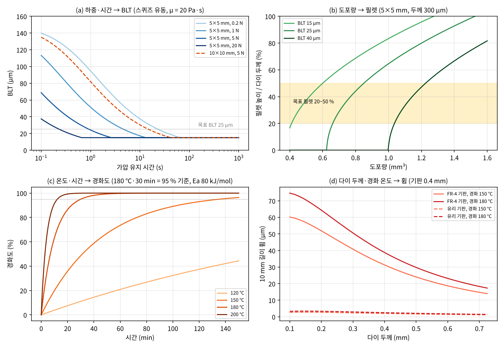

# 4. 공정 물리: 공정 변수와 접합 품질 (Process Physics)

**중간 대비 바뀐 점**

- 스퀴즈·체적 보존·아레니우스·티모셴코와 TCB 구속 개념을 기초 예제로 유지했다.
- NCF 온도×경화 점도와 RK4 스퀴즈, MUF 가압 충전·모세관·필러 규칙을 추가했다.
- 리플로우 자기정렬과 다층 적층판 휨의 식·가정·한계를 정리했다.
- NCF 정량 보이드 모델 부재와 S3 한계를 명시하고 기말 수치 결과는 15장으로 넘겼다.

## 4.1 이 장의 역할

PBL 3쪽은 이 장비로 학생이 "공정 물리 현상을 관찰"하고 "파라미터를 바꾸며 불량 메커니즘을 분석"하는 것을 목표로 든다. 5쪽은 실습 변수로 온도·유지 시간·하중·도포량을 제시한다. 이 장에서는 두 가지를 정리한다.

- **원인과 결과:** 각 공정 변수가 접합 품질(BLT, 필렛, 보이드, 크랙, 휨)을 어떤 물리로 바꾸는지
- **장비 요구:** 그 물리를 학생이 관찰하고 측정하려면 장비가 무엇을 갖춰야 하는지

중간의 단일 다이 물리(4.2~4.10절)는 기초 비교로 보존한다. 기말 적층 모델은 4.11~4.15절에 추가하고, 수치 결과·시나리오 비교는 15장으로 넘긴다. 이 장의 식은 3장 설계와 13장 실습의 근거다. 강의 근거는 쪽수와 함께 표시한다.

**모델의 한계.** 아래 계산은 경향을 보이기 위한 단순 모델이다. 중간 기초 예제의 재료 물성(점도, 반응 에너지 등)은 일반 범위의 가정값이다. 기말 입력은 `sim/params.json`의 문헌값·설계값·역산 추정값·가정값을 각각 따른다. 실제 실습에서는 사용할 접착제의 데이터시트 값으로 바꿔 넣는다.

## 4.2 공정 변수와 품질 지표의 대응

| 공정 변수 | 바뀌는 물리 | 영향을 받는 품질 | 강의 근거 | 장비가 측정·기록하는 것 |
|---|---|---|---|---|
| 하중 F (압력 p = F/A) | 접착제 스퀴즈 유동, 다이 응력 | BLT, 필렛, 다이 크랙 | 0917 공정 40쪽(힘·시간·온도 조절), 43쪽(박형 다이 크랙) | 로드셀 1 kHz, Z 위치 |
| 유지 시간 t | 유동이 진행되는 시간, 경화 반응 진행 | BLT, 경화도 | 0917 공정 38~39쪽(경화 180 ℃·30분) | 실제 유지 시간 |
| 온도 T, 승온 속도 | 점도 저하, 경화 반응 속도, 열팽창 | 경화도, 보이드(가스 발생), 휨 | 0917 공정 39쪽, 82쪽(CTE 차이 → 휨), 148쪽(설정 온도와 실제 온도 차이) | 툴 팁·척 온도 100 Hz |
| 도포량 V, 도포 패턴 | 체적 보존 (BLT 몫 + 필렛 몫), 공기 갇힘 | 필렛, 보이드 | 0917 공정 40쪽(Writing·Showerhead 도포), 42쪽(필렛 유무) | 디스펜서 압력·시간, 측면·하부 영상 |
| 접근 속도 v_z | 접촉 충격 | 다이 크랙, 위치 밀림 | 1008 2.5D·3D 97쪽(가압 속도 조절) | Z 위치와 하중 동시 기록 |
| 툴–척 평행도 | 한쪽 쏠림 | BLT 기울기, 국부 응력 | 1008 2.5D·3D 97쪽(정밀 가압) | 레이저 BLT 스캔 |

## 4.3 하중·시간 → BLT: 스퀴즈 유동 (중간 기초 예제)

**물리.** 다이가 접착제를 누르면 접착제가 다이 아래에서 바깥으로 밀려 나간다. 두 평판 사이의 점성 유체가 짜이는 이 흐름을 스퀴즈 유동이라 한다. 뉴턴 유체에 대한 스테판(Stefan) 식은 다음과 같다(정사각형 다이는 같은 면적의 원판 R = a/√π로 근사).

F = (3π μ R⁴ / 2h³) · (−dh/dt)  →  1/h² = 1/h₀² + 4Ft / (3π μ R⁴)

가정한 값은 다음과 같다.

- 점도 μ = 20 Pa·s (은 충전 에폭시)
- 도포 직후 높이 h₀ = 150 μm
- 최소 BLT = 15 μm (은 필러 크기에 따른 하한)

*그림 4-1. 공정 변수와 품질의 관계. (a) 하중·시간에 따른 BLT, (b) 도포량에 따른 필렛 높이, (c) 온도·시간에 따른 경화도, (d) 다이 두께·경화 온도에 따른 휨.*

**목표 BLT 25 μm에 도달하는 시간**

| 다이 | 0.2 N | 1 N | 5 N | 20 N |
|---|---|---|---|---|
| 2×2 mm | 0.6 s | 0.12 s | 0.02 s | 0.01 s |
| 5×5 mm | 23 s | 4.6 s | 0.9 s | 0.2 s |
| 10×10 mm | 371 s | 74 s | 15 s | 3.7 s |

**읽을 수 있는 것 세 가지.**

1. **BLT는 하중과 시간의 곱으로 정해진다.** 하중을 줄이면 같은 BLT에 도달하는 시간이 그만큼 늘어난다. 그래서 하중과 유지 시간은 따로가 아니라 함께 실험해야 하는 변수다(13장 DoE).
2. **같은 압력이라도 큰 다이는 느리다.** 필요한 시간은 다이 크기의 4제곱에 비례하고 하중에 반비례한다. 압력 p = F/A를 같게 맞춰도 시간은 a²에 비례해 늘어난다. 10×10 mm 다이는 2×2 mm 다이보다 같은 압력에서 25배 오래 눌러야 한다. 접착제가 빠져나가야 할 거리가 길기 때문이다.
3. **작은 다이는 순식간에 짜인다.** 2×2 mm 다이에 5 N을 주면 0.02 s 만에 목표 BLT를 지나 필러 한계까지 짜인다. 중간 고레인지 예제의 하중 램프(5 N/s)가 끝나기도 전이다. 그래서 작은 다이는 2 N/mm 저 레인지 판스프링(6장)으로 0.2~1 N을 정밀하게 주어야 BLT를 조절할 수 있다. 기말 FIRMWARE의 저레인지 기본 램프는 1 N/s다(`firmware/README.md`). 하중 2레인지 설계의 공정 측 근거다.

## 4.4 도포량 → 필렛과 BLT: 체적 보존

**물리.** 도포한 접착제 부피 V는 다이 아래(A × BLT)와 다이 둘레의 필렛으로 나뉜다. 필렛을 45° 삼각 단면으로 근사하면 다음과 같다.

V = A · BLT + 4a · h_f² / 2

강의 0917 공정 42쪽은 페이스트 접착(필렛 있음)과 DAF(필렛 없음)를 비교한다. 필렛은 접착제가 다이 밖으로 나온 몫이다.

**결과 (5×5 mm 다이, 두께 300 μm, 목표 BLT 25 μm, 그림 4-1 b).**

| 항목 | 값 |
|---|---|
| 필렛 20 %에 필요한 도포량 | 0.66 mm³ |
| 필렛 50 %에 필요한 도포량 | 0.85 mm³ |
| 허용 도포량 범위 | ±13 % (중앙값 기준) |

도포량이 0.62 mm³보다 적으면 다이 아래를 다 채우지 못해 필렛이 생기지 않고, 가장자리에 미충전(보이드)이 남는다. 반대로 0.85 mm³보다 많으면 필렛이 다이 윗면 쪽으로 올라가 콜렛을 오염시킬 수 있다. 같은 도포량이라도 BLT가 얇아지면(하중을 크게 주면) 남는 접착제가 필렛으로 가서 필렛이 커진다. **도포량과 하중은 서로 얽혀 있다.**

**장비 요구.** 허용 범위가 ±13 %이므로 디스펜서의 도포량 반복성은 그보다 충분히 작아야 한다. 3장에서 시간–압력식 디스펜서(0.1–0.6 MPa × 0.05–1 s)를 넣고, 측면 카메라로 필렛을 기록하도록 한 이유다.

## 4.5 온도·시간 → 경화도

**물리.** 에폭시 경화는 열로 활성화되는 화학 반응이다. 반응 속도는 아레니우스 식 k = k₀·exp(−Ea/RT)를 따른다. 1차 반응으로 근사하고, 강의 0917 공정 39쪽의 경화 조건 "180 ℃·30분"을 95 % 경화의 기준점으로 삼았다. 활성화 에너지 Ea는 일반적인 에폭시 범위(60~100 kJ/mol)에서 바꿔 보았다.

**95 % 경화까지 걸리는 시간 (분)**

| Ea | 120 ℃ | 150 ℃ | 180 ℃ | 200 ℃ |
|---|---|---|---|---|
| 60 kJ/mol | 341 | 93 | 30 (기준) | 15 |
| 80 kJ/mol | 767 | 135 | 30 (기준) | 12 |
| 100 kJ/mol | 1,723 | 197 | 30 (기준) | 10 |

**읽을 수 있는 것.**

- 온도 30 ℃ 차이가 경화 시간을 3~7배 바꾼다. 온도는 경화에서 가장 민감한 변수다.
- 그래서 **실제 접합부 온도**를 아는 것이 중요하다. 강의 0917 공정 148쪽은 "실제 온도값이 세팅한 온도 값인지 확인"하라고 한다. 본 장비는 열전대를 넣은 더미 다이로 툴 팁 온도와 접합부 온도의 차이를 보정하는 절차를 설계했다(3장 3.4절, 7장).
- 중간 에폭시 예제의 척 200 ℃(2장 2.4절)에서는 이 가정 모델로 10~15분 경화가 계산된다. 실습 시간 안에 장비 위에서 경화(스냅 경화)를 끝낼 수 있다는 뜻이다. 장시간 경화가 필요한 접착제는 별도 오븐을 고려한다. 기말 MR-MUF 후경화 조건은 2장 2.7절과 15장 15.7절에서 구분한다.

**경화 중 위치 이동.** 경화 초기에는 점도가 먼저 떨어진다. 그동안 다이가 표면장력과 열팽창 때문에 움직일 수 있다. 이것이 2장에서 ±1 μm KPI를 접착제 없는 건식 배치로 검증하고, 경화 중 이동량은 실습 측정 항목으로 따로 둔 이유다.

## 4.6 보이드: 도포 패턴과 가스

**원인.** 보이드는 크게 두 가지 원인으로 생긴다.

1. **공기 갇힘:** 점을 여러 개 찍는 도포는 점 사이에 공기를 가둔다. 다이가 눌리며 점들이 합쳐질 때 빠져나가지 못한 공기가 남는다. 강의 0917 공정 40쪽의 Writing(선 그리기) 방식이 Showerhead(점 여러 개)보다 공기를 바깥으로 밀어내기 쉬운 이유다. X자나 별 모양처럼 가운데에서 바깥으로 이어지는 패턴이 유리하다.
2. **가스 발생과 팽창:** 빠르게 승온하면 용제나 수분이 기체가 되어 보이드가 생긴다. 강의 0917 공정 80쪽은 갇힌 공기가 가열되면 팽창해 균열을 일으킨다고 설명한다.

**검사 방법의 구분.** 강의 1029 신뢰성 118~121쪽의 X-ray와 SAT는 불투명한 패키지 내부의 보이드와 박리를 보는 장비다. 교육 장비에 이 장비를 넣을 수는 없다. 대신 본 장비는 **유리 기판과 하부 카메라**를 쓰는 하드웨어 관찰 모드(3장 3.3절)를 설계했다. 실물 제작 시에는 이 영상으로 보이드 면적률을 계산하고, 불투명 Si 시편은 외부 X-ray·SAT로 확인한다. 현재 웹 시뮬레이션은 관찰 카메라의 실측 보이드 영상을 제공하지 않는다.

## 4.7 하중 → 크랙: 압력과 평행도

**압력.** 같은 하중이라도 다이가 작으면 압력이 크다(p = F/A).

| 다이 | 1 N | 5 N | 50 N |
|---|---|---|---|
| 2×2 mm | 0.25 MPa | 1.25 MPa | 12.5 MPa |
| 10×10 mm | 0.01 MPa | 0.05 MPa | 0.5 MPa |

평균 압력만 보면 Si가 깨질 수준이 아니다. 실제 크랙은 하중이 한 점에 몰릴 때 생긴다. 원인은 세 가지다.

- 툴과 척이 기울어 한 모서리만 먼저 닿을 때
- 다이 아래에 이물질이나 큰 필러 입자가 있을 때
- 박형 다이를 이젝터 핀으로 들어 올릴 때 (0917 공정 43쪽)

**평행도.** 툴–척 평행도가 2 μm/10 mm(2장 2.4절 설계 목표)일 때 다이 양 끝의 BLT 차이는 다음과 같다.

| 다이 | BLT 차이 | 목표 BLT 25 μm 대비 |
|---|---|---|
| 2×2 mm | 0.4 μm | 2 % |
| 5×5 mm | 1.0 μm | 4 % |
| 10×10 mm | 2.0 μm | 8 % |

평행도가 나빠지면 BLT가 한쪽으로 기울고, 얇은 쪽 모서리에 하중이 몰린다. 그래서 잠금형 짐벌(3장)과 진공 척 평면도 2 μm(11장 도면)를 넣었다. 1008 2.5D·3D 97쪽의 Advanced TC-NCF도 높이별 가압력을 정밀하게 제어해 휨과 크랙을 억제한다.

**장비 요구.** 13장 실습 매뉴얼에는 다이 크기와 두께별 하중 상한을 둔다. 그리고 레이저로 BLT를 네 모서리에서 재서 기울기를 기록한다.

## 4.8 온도 → 휨: 열팽창 차이

**물리.** 다이(Si, 2.6 ppm/K)와 기판(FR-4, 16 ppm/K)은 열팽창계수가 다르다. 접착제가 경화 온도에서 굳은 뒤 상온으로 식으면, 기판이 더 많이 줄어들면서 붙어 있는 다이와 함께 휜다. 강의 0917 공정 82쪽은 이 CTE 차이를 휨의 원인으로 들고, 대책으로 "다이의 크기와 두께 조정"을 제시한다. 두 층 판의 티모셴코(Timoshenko) 식으로 계산했다. 접착층의 유연함을 무시했으므로 상한값이다.

**10 mm 길이의 휨 (기판 0.4 mm)**

| 기판 | 경화 온도 | 다이 100 μm | 다이 300 μm | 다이 725 μm |
|---|---|---|---|---|
| FR-4 | 150 ℃ | 60 μm | 41 μm | 14 μm |
| FR-4 | 180 ℃ | 75 μm | 51 μm | 17 μm |
| 유리 | 180 ℃ | 3.3 μm | 2.9 μm | 1.4 μm |

**읽을 수 있는 것.**

- 경화 온도를 30 ℃ 낮추면 휨이 약 20 % 줄어든다. 대신 4.5절에서 본 것처럼 경화 시간이 3~7배 늘어난다. **휨과 생산성이 서로 반대로 움직이는 관계**를 학생이 직접 확인할 수 있다.
- 다이 두께와 기판 강성의 비율이 휨을 크게 바꾼다. 강의의 "다이 두께 조정" 대책을 수치로 보여 준다.
- 유리 기판은 Si와 열팽창계수가 비슷해 휨이 1/20 이하다. KPI 검증과 관찰 모드에 유리 기판을 쓰는 또 다른 이유다.

**측정.** 본 장비의 레이저 변위계로 경화 전후 다이 윗면을 스캔해 휨을 잰다. 강의 1029 신뢰성 133쪽의 섀도우 무아레가 산업에서 쓰는 방식이며, 레이저 스캔은 그 단순한 대안이다.

## 4.9 확장 공정: Cu pillar 열압착 (TCB)

본 장비의 확장 공정은 Cu pillar 범프의 열압착이다. 강의 내용과 장비 사양의 관계는 다음과 같다.

| 강의 내용 | 장비 사양 |
|---|---|
| Cu pillar 위의 SnAg 솔더 캡 (1001 플립칩 42~45쪽), SnAgCu 녹는점 약 217 ℃ (1001 40쪽) | 헤드 히터 최고 400 ℃ (원문 KPI). 솔더 녹는점보다 충분히 높아, 툴 → 다이 → 범프로 가는 동안의 온도 손실을 감당한다 |
| TC-NCF: 250~300 ℃와 수직 압력을 동시에 가한다 (1008 2.5D·3D 96쪽) | 펄스 히터 22 K/s 승온(7장)과 1 ms 하중 루프(10장)로 온도·하중 프로파일을 동시에 실행한다 |
| 층별 정밀 가압 프로파일, 승온 속도 조절 (1008 97쪽) | 3장 레시피의 하중 램프·승온 속도 변수 |
| 솔더 산화 방지 | N₂ 쉴드 가스 (3장) |
| 리플로우 시 솔더 표면장력에 의한 자기 정렬 (1001 45쪽) | TCB는 하중으로 다이를 붙잡고 있어 자기 정렬이 거의 없다. 그래서 접촉 전 정렬 정밀도(±1 μm KPI)가 그대로 최종 정합이 된다 |

마지막 행이 중요하다. 리플로우 공정은 솔더가 녹을 때 표면장력이 다이를 패드 중심으로 끌어당겨 작은 오차를 스스로 고친다. 열압착은 하중이 다이를 잡고 있으므로 이 효과가 없다. 미세 피치 Cu pillar에서 장비의 정렬 정밀도가 중요해지는 이유다.

## 4.10 장비 설계에 반영된 내용

| 공정 물리 결과 | 장비 설계 반영 | 장 |
|---|---|---|
| 작은 다이는 0.2~1 N에서 BLT가 정해진다 | 하중 2레인지 (2 / 50 N/mm 판스프링), 하중 오차 ±(0.05 N + 1 %) | 2, 6장 |
| 하중과 시간의 곱이 BLT를 정한다 | 하중·유지 시간을 레시피 변수로, 1 kHz 하중 기록 | 3, 10장 |
| 도포량 허용 범위 ±13 % | 시간–압력 디스펜서, 측면 카메라 필렛 기록 | 3장 |
| 온도 30 ℃가 경화 시간을 3~7배 바꾼다 | 열전대 더미 다이 보정, 척 200 ℃ 스냅 경화 | 3, 7장 |
| 보이드는 패턴과 승온 속도에 좌우된다 | 도포 패턴 선택, 승온 속도 변수, 유리 기판 + 하부 카메라 | 3장 |
| 평행도 2 μm/10 mm → BLT 차이 ≤ 8 % | 잠금형 짐벌, 척 평면도 2 μm | 3, 11장 |
| 휨은 CTE 차이와 두께비로 정해진다 | 레이저 스캔 휨 측정, 유리 기판 | 3장 |
| TCB는 자기 정렬이 없다 | ±1 μm 정렬 정밀도, 400 ℃·50 N | 2, 5장 |

*중간 기초 예제 출처·구분: 4.2~4.10절은 `docs/report/midterm/04_공정물리.md`를 계승했다. 입력 가정·설계 목표는 `docs/model_inventory.md` 1.1절, 계산은 `calc/midterm/process_physics.py`·`process_physics.json`을 따른다. 스퀴즈 시간표·필렛 체적·경화 시간·압력·BLT 차이·휨 표는 해당 입력의 계산 결과다. 습식 BLT 25 μm 등은 중간 에폭시 예제이며 기말 NCF 간격에 직접 적용하지 않는다. 기말은 아래 모델을 사용한다.*

## 4.11 NCF 점도·경화와 RK4 스퀴즈

NCF는 승온하면 점도가 떨어지지만, 경화가 진행되면 유동이 멈춘다. 이 경쟁을 아레니우스 온도항과 Castro–Macosko 경화항의 곱으로 근사한다.

μ(T, α) = μref exp[(Eμ/R)(1/T − 1/Tref)] · [αg/(αg − α)]^(A + Bα),  α < αg

α ≥ αg이면 μ = ∞로 두어 유동을 정지한다. T는 절대온도, α는 경화도, αg는 겔 경화도다. 기준 점도 μref=1727 Pa·s와 Tref=138 ℃는 문헌 기준점이며, 전 온도 범위의 최소 점도로 고정하지 않는다. 경화는 dα/dt=k(T)(1−α), H=∫k(T)dt, α=1−exp(−H)로 누적한다. 반응 시작 141 ℃는 문헌값, 활성화 에너지 60 kJ/mol·αg=0.6·A=2·B=0은 가정값이다. 250 ℃에서 3 s 후 겔이라는 기준은 공개 유지 시간·빠른 경화를 참고한 가정값이다(근거: `sim/params.json:ncf`, `docs/tcncf_mode_report.md` 모델·입력 절). 서로 다른 공개 재료의 자료를 조합한 대리 모델이며 양산 NCF의 실측 곡선이 아니다.

스퀴즈 기본식은 4.3절과 같다. 시간에 따라 F와 μ가 변하므로 다음 상태변수로 바꾸어 RK4 적분한다.

y = 1/h²,  dy/dt = 4F(t)/(3π μ(T,α) R⁴),  R = a/√π

이 변환은 h³의 수치 강성을 줄이며 같은 Stefan 방정식을 푼다. 경화 누적 반응량도 온도 이력의 시작점 교차를 나눠 RK4 가중치로 적분한다. 무한 점도에서는 유동률이 0이다. 접촉 시점은 부분 스텝에서 이분법으로 찾는다(`sim/ncf.js`, `docs/tcncf_mode_report.md`).

초기 필름은 **h₀ = gap + 4 μm = 19 μm**다. +4 μm는 문헌값, gap=15 μm는 문헌 입력이다. 두 길이의 곱으로 두었던 이전 정의는 Issue #20에서 수정했다. 유효 접촉은 h≤gap으로 정의하며, 기본 Cu pillar 9 μm와 솔더 캡 6 μm는 형상 가정값이다(`sim/params.json:geometry`·`ncf.film_thickness_over_gap`). 접촉 후 두께는 고정하므로 범프 압축·접촉 후 수지 배출·하중 분담을 풀지 않는다. 다이 중심 온도를 필름 온도의 대리값으로 쓰고 열 모델에 유동·경화 발열을 되먹임하지 않는다. 층별 결과는 **15장 15.4절**에 둔다.

## 4.12 MUF 가압 충전: Hele-Shaw와 모세관 보정

두 평판 사이의 뉴턴 유체가 한 변 전체에서 직선 선단으로 들어간다고 가정한다. 간격 h, 충전 거리 L, 입구 유효압력 ΔPapp에서 다음을 사용한다.

ΔP = ΔPapp + 2γcosθ/h

x² = h² ΔP t/(6μ),  t_fill = 6μL²/(h²ΔP)

입구 압력이 0이면 t_fill=3μL²/(γhcosθ)로 중간 Washburn 식과 같다. 층별 유입은 병렬이며 전체 완료는 가장 느린 층의 시간이다. 허용 시간 t_allow에서 미충전 면적비는 max(0, 1−√(t_allow/t_fill))로 구하고, 층 면적으로 가중 평균한다(`sim/muf.js`, `docs/stage4_model_update.md` 모델 계약 절).

| 입력 | 값·구분 | 파일·키 |
|---|---|---|
| 충전 점도 | 5 Pa·s, 가정값 | `sim/params.json:muf.viscosity_at_fill` |
| 입구 유효압력 | 기본 1 MPa, 0.1~3 MPa, 0은 모세관 비교, 가정값 | `muf.applied_pressure` |
| 금형압력·온도 | 3 MPa·175 ℃, 문헌값 | `mrmuf_process.mold_pressure_applied`·`mold_fill_temp` |
| 표면장력·접촉각 | 0.0298 N/m 가정값 / 20° 문헌값 | `muf.surface_tension`·`contact_angle` |
| 충전 허용·겔 시간 | 10 s / 25 s, 문헌값 | `cycle.mold_fill_time`·`muf.gel_time` |
| 최대 필러 | 3 μm, 문헌값 | `muf.filler_max_size` |

*수치·구분·문헌 근거: `docs/stage4_model_update.md` 파라미터 변경 표,`sim/params.json`의 각 source. 금형압력과 손실 후 갭 입구 유효압력은 다른 물리량이다.*

간격/최대 필러 ≥ 4를 권고하고, <4는 막힘 경고, <3은 불량으로 덮어쓴다(문헌 기반 교육용 규칙, `muf.gap_to_filler_min_ratio`). 막힘을 유동 방정식의 투과도나 추가 결함 면적으로 환산하지는 않는다. 겔 시간 초과는 별도 경고이며 충전 허용 시간을 자동으로 바꾸지 않는다. 범프 투과도·필러 여과·경화에 따른 점도 변화·갇힌 공기는 정량 모델에 없다. 결과는 **15장 15.5절**에 둔다.

## 4.13 리플로우 자기정렬: 메니스커스 강성과 감쇠

TC-NCF는 가압·필름 구속 아래에서 붙으므로 모델에서 자기정렬을 적용하지 않는다. MR-MUF는 솔더가 액상일 때 작은 오프셋을 메니스커스 복원력으로 줄인다. 범프별 작은 변위 강성을 병렬로 합쳐 다음을 사용한다.

K = N_b · 2γ_s d/h_s,  m x″ + c x′ + Kx = −F_resist sign(x′)

N_b=floor(a/pitch)²는 배열 개수, d는 원형 범프 지름을 문헌의 패드 폭으로 대입한 값, h_s는 용융 높이다. m은 해당 다이 질량, c는 점성 감쇠다. 정지 시 |Kx|≤F_resist이면 붙어 있다고 본다. 따라서 충분히 오래 녹아 있어도 마찰에 따른 잔여 오프셋이 남는다. 층별 액상선 위 시간 동안 2차 감쇠 응답을 계산하며, 미끄럼 구간은 선형 해를 쓰고 속도 극점에서 마찰 방향을 바꾼다(`sim/alignment.js:selfAlign`·`selfAlignCoefficients`, `docs/stage3_report.md`).

감쇠·가접 구속 마찰은 공개 검증값이 없는 **가정값**으로 `sim/params.json:alignment.damping`·`resist_force`에 둔다. 작은 변위·독립 층간 좌표의 근사이며, 전체 적층체의 다물체 운동·접촉선 탈착·젖음 불균일은 풀지 않는다. 잔여 표준편차는 정규분포 보증이 아니다. 정렬 결과는 **15장 15.6절**에서 비교한다.

## 4.14 티모셴코에서 고전 적층판 휨으로

중간의 두 층 티모셴코 식을 다층 자유 적층판의 열합력·모멘트 평형으로 확장한다. 두 층일 때 같은 strip 규약으로 티모셴코 식을 재현한다(`docs/thermal_history_report.md`, `sim/warpage.js`).

[A  B; B  D] [ε₀; κ] = [N_T; M_T],  w = κL²/8

각 층 경계 z_i에서 A=ΣQ_i(z_i−z_{i−1}), B=ΣQ_i(z_i²−z_{i−1}²)/2, D=ΣQ_i(z_i³−z_{i−1}³)/3이다. N_T=ΣQ_i α_i ΔT_i(z_i−z_{i−1}), M_T=ΣQ_i α_i ΔT_i(z_i²−z_{i−1}²)/2를 쓴다. strip에서는 Q=E, 이축 입력을 지정할 때는 Q=E/(1−ν)이다. ε(z)=ε₀+κz의 부호 규약이며 z는 적층체 중앙 기준이다.

TC-NCF는 각 층 부착 시의 온도를 무응력 기준으로 저장한다. MR-MUF는 리플로우에서 Si·범프 기준을 재설정하고, MUF는 경화 온도를 자체 기준으로 사용한다. 간격과 Si 층을 순서대로 쌓아 현재 온도와 무응력 온도의 차이를 평가한다. 상온 탄성률·CTE 고정, 기판 구속·점탄성·경화 수축·소성 미포함이라는 가정이다. 접착 시 이전 곡면의 기하학적 상속도 풀지 않는다. 모든 중간 단계의 최대 절대 휨을 판정하므로 층 수에 따라 단조 증가한다고 가정하지 않는다.

**S3 모델 한계.** 현재 모델은 박형 다이에서 두 모드 모두 불량으로 나타나며 업체의 “MR-MUF가 박형 휨에 유리”라는 일반 주장을 재현하지 못한다. 그 주장은 관찰 항목으로만 남긴다. 휨 결과·두께 효과와 한계는 **15장 15.3절과 15장 15.9절**에 정리한다(`docs/stage4_model_update.md` S3 절).

## 4.15 보이드 모델의 범위와 교육 해석

중간의 체적 보존·공기 갇힘·가스 발생·평행도 개념은 유효하다. 그러나 NCF의 접촉 전 겔과 저점도 체류시간은 **정성 경향**만 제공한다. 접촉 전 겔화나 미접촉은 미접합 위험이며, “낮은 경향”도 무결함을 뜻하지 않는다. NCF 결함 면적률은 null이고 정량 판정은 없다(`docs/tcncf_mode_report.md`, `sim/ncf.js`).

MR-MUF의 미충전 면적률 역시 갇힌 보이드를 포함하지 않는다. 설계 목표의 “보이드+미충전” 합산 면적률과 구현 모델의 출력 범위를 구분한다. 진공·금형 조건 일부는 메타데이터로 기록하며 결함률에 직접 적용하지 않는다. 학생은 두 공정의 불량 메커니즘 차이를 학습하되 시뮬레이션이 제공하지 않는 정량 수율을 추정하지 않는다(2장, **15장 15.9절**).

