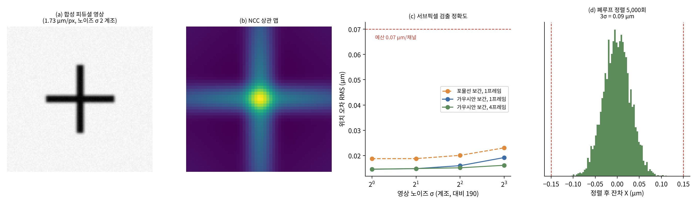

# 9. 비전 정렬 알고리즘 (Vision Alignment)

**중간 대비 바뀐 점**

- 중간 NCC·서브픽셀·평탄화·아핀 보정 설명을 유지했다.
- Python 모델의 sim/vision.js 이식과 golden 대조를 추가했다.
- 기말 영상 기반 폐루프 표본 결과를 중간 통계 시뮬레이션과 구분했다.
- 상수의 params 이관과 층별 웹 표시를 추가했다.

**중간 결과의 출처·범위.** 9.1~9.7절은 중간 합성영상·통계 계산 기준점이다. 광학 사양·노이즈·표본 수는 설계값 또는 시험 가정값, 표의 오차는 계산 결과이며 실측이 아니다. 수치 출처는 `calc/midterm/vision.json`, `vision_robust.json`, `docs/report/midterm/09_비전정렬.md`이다. 기말 재실행은 9.8절에 별도로 기록했다.

## 9.1 원문 요구와 목표

PBL 9쪽은 비전 정렬에 세 가지를 요구한다.

1. **광학계:** 동축 조명 + 빔스플리터 + 텔레센트릭 렌즈로 칩과 기판을 동시에 촬영
2. **검출:** NCC 템플릿 매칭 또는 원형 검출로 오차 벡터(Δx, Δy, Δθ)를 추출
3. **보정:** 아핀 변환으로 픽셀 좌표를 스테이지 이동량으로 바꿔 "정합 오차를 서브마이크론으로 수렴"

5장 오차 예산이 비전에 배정한 목표는 다음과 같다.

| 항목 | 목표 | 5장 근거 |
|---|---|---|
| 피듀셜 검출 반복성 (채널당) | σ ≤ 0.04 px (0.07 μm) | #1 |
| 정렬 수렴 판정 | \|Δ\| ≤ 0.15 μm, 최대 3회 반복 | #2 |
| 각도 (설계 목표) | ±0.005° (3σ) | 5.4절 |

## 9.2 알고리즘

**① 영상 획득.** 빔스플리터 한 프레임에 칩 아랫면(또는 테스트 다이)의 피듀셜과 기판 피듀셜이 함께 담긴다. 2× 텔레센트릭 렌즈와 3.45 μm 픽셀 센서를 쓰므로 1 픽셀은 1.73 μm다. 시야는 4.2×3.5 mm다. 피듀셜은 Cr 십자 마크(팔 길이 100 μm, 선폭 10 μm)이고, 동축 조명 아래에서 밝은 배경에 어두운 마크로 보인다.

**② 평탄화 보정.** 피듀셜이 없는 빈 유리를 찍은 기준 영상으로 각 영상을 나눈다. 조명 불균일을 없애는 단계다(9.4절에서 필요성을 확인한다).

**③ NCC 템플릿 매칭.** 저장된 마크 템플릿과 영상의 정규화 상호상관(Normalized Cross-Correlation)을 계산하고, 상관 맵의 최댓값 픽셀을 찾는다. NCC는 밝기와 대비의 전체적인 변화에 영향을 받지 않는다.

**④ 서브픽셀 보간.** 최댓값 주변 3×3 상관값의 로그에 포물선을 맞춘다(가우시안 피크 보간). 이렇게 픽셀보다 작은 단위로 중심을 구한다. 여러 프레임을 평균하면 노이즈를 더 줄일 수 있다.

**⑤ 아핀 좌표 변환.** 픽셀 좌표 p를 스테이지 좌표 s로 바꾼다: s = A·p + b. A(2×2)에는 배율, 카메라 회전, 기울어짐이, b에는 원점 이동이 들어 있다. 이 값들은 캘리브레이션(9.5절)으로 미리 구한다.

**⑥ 오차 벡터 계산.** 칩 마크와 기판 마크의 스테이지 좌표 차이에서 매일 측정한 광학 채널 오프셋을 뺀다. 그 결과가 Δx, Δy다. Δθ는 네 모서리 마크로 구한 두 대각선 방향의 평균으로 계산한다.

**⑦ 보정 이동과 반복.** 미동 XY 스테이지와 θ 스테이지를 −Δ만큼 움직이고 다시 촬영한다. \|Δ\| ≤ 0.15 μm이고 \|Δθ\| ≤ 0.002°가 되면 멈춘다. 최대 3회까지 반복한다.

## 9.3 검증 방법: 합성 영상

실제 카메라 없이 알고리즘의 정확도를 확인하기 위해 위치를 정확히 아는 합성 영상을 만들었다(Python, OpenCV 5.0).

- **렌더링:** 십자 마크를 무작위 서브픽셀 위치(±2 px)에 놓고, 픽셀마다 마크가 덮는 면적을 정확히 계산했다.
- **광학 블러:** 가우시안 블러(σ 1 px)를 적용했다.
- **카메라 노이즈:** 정규분포 노이즈를 더하고 10 bit로 양자화했다.
- **판정:** 검출 위치와 참값의 차이로 오차를 계산했다.

*그림 9-1. (a) 합성 피듀셜 영상, (b) NCC 상관 맵, (c) 노이즈 수준별 서브픽셀 검출 오차, (d) 폐루프 정렬 5,000회 시뮬레이션의 최종 잔차.*

## 9.4 검출 정확도

| 조건 (대비 190 계조) | 오차 RMS | 판정 (목표 0.04 px) |
|---|---|---|
| 노이즈 σ 2, 포물선 보간 | 0.011 px (0.019 μm) | 통과 |
| 노이즈 σ 2, 가우시안 보간 | 0.0086 px (0.015 μm) | 통과 |
| 노이즈 σ 8, 가우시안 보간, 4프레임 평균 | 0.0094 px (0.016 μm) | 통과 |

**조건이 나쁠 때 (노이즈 σ 2 기준, 가우시안 보간)**

| 조건 | 오차 RMS | 판정 |
|---|---|---|
| 초점 이탈 (블러 2.5 px) | 0.005 px | 통과 |
| 저대비 (대비 50) | 0.011 px | 통과 |
| 조명 기울기 ±10 % | 0.020 px | 통과 |
| **최악 복합 (블러 2.5 px, 대비 50, 조명 기울기, 노이즈 σ 4)** | **0.102 px (0.18 μm)** | **실패** |
| 최악 복합 + **평탄화 보정** | 0.031 px (0.053 μm) | 통과 |

조명 불균일이 다른 악조건과 겹치면 NCC 최댓값이 밝은 쪽으로 끌려가 오차가 2.5배 커진다. 그래서 알고리즘 ②단계의 평탄화 보정을 필수로 넣었다.

**시뮬레이션의 한계.** 합성 영상에는 렌즈 왜곡, 마크 가장자리의 거칠기, 센서 픽셀 간 감도 차이가 없다. 그래서 실제 오차는 이 결과보다 커진다. 그 몫을 고려해도 5장 예산 0.04 px는 기준 조건 결과(0.009 px)보다 약 4배, 최악 복합 조건 결과(0.031 px)보다 약 1.3배 여유가 있다.

## 9.5 아핀 캘리브레이션

**절차.**

1. 기준 다이를 척에 고정한다.
2. 미동 스테이지로 시야 안 5×5 격자(±1.5 mm × ±1.2 mm)를 차례로 이동한다. 이동량은 정전용량 센서(10 nm)가 보증한다.
3. 각 위치에서 마크의 픽셀 좌표를 검출한다.
4. 25쌍의 (픽셀, 스테이지) 좌표에 최소제곱법으로 아핀 계수 6개를 맞춘다.

**검증 결과.** 카메라 회전 0.3°, 배율 오차 0.2 %, 약간의 기울어짐을 일부러 넣고 캘리브레이션을 시험했다.

| 항목 | 결과 |
|---|---|
| 추정 회전 | 0.2998° (참값 0.3°) |
| 추정 배율 | 1.7284 μm/px (참값 1.7285 μm/px) |
| 캘리브레이션 후 시야 전체 좌표 오차 | RMS 0.028 μm |
| 캘리브레이션 없이 공칭 배율만 쓸 때, 1 mm 지점 오차 | **5.6 μm** |

캘리브레이션을 하지 않으면 카메라가 0.3°만 돌아가 있어도 1 mm 떨어진 곳에서 5 μm 이상 틀린다. 그래서 PBL 9쪽의 아핀 변환은 선택이 아니라 서브마이크론 정렬의 전제 조건이다. 아핀 변환이 "픽셀 → 모터 펄스"가 아니라 "픽셀 → 엔코더·센서 좌표"로 이어져야 한다는 점도 중요하다(5장, 6장).

## 9.6 폐루프 정렬과 각도

**시뮬레이션 조건 (5,000회).**

- 초기 오차: ±30 μm, ±0.3° (조동 스테이지 위치결정 이후)
- 반영한 오차: 채널별 검출 노이즈, 캘리브레이션 잔차(0.05 %), 미동 스테이지 위치결정 노이즈(σ 0.02 μm), θ 스테이지 노이즈

| 항목 | 결과 | 목표 | 판정 |
|---|---|---|---|
| 최종 잔차 3σ (X·Y) | 0.09 μm | 5장 #1+#2 배정치 √(0.10² + 0.087²) × 3 = 0.40 μm | 통과 |
| \|Δ\| ≤ 0.15 μm 도달 비율 | 100 % | — | — |
| 필요 반복 횟수 | 1회 99.1 %, 2회 0.8 %, 3회 0.1 % | ≤ 3회 | 통과 |
| 각도 잔차 3σ | 0.0017° | ±0.005° | 통과 |
| 각도 측정 σ (4 마크 × 4프레임, 간격 4 mm) | 0.0003° | 5장 배정치 0.0005° | 통과 |

반복은 거의 한 번에 끝난다. 아핀 캘리브레이션이 정확하면 첫 보정 이동만으로 오차가 판정 기준 안에 들어오기 때문이다.

## 9.7 5장 예산과의 대응

| 5장 항목 | 예산 (1σ) | 9장 결과 (1σ) | 비고 |
|---|---|---|---|
| #1 비전 검출 (두 채널) | 0.10 μm | 0.021 μm (기준) / 0.075 μm (최악+평탄화) | 실제 광학 오차 몫으로 여유 확보 |
| #2 정렬 수렴 잔차 | 0.087 μm | 0.030 μm (폐루프 최종) | — |
| 각도 측정 | 0.0005° | 0.0003° | — |

*스크립트: `calc/midterm/vision.py`, `calc/midterm/vision_robust.py` (결과 `calc/midterm/vision.json`, `calc/midterm/vision_robust.json`).*

## 9.8 기말 JS 이식과 영상 기반 재검증

`sim/vision.js`는 합성영상 생성, NCC, 가우시안 서브픽셀 보간, 기준영상 또는 가장자리 기반 평탄화, 최소제곱 아핀 변환, 이동 후 영상 재측정의 폐루프를 구현한다. 원본 수치 참조와 같은 입력을 넣는 이식 검증과, 참위치를 아는 영상의 검출 정확도 검증을 나누었다.

| 검증 | 기말 결과 (계산 결과) | 기준·비교 / 출처 |
|---|---|---|
| golden measure 최대 절대 오차 | 약 3.6e-13 px | 이식 허용치 2e-4 px; `sim/test/vision.test.js` 진단 출력·`golden_vectors.json` |
| 조명 기울기 평탄화 전 → 후 위치오차 | 0.161 → 0.005 px | 무노이즈 복합 영상의 편향 분리 시험; `vision.test.js`의 blank-reference 시험 |
| 영상 재측정 폐루프 잔여 3σ | X 0.077 / Y 0.072 μm | 시드 489, 표본 32; 같은 파일 MC 진단 출력 |
| 중간 폐루프 잔여 3σ | 0.09 μm | 중간 통계 시뮬레이션 5,000회, 9.6절·`vision.json` |

3.6e-13 px는 같은 계산을 옮긴 오차이며 물리적인 영상 검출 정확도가 아니다. 평탄화 시험은 조명 편향을 분리하기 위한 무노이즈 조건으로 중간 최악 복합 시험과 같지 않다. 영상 기반 표본 32회의 3σ가 중간 0.09 μm보다 작더라도 성능 개선율로 해석하지 않는다. 표본 수·난수·영상 처리 경로가 다르고 표준편차의 상대 표본 불확실성이 약 13 %다(`vision.test.js` 주석·진단). 렌즈 왜곡·가공 마크 결함·채널 장기 드리프트는 여전히 실측 대상이다.

## 9.9 params 상수와 층별 표시

비전 상수 24개를 `sim/params.json`의 `alignment`로 이관했다. 이 중 21개는 중간 입력(`midterm`), θ 분해능·조명 기울기 관련 3개는 가정값(`assumption`)이다. `value·unit·kind·source`를 함께 보존하고 `visionOptions`가 params → 원본 기본값 순서로 읽은 뒤 호출자 override를 적용한다(`README.md` 3.2절, `sim/vision.js`). 새로운 상수를 실측 보정값처럼 취급하지 않는다.

`web/vision.html`은 층별 상·하 피듀셜 영상, 검출 십자선, Δx·Δy·Δθ와 보정 반복을 보여 준다. HMI의 현재 층 링크로 해당 층을 선택한다. 이는 15장 15.6절의 적층 정렬·자기정렬 비교에 앞서는 광학 정렬 과정이며, 웹 구성·실행 검증은 16장 16.3·16.5절에서 다룬다.
