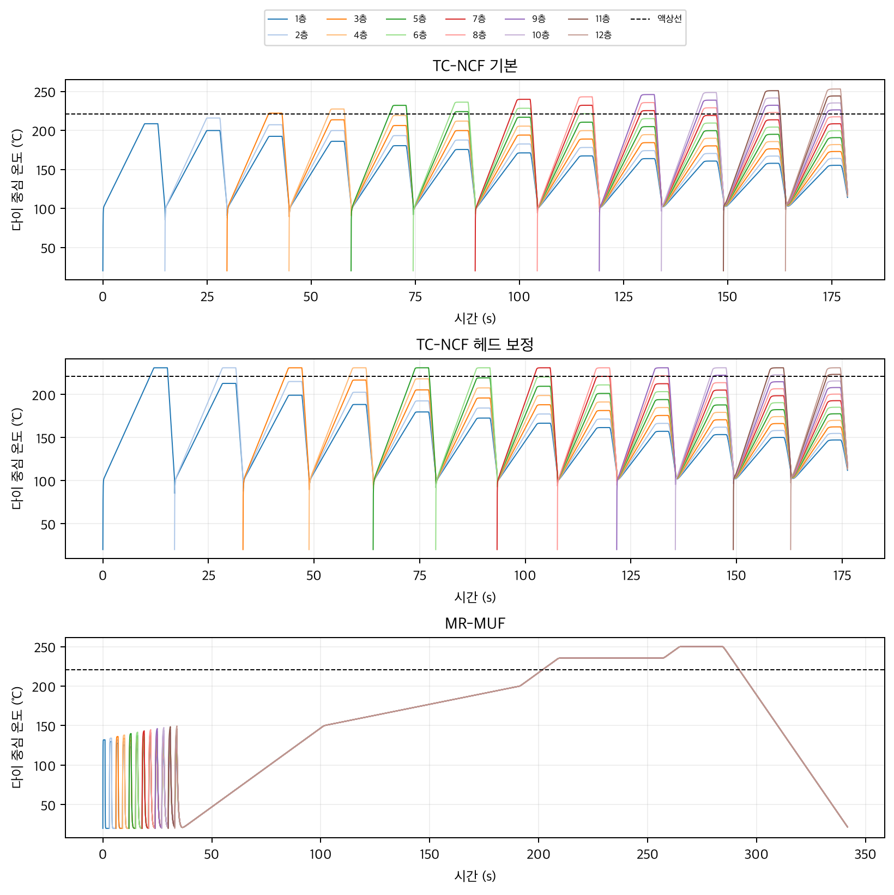
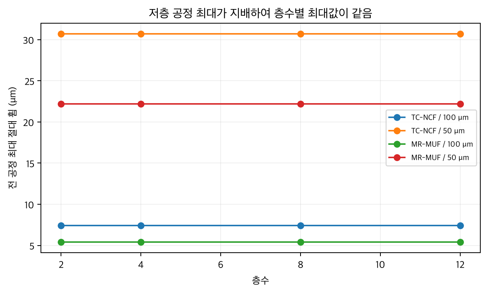
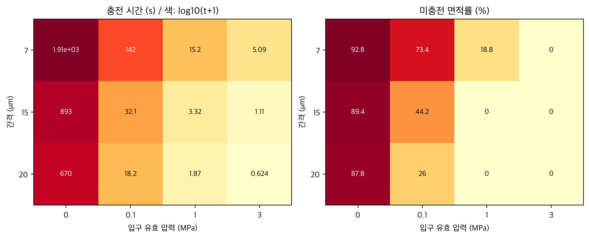
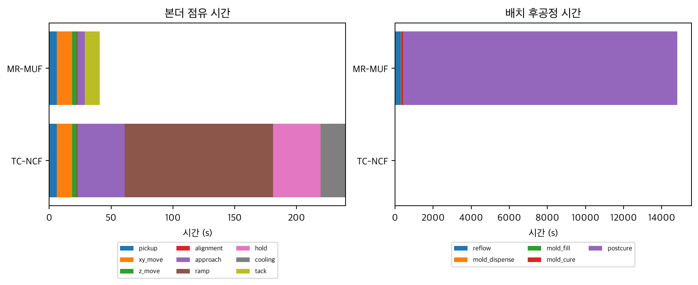

# 15. TC-NCF / MR-MUF 적층 공정 모델과 시나리오 결과

## 15.1 공정 비교 개요

단일 다이의 에폭시 부착·열압착 모델을 다단 적층으로 확장했다. 목적은 두 공정의 원리 차이를 같은 조건에서 관찰하는 것이며, 양산 공정의 우열 판정이 아니다. 업체는 세부 조건을 공개하지 않았다. 따라서 공정 레시피는 교육용 가정 조건이고, 개별 입력은 `sim/params.json`의 문헌값·설계값·역산 추정값·가정값 구분을 따른다. 원문 KPI는 ±1 μm, 400 ℃, 50 N, 가로·세로 ≤ 600 mm이고 피드백 10 ms는 원문 요구다. 아래 휨·결함·층간 3σ 기준은 설계 목표다.

| 항목 | TC-NCF | MR-MUF |
|---|---|---|
| 층별 작업 | NCF를 사이에 두고 정렬·가열·가압 접합 | 정렬·순간 가열 가접 |
| 최종 접합 | 각 층 접합 단계 | 전체 스택 일괄 리플로우 |
| 층간 충전 | NCF 스퀴즈와 경화 | 가압 + 모세관 MUF 충전, 금형 내 경화·후경화 |
| 열 이력 | 후속 층 접합에 따른 반복 가열 | 후속 가접 노출과 전체 리플로우를 구분 |
| 자기정렬 | 적용하지 않음 | 액상 시간 동안 표면장력·감쇠·마찰 모델 적용 |
| 결함 출력 | 접촉·겔·저점도 체류에 따른 정성 경향 | 미충전 면적률, 필러·겔 경고; 갇힌 보이드 정량 모델 없음 |
| 시간 비교 | 본더 점유 시간 | 본더 점유와 배치 후공정 시간 분리 |

결과 출처는 `sim/test/stage4_results.json`(S1~S5), `scenario_results.json`(층수·두께 조합과 민감도), `bond_temp_results.json`(보정·거부 사례)이다. 그림은 `fig/ch15_figs.py`로 이 JSON들을 읽어 생성한다. 이전 단계 수치와 혼동하지 않도록 이 장에서는 단계 4 결과를 사용한다.

정밀값: `sim/test/stage4_results.json:representative[].results`의 `thermal_layers`, `warpage`, `alignment`, `muf`, `cycle`, `ncf`와 `sim/test/bond_temp_results.json:S1[].head_compensation` 참조. 아래 수치는 이 저장값을 반올림한 표시값이다.

## 15.2 열 이력

열 모델은 Si 중심 N절점의 1차원 집중정수 사슬이다. 열수지는 후진 오일러로 적분하며 접합층의 열용량을 다이 절점에 합친다. 접합층 독립 온도, 잠열, 경화 발열은 포함하지 않는다. 스택의 헤드 경계는 이상 추종 조건이므로 400 W 출력 제한과 wasm 제어기의 폐루프를 직접 결합한 결과가 아니다.

S1은 12단·다이 100 μm·간격 15 μm·하중 40 N·시드 489 조건이다. 간격은 문헌값, 하중은 설계값이며 세부 프로파일은 교육용 가정이다. 툴–다이 및 다이–척 면적 접촉 열저항 각각 2e-4 m²K/W는 직접 측정값이 아닌 역산 추정값이다.

| S1 조건 | 자기 접합 최고 온도 (계산 결과) | 알람·설정값 | 재가열·재용융 |
|---|---|---|---|
| TC-NCF 기본 | 1층 208.5 ℃, 2층 215.8 ℃ | 액상선 221 ℃ 대비 12.5 / 5.2 ℃ 부족, `BOND_TEMP_LOW` | 1층 후속 가열 11회; 5~9층 액상선 상향 통과 2/3/3/4/4회 |
| TC-NCF 헤드 보정 | 층별 231 ℃ | 목표 231 ℃=액상선+10 ℃(설계값), 알람 없음; 헤드 341→271 ℃, 최소 KPI 여유 59 ℃ | 5~9층 상향 통과 1/1/2/2/2회 |
| MR-MUF | 전 층 약 250 ℃ | 리플로우 접합 온도 미달 없음 | 전 층 리플로우 1회·상향 통과 1회, 가접 노출 별도 |

*그림 15.1 S1의 층별 다이 중심 온도–시간. 기본 TC-NCF, 헤드 보정 TC-NCF, MR-MUF 순서이며 점선은 액상선이다. 금형·후경화 이력은 포함하지 않는다.*

재가열 횟수는 후속 접합 가열 이벤트 수다. 재용융 횟수는 첫 용융을 포함한 액상선 상향 통과 수이며, 추가 통과 수는 `subsequent_remelts`로 따로 기록한다. 따라서 후속 재가열을 자기 접합 성공으로 대체해서는 안 된다. MR도 후속 가접 열 노출이 있으므로 “열 노출이 한 번뿐”이라고 해석하지 않는다.

헤드 보정은 이전 층 설정을 고정하고 층 순서대로 이분법으로 계산한다. 탐색 구간 폭 0.05 ℃ 이하, 최대 64회는 계산 설정이다. 필요 헤드가 원문 KPI 400 ℃를 넘으면 `HEAD_TEMP_LIMIT`로 거부한다. 검증용 툴 접촉 열저항 1e-3 m²K/W에서는 1층 필요 헤드 약 782 ℃로 거부되었다. 저장된 기본 파라미터는 바꾸지 않았다.

## 15.3 휨

열 이력과 층별 무응력 온도를 적층판 A/B/D 열합력·모멘트 모델에 전달하고 곡률에서 `w=κL²/8`을 계산한다. 두 층에서는 중간 보고서의 Timoshenko 식과 일치한다. 판정은 완성 스택의 끝점이 아니라 전체 접합·냉각 공정에서 최대 절대 휨을 대상으로 한다.

| S3 두께 변화 | 100 μm 최대 휨 | 50 μm 최대 휨 | 두께 절반의 증가 배율 |
|---|---|---|---|
| TC-NCF | 7.4 μm, 주의 | 30.7 μm, 불량 | 4.1 |
| MR-MUF | 5.4 μm, 주의 | 22.2 μm, 불량 | 4.1 |

공통 설계 목표는 간격/4 초과 시 주의, 절대 휨 20 μm 초과 시 불량이다. 15 μm 간격의 주의 경계는 3.75 μm다. 모드마다 판정 기준을 다르게 주지 않았다.

*그림 15.2 층수·두께에 따른 전체 공정 최대 절대 휨. 저층 공정 최대가 지배하여 층수 증가에도 최대값이 같게 나타난다.*

S3은 두께 감소 민감도를 보여 준다. 두 모드 모두 50 μm에서 불량이며, 업체의 “MR-MUF가 박형 휨에 유리하다”는 주장을 재현하지 못한다. 1D 선형 탄성·상온 물성 모델에는 기판 구속, 점탄성, 경화 수축이 없다. 결과에 맞춰 물성이나 모드별 기준을 조정하지 않았다.

## 15.4 NCF 스퀴즈·보이드 경향

온도·경화도에 따른 점도와 Stefan 스퀴즈 유동을 결합한다. 상태 `1/h²`를 RK4로 적분하고 접촉 두께를 층간 간격으로 둔다. 기본 초기 필름은 `간격 + 4 μm = 19 μm`이며 곱셈이 아니다(Issue #20). 범프의 pillar+cap 형상은 참고 형상이고, 유효 접촉 간격 정의와 구분한다.

| 단계 4 TC-NCF 기본 | 1층 접촉 시간 | 12층 접촉 시간 | 접촉 전 겔화 | 경향 |
|---|---|---|---|---|
| 100 μm 다이 | 7.4 s | 6.0 s | 없음 | 낮은 경향 |
| 50 μm 다이 | 7.4 s | 6.0 s | 없음 | 낮은 경향 |

위 시간은 저장된 층별 NCF 결과다. 경향은 겔 전 접촉 여부와 저점도 체류를 보는 정성 규칙이며, 결함 면적률은 `null`이다. “낮은 경향”은 보이드 0 %나 접합 품질 보증을 뜻하지 않는다. 특히 기본 1·2층은 NCF가 접촉하더라도 솔더 자기 접합 온도가 부족하다.

장비 승온 설정 20 K/s는 중간 히터 능력 최대 22 K/s를 고려한 값이며 문헌 비교값 80 ℃/s와 다르다. 느린 승온은 저점도 체류와 경화를 함께 바꾸므로 승온 속도 하나만으로 보이드율을 결정하지 않는다. NCF 온도는 새 다이 중심 온도의 대리값이며 접합층 내부 분포를 해석하지 않는다.

## 15.5 MUF 가압 충전

충전 모델은 평행판 Hele-Shaw 유동에 모세관 압력을 더한 `t=6μL²/[h²(ΔP입구+2γcosθ/h)]`이다. 압력 0에서는 중간 Washburn 식으로 환원된다. 금형 압력 3 MPa(문헌값)와 간격 입구 유효 압력 기본 1 MPa·범위 0.1~3 MPa(가정값)는 다른 물리량이다. 계산에는 입구 압력을 사용한다. 충전 점도 5 Pa·s는 가정값이며 실제 재료 실측 피팅값이 아니다.

S5는 12단·100 μm에서 간격과 입구 압력을 바꾼다. 충전 허용 시간 10 s와 겔 경고 시간 25 s는 문헌값이다. 겔 경고가 없어도 10 s 안에 충전하지 못하면 미충전이 남는다.

| 간격 μm | 입구 MPa | 충전 s | 미충전 % | 판정 | 필러 경고 | 겔 경고 |
|---|---|---|---|---|---|---|
| 7 | 0 | 1,913 | 92.8 | 불량(필러 막힘) | 있음 | 있음 |
| 7 | 1 | 15.2 | 18.8 | 불량(필러 막힘) | 있음 | 없음 |
| 7 | 0.1 | 142 | 73.4 | 불량(필러 막힘) | 있음 | 있음 |
| 7 | 3 | 5.1 | 0 | 불량(필러 막힘) | 있음 | 없음 |
| 15 | 0 | 893 | 89.4 | 불량 | 없음 | 있음 |
| 15 | 1 | 3.3 | 0 | 양호 | 없음 | 없음 |
| 15 | 0.1 | 32.1 | 44.2 | 불량 | 없음 | 있음 |
| 15 | 3 | 1.1 | 0 | 양호 | 없음 | 없음 |
| 20 | 0 | 670 | 87.8 | 불량 | 없음 | 있음 |
| 20 | 1 | 1.9 | 0 | 양호 | 없음 | 없음 |
| 20 | 0.1 | 18.2 | 26.0 | 불량 | 없음 | 없음 |
| 20 | 3 | 0.62 | 0 | 양호 | 없음 | 없음 |

*그림 15.3 S5 간격×입구 압력의 충전 시간과 미충전 면적률. 숫자는 원래 단위이며 충전 시간의 색상만 로그 변환했다.*

최대 필러 3 μm는 문헌값이다. 간격/최대 필러 비 <4는 경고, <3은 불량으로 덮어쓰는 문헌 기반 교육용 규칙이다. 따라서 7 μm·3 MPa는 미충전 0 %여도 필러 막힘 불량이다. 필러 면적률을 임의로 더하지 않았다. 층별 독립 병렬 공급, 한 변 유입의 직선 선단, 일정 점도를 가정한다. 범프 투과도·필러 여과·갇힌 공기·경화 중 유동은 정량 모델에 없다. 여기의 결함률은 미충전만이며 전체 보이드율이 아니다.

## 15.6 정렬·자기정렬

층간 초기 오차는 중간 RSS 표준편차 0.294 μm를 축별 독립 정규분포로 근사한다. 직전 층 기준 TC-NCF는 자기정렬 없이 오차를 더한다. 이때 기판 기준 누적 평균 기대는 0, 분산은 Nσ²이고 축별 누적 3σ는 √N에 비례한다. 첫 다이 기준은 N−1개의 오차이므로 기판 기준과 구분한다. 기판 기준 정렬에서는 공통 기준의 인접 공분산을 보존한다.

MR-MUF는 범프 병렬 복원 강성 `K=N_b·2γd/h`와 다이 질량, 감쇠·정지 마찰을 사용해 액상 시간 동안 초기 오차를 줄인다. 작은 변위, 독립 층간 좌표 및 젖음·접촉을 가정하며 실제 접촉의 정량 판정은 없다.

| S2: 동일 시드 489·12단 | TC-NCF | MR-MUF |
|---|---|---|
| 기판 기준 누적 x,y (μm), 단일 표본 관찰값 | (0.24, −1.16) | (0.041, 0.012) |
| 층간 축별 3σ | 0.88 μm | 약 0.053 μm |
| 판정 대상 | 층간 3σ ≤ 1 μm, 설계 목표 | 같은 설계 목표 |

MC는 20,000 표본·시드 489의 완전한 스택을 사용한다. MR 잔여는 비정규분포이므로 표본 표준편차×3을 99.7 % 확률 보장으로 해석하지 않는다. 누적 단일 표본과 누적 기대 범위는 관찰 항목이며 원문 ±1 μm 반복정밀도의 실물 시험을 대신하지 않는다.

## 15.7 사이클 시간

이동은 삼각·사다리꼴 프로파일로 계산하고 픽업·정렬·접근·가열 단계를 합산한다. TC 층당 20 s, MR 층당 3.4 s는 해당 레시피의 계산 결과다. 아래는 12단 S4이며 배치 크기를 새로 가정하지 않는다.

| 모드 | 본더 점유 s | 배치 후공정 s | 단독 직렬 합계 s (참고) |
|---|---:|---:|---:|
| TC-NCF | 240 | 0 | 240 |
| MR-MUF | 41 | 14,826 | 14,866 |

MR 배치 후공정은 리플로우 306 s, 디스펜스 10 s, 충전 10 s, 금형 내 경화 100 s, 후경화 4 h다. 후경화 175 ℃·4 h는 문헌값이다. 단계 3의 2 h 경화 결과를 현재 결과와 섞지 않는다.

*그림 15.4 S4 본더 점유와 배치 후공정의 단계별 시간. 서로 다른 가로축 범위를 사용한다.*

본더 점유가 짧다는 결과는 라인 UPH가 아니다. 배치 수량·병렬 장비·이송·대기·수율이 없으므로 두 공정의 생산성 우열을 계산할 수 없다.

## 15.8 대표 장면 S1~S5

| 장면 | 비교 조건 | 핵심 계산 결과·해석 |
|---|---|---|
| S1 열 이력 | 12단 TC 기본/헤드 보정/MR | 기본 1·2층 208.5/215.8 ℃ 미달; 보정 약 231 ℃, MR 약 250 ℃; 이벤트와 액상선 통과 구분 |
| S2 정렬 | 같은 시드의 초기 오차 | TC 누적 (0.24, −1.16) μm, MR (0.041, 0.012) μm; 단일 표본 관찰값 |
| S3 두께 민감도 | 100→50 μm | 휨 TC 4.1배, MR 4.1배; 50 μm 두 모드 모두 불량 |
| S4 사이클 | 12단, 본더/배치 분리 | TC 240/0 s, MR 41/14,826 s; 라인 UPH 아님 |
| S5 충전 | 7/15/20 μm × 0/0.1/1/3 MPa | 압력 증가로 충전 빨라짐; 7 μm는 필러 규칙에 의해 계속 불량 |

## 15.9 민감도와 모델 한계

단계 4 민감도는 대표 12단 TC 50 μm, MR 간격 7 μm, 12단 TC/MR 100 μm에서 한 번에 한 입력만 기존 범위 양끝으로 바꾼 결과다. 순위는 정렬·휨·접촉·결함 판정 셀의 변화 수에 한정하며 전역 민감도 순위가 아니다.

| 상위 입력 | 구분·범위 | 판정 변화 셀 | 의미 |
|---|---|---:|---|
| 툴–다이 접촉 열저항 | 역산 추정값, 2e-5~1e-3 m²K/W | 8 | 열 전달·휨·NCF 접촉을 함께 바꿈 |
| 다이–척 접촉 열저항 | 역산 추정값, 5e-5~2e-3 m²K/W | 3 | 냉각 경계와 휨 민감도 |
| 간격 입구 유효 압력 | 가정값, 0.1~3 MPa | 1 | MR 기본 조건의 미충전 판정 변화 |

변화 셀 0은 영향이 없다는 뜻이 아니다. 해당 범위에서 임계값을 넘지 않거나 계산에 쓰이지 않는 메타데이터일 수 있다. 가접 시간 3 s 끝점은 기존 총 가접 사이클과 충돌하여 MR 두 사례가 계산 불가로 남았다. 다른 입력을 동시에 바꾸어 숨기지 않았다.

접촉 열저항과 입구 압력은 우선 실측해야 할 입력이다. 그 밖에 휨의 기판·점탄성·경화 수축, NCF 보이드 정량화, MUF 범프 투과도·기포 포획, 스택 열 모델과 출력 제한 제어기의 결합이 남아 있다. 하드웨어 냉각도 피크→180 ℃의 4 K/s 이상 유지 설계 목표에 최소 3.39/평균 4.1 K/s로 FAIL/REVIEW다(`calc/hardware/reflow_heater.json`). 180 ℃ 아래는 관찰 항목이며, 풍량 100 L/min·h=400 W/m²K는 실측 전 가정값이다.

근거 문서: `docs/stage4_model_update.md`, `docs/thermal_history_report.md`, `docs/tcncf_mode_report.md`, `docs/stage3_report.md`, `docs/requirements.md`. 업체 주장은 16장 16.3절의 표시 원칙에 따라 계산·판정과 분리한다.
