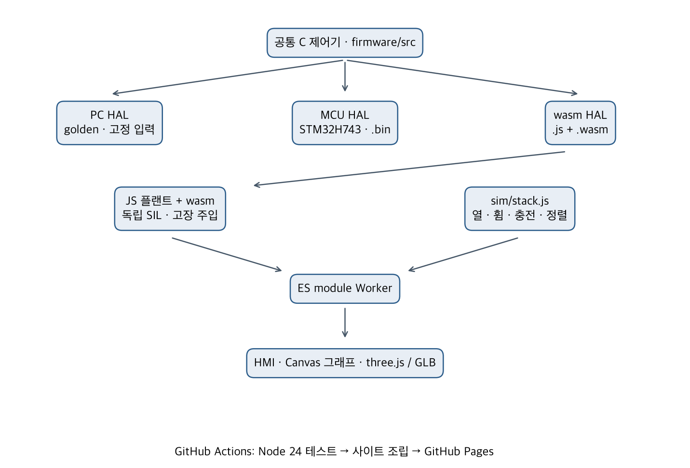
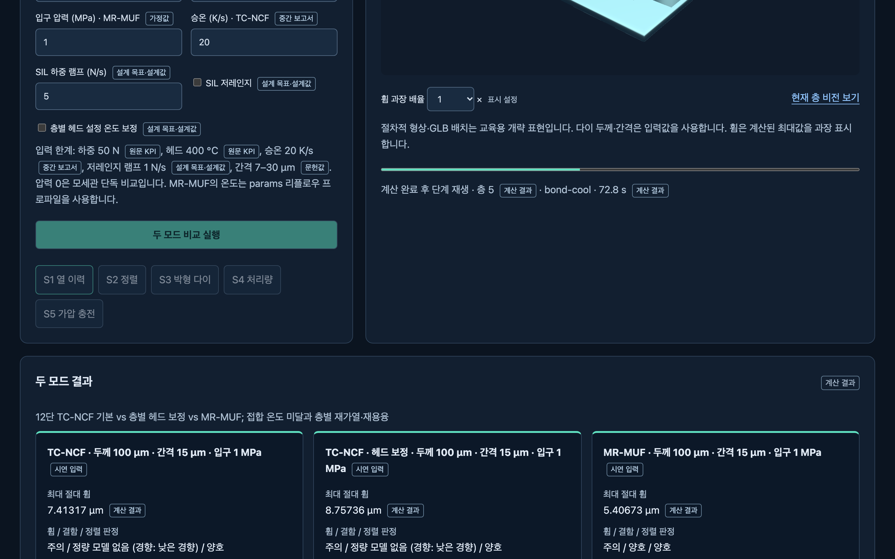
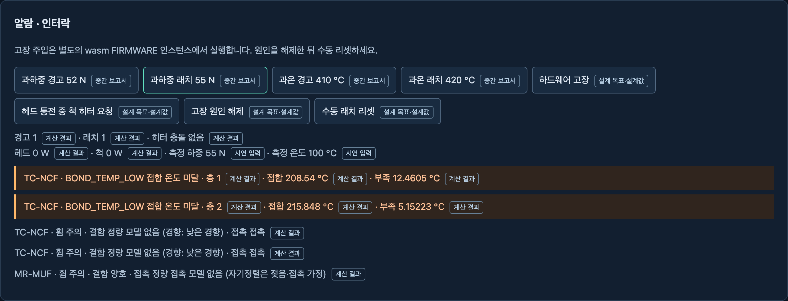

# 16. 디지털 트윈: 펌웨어 SIL·웹 HMI·배포

## 16.1 아키텍처

장비의 제어기, 플랜트, 공정 모델과 화면을 분리했다. `firmware/src/`의 공통 C 제어기는 HAL을 통해 PC·MCU·wasm 대상으로 빌드된다. 웹에서는 wasm 제어기와 JS 플랜트로 독립 SIL을 실행하며, 적층 열·휨·충전·정렬 계산은 `sim/stack.js`가 통합한다. ES module Worker가 계산 결과와 진행 이벤트를 HMI로 전달한다.

*그림 16.1 공통 C 제어기, HAL, 독립 SIL과 적층 모델, 웹 표시 및 배포의 관계. PC·MCU·wasm은 같은 제어 소스를 사용한다.*

하중 그래프는 `sim/plant.js`와 wasm REFERENCE 제어기의 독립 SIL이다. 적층 스케줄의 이상 온도 경계를 실제 출력 제한 폐루프로 구동한 것으로 해석하지 않는다. 고장 주입은 별도의 wasm FIRMWARE 인스턴스에서 실행하여 기준 응답과 보호 상태를 구분한다. 계산 후에는 저장된 실제 층·단계 이력을 재생한다. 진행 애니메이션의 시간과 물리 계산 시간을 혼동하지 않는다.

## 16.2 펌웨어 C와 SIL(PC·MCU·wasm)

C99 float 제어기 한 벌에 하중 PI 1 ms·온도 PI 10 ms·시퀀서·인터락을 구현했다. 동적 할당은 사용하지 않는다. 10 ms는 원문 피드백 요구이며 1 ms 하중 루프는 설계 선택이다.

| 대상 | 빌드·검증 명령 | 역할·산출물 |
|---|---|---|
| PC | `make -C firmware test` | host HAL, golden·성능·포화·인터락 검증 |
| MCU | `make -C firmware mcu` | STM32H743, `controller.elf/.bin` |
| wasm | `make -C firmware wasm` | Emscripten ES module, `controller.js/.wasm` |
| PC↔wasm | `make -C firmware test-wasm` | 고정 측정 입력에 대한 출력 일치 검사 |

REFERENCE 모드는 원본 golden 재현용으로 출력·적분 제한이 없다. FIRMWARE 모드는 속도 ±0.5 mm/s, `I_max=v_max/Ki`, 포화 시 이번 적분 되돌림을 적용한다(설계값). 저레인지에서 `ramp > k_spring×v_max`이면 레시피를 거부하며 기본 램프는 1 N/s다. 계산상 장비 능력과 레시피를 함께 검사한다.

저장된 SIL 검증은 600개 고정 측정값을 두 모드에 각각 입력하고, 출력 12열·1,200행의 14,400 값을 비교했다. 허용치는 `max(상대 1e-3, 절대 1e-4)`이며 최대 절대 차이는 **8.1e-6**, PASS다(`firmware/README.md`, 1 N/s 검증 기록). 출력은 단위가 여러 가지이므로 이 최대 차이를 온도나 하중 하나의 오차로 해석하지 않는다. 접촉·출력 포화·경고·래치·고장·수동 리셋을 포함한 테스트 가정 입력이며, 실제 센서 검증이나 PC↔MCU 실물 검증이 아니다.

MCU 빌드는 보드용 산출물 생성 수준이다. 실물 bring-up은 범위 밖이고 리플로우 척 PWM은 PE11 TIM1 CH2 배선 설계값에 대한 HAL 스텁이다. 리플로우 센서 모델·온도 폐루프와 실제 배선 동작은 검증하지 않았다.

## 16.3 웹 HMI·알람

HMI는 모드·층수·두께·간격·하중·입구 압력과 헤드 보정 옵션을 제공한다. 레시피 한계 검증으로 범위를 벗어난 입력을 차단하며, 모델 계산은 Worker에서 실행한다. 온도·하중·휨·충전 결과와 모드 비교 그래프, S1~S5 프리셋은 15장의 결과를 탐색하는 진입점이다. 현재 층 링크로 `web/vision.html`을 열면 합성 피듀셜, NCC·서브픽셀 보간·아핀 보정과 반복 정렬을 확인한다.

*그림 16.2 웹 HMI 첫 화면: 레시피(입력마다 구분 배지), S1~S5 프리셋, GLB 3D 뷰. 배포 주소에서 S1 실행 후 캡처 (2026-11-28).*

*그림 16.3 알람·인터락 패널: 과하중 래치 55 N 주입 후 경고 1·래치 1, 히터 출력 0 W. S1의 TC-NCF 1·2층 `BOND_TEMP_LOW`(208.54 / 215.8 ℃)가 함께 표시된다. 측정 하중·온도는 "시연 입력" 배지.*

| 상태·기능 | 표시·동작 | 구분 |
|---|---|---|
| 과하중·과온 경고 | 52 N / 410 ℃에서 Z 정지 | 중간 안전 계층의 설계값 |
| 래치 | 55 N / 420 ℃ 또는 하드웨어 고장 입력에서 히터·Z 차단 | 독립 하드웨어 보호의 소프트웨어 모사 |
| 고장 주입·복구 | 과하중·과온·HW 고장 모사, 원인 해제 후 수동 리셋; 조건이 남으면 재래치 | wasm FIRMWARE 인스턴스 |
| 두 히터 동시 통전 금지 | 수락된 헤드·척 지령 중 하나만 양수 허용; 충돌 출력 0 W, 비래치 경고 | 원문 KPI와 별개인 전원 설계 인터락 |
| 접합 온도 미달 | `BOND_TEMP_LOW`, 층·부족 온도 표시 | 액상선 대비 모델 판정 |
| 헤드 보정 거부 | 필요 온도 >400 ℃이면 `HEAD_TEMP_LIMIT` | 원문 KPI 한계 검사 |
| 휨·충전 | 공통 휨/결함 판정, 필러·겔 경고, NCF 정량 모델 부재 표시 | 설계 목표·모델 한계 |

두 히터 인터락은 실제 전류가 아니라 HAL 수락 지령 >0 W로 통전을 판단한다. 직전 주기의 히터가 우선이며, 끄는 주기에도 상대를 막고 두 출력이 0인 주기를 지난 뒤 전환한다. 둘 다 꺼진 상태에서 동시 요청하면 헤드 우선이다. 래치 시 두 히터 모두 0이며, 충돌 플래그 자체는 비래치 경고다. 상세 계약은 `firmware/README.md`를 따른다.

근거 배지와 파라미터 표는 원문 KPI·설계값·문헌값·역산 추정값·가정값을 구분한다. 업체 주장 패널은 `sim/params.json`의 `vendor_claims`를 회사·출처와 함께 표시하며 판정·계산 입력으로 사용하지 않는다. 저장소 조사에 기록된 SK hynix의 접합 온도 14 ℃ 저감 주장(Lee et al., ECTC 2023), Samsung 인용 시뮬레이션의 TC-NCF 열저항 35 % 저감 주장(Chip Scale Review 2024 p.47, A.U.)은 **관찰 항목(판정 없음)**이다. 이 장의 시뮬레이션이 이를 검증했다고 주장하지 않는다. 출처 목록과 조사 맥락은 `docs/research/params_research.md` 7절에 있다.

## 16.4 3D 뷰

three.js 뷰는 절차적으로 만든 장비·스택과 선택 GLB를 지원한다. 기본 절차적 형상으로도 헤드 하강과 층별 적층 진행을 볼 수 있고, Fusion의 `cad/stacker/out/` 산출물을 사이트 조립 경로에 복사하면 GLB 장비 형상을 함께 표시한다. GLB는 다운로드 가능한 CAD 산출물과 웹 표시를 연결하지만, 3D 화면의 움직임 자체가 간섭 해석·열변형 검증을 대신하지 않는다. 간섭·외곽 판정의 근거는 `cad/stacker/out/summary.json`이다.

## 16.5 배포·검증

데모 주소는 **https://ycpark06.github.io/hbm-stacking-edu-sim/web/** 이다. `.github/workflows/pages.yml`의 GitHub Actions는 main push 또는 수동 실행으로 동작한다. Node 24에서 `node --test 'sim/test/*.test.js'`를 먼저 실행하고, 성공한 뒤 `web/tools/assemble_site.sh`가 `web/`·`sim/`·`firmware/build/`와 선택 CAD GLB를 `_site/`에 모은다. 이후 Pages artifact 업로드와 배포 잡으로 이어진다. 테스트 실패 시 배포 잡으로 진행하지 않는다.

Node 버전에 따른 Box–Muller 끝자리 차이는 상대 1e-12+절대 1e-15 허용 비교로 처리한다(Issue #37, PR #38). 문자열·판정·배열 길이는 정확히 비교한다. 수치 허용 비교가 판정 차이를 허용한다는 뜻은 아니다. 웹 자산은 Pages가 직접 제공할 수 있도록 일반 커밋 대상이며, 영상은 별도 단계 산출물이다.

이 장의 수치·계약은 저장소의 검증 기록을 옮긴 것이다. 보고서 작성 중 전체 제어·웹 검증을 새로 수행했다는 뜻은 아니다. 최종 HMI 캡처와 통합 PDF의 시각 검토는 장별 원고 병합 후 확인한다.
