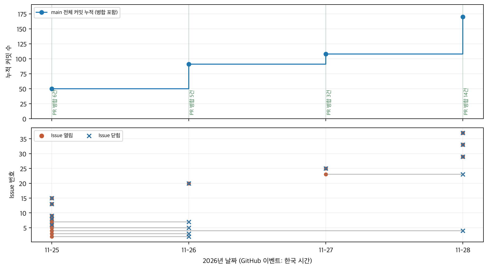
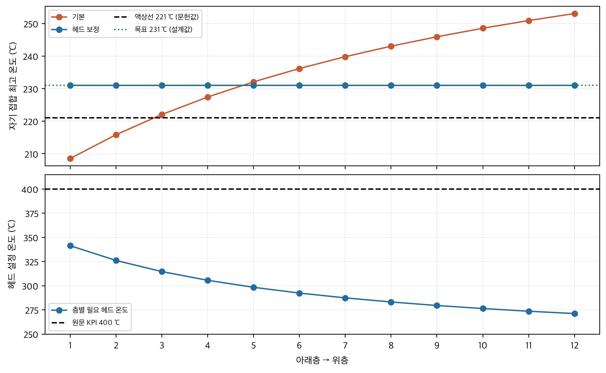
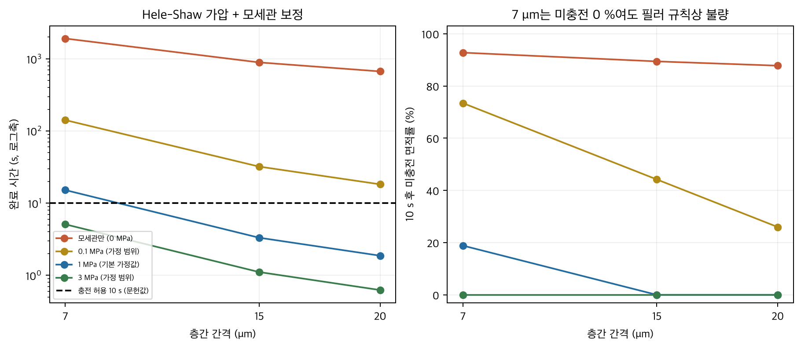
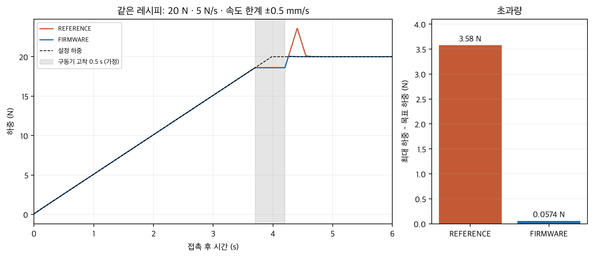

# 17. 트러블슈팅 과정과 개선 성과

## 17.1 작업 방식(Codex 작성·Claude 검증·PR)

기능별 완료 기준을 정하고 브랜치·worktree를 나눈 뒤 Codex가 코드·문서를 작성하고 Claude가 검증했다. 검증 기준은 폴더 구조, 모델 golden 재현, 펌웨어·시나리오 테스트, 원문 KPI·설계 목표·문헌값·역산 추정값·가정값의 구분이다. PR에는 검증 결과와 리뷰 반영 내용을 남겼으며, 문제는 Issue에 증상→원인→해결→결과로 기록하고 수정 후 다시 검사했다. 독립 기능은 worktree에서 병렬로 진행하고 담당 경로를 제한했다. 이 흐름의 근거는 `CLAUDE.md` 4절과 `docs/PLAN.md` 11절이다.

작업의 핵심은 예상한 결과를 만드는 것이 아니라 입력·정의·실행 환경을 추적하는 데 있었다. 계산 결과가 설계 목표를 벗어나면 입력의 출처부터 확인하고, 근거 없는 파라미터 조정 대신 알람·레시피 거부·모델 한계를 결과에 남겼다. 아래 다섯 사례는 열전달, 수지 유동, 제어 포화, 지시의 정확성, 수치 재현성을 다룬다. README 6절의 **전체 트러블슈팅 로그는 부록 A**에 수록했다.

*그림 17.1 main의 날짜별 누적 커밋 수, PR 병합 날짜별 건수와 Issue 개폐 시점. 커밋은 `git log main --date=short`의 작성 날짜, GitHub 이벤트는 조회된 시각을 한국 시간으로 환산했다. 병합 커밋도 누적에 포함하며, 아래 패널의 선은 열림부터 닫힘까지를 연결한다. 같은 날의 개폐는 같은 날짜에 겹친다. 원자료: `fig/ch17_history.json`(GitHub 직접 조회, 대체 이력 아님). 커밋·PR·Issue 건수는 물리 성능의 지표가 아니라 문제와 변경의 추적 근거다.*

## 17.2 트러블슈팅 사례

### 17.2.1 #29 — TC-NCF 1·2층 자기 접합 온도 미달

#### 증상

TC-NCF 기본 레시피는 헤드를 300 ℃로 설정하지만, 헤드와 다이 중심의 온도는 같지 않다. 접촉 열저항을 반영한 12단·100 μm 다이·15 μm 간격 조건에서 **1층 자기 접합 최고는 208.5 ℃, 2층은 215.8 ℃**였다. SnAg 액상선 221 ℃보다 각각 12.5 ℃와 5.2 ℃ 낮다. NCF가 눌려 접촉했다는 결과만으로 솔더가 용융했다고 볼 수 없으며, 이후 위층 접합 때 다시 가열되는 것도 해당 층의 자기 접합 성공을 대신하지 않는다.

이 현상은 12단의 마지막 상태만 보면 가려질 수 있다. 스택 전체 최고 온도나 뒤층 본딩 중 온도가 아니라, 각 층을 처음 접합하는 구간의 최고 온도를 따로 확인해야 한다. 저장된 2·4·8단 검사에서도 1·2층 미달이 남았다. 따라서 단순한 표시 문제나 특정 층 수의 예외가 아니라 기본 열 경계와 접합 판정 정의를 함께 점검할 문제였다. 정밀 결과는 `sim/test/bond_temp_results.json`의 `S1[0].thermal_layers`, `small_stacks`에 보존되어 있다.

#### 원인

단계 4에서 툴–다이와 다이–척의 면적 접촉 열저항을 각각 1e-5에서 2e-4 m²K/W로 바꿨다. 새 값은 문헌의 온도차와 모델을 대조한 **역산 추정값**이며 직접 측정값이 아니다. 이전의 작은 저항에서는 다이가 헤드 온도를 더 빨리 따라갔지만, 저항 증가 후 아래층에서 열강하가 커졌다. 특히 척과 가까운 저층은 열이 빠져나가는 경계의 영향을 크게 받았다. 입력 출처를 개선한 결과 오히려 기존 레시피의 부족이 드러난 사례다.

원문 KPI 400 ℃는 헤드 최고 온도 요구다. 다이의 솔더 접합부가 액상선을 통과한다는 보증과는 구분된다. 또한 스택 열 모델의 헤드 온도는 이상 추종 경계이므로, 400 W 히터와 출력 제한 제어기의 실제 폐루프 성능까지 검증한 결과는 아니다. 이 구분을 생략하면 헤드 설정값과 다이 계산값을 같은 물리량처럼 비교하게 된다.

#### 해결

기본 열저항·레시피는 유지하고 자기 접합 최고가 액상선보다 낮으면 `BOND_TEMP_LOW` 알람에 층 번호·최고 온도·부족분을 반환하도록 했다. 기준과 정확히 같은 경우는 미달이 아니다. 보정은 사용자가 선택하는 별도 옵션으로 두었다. 보정 목표 **231 ℃**는 액상선에 10 ℃를 더한 **설계값**이며 원문 KPI가 아니다. 이전 층 설정을 고정한 채 층 순서대로 이분법으로 필요 헤드 온도를 구한다.

*그림 17.2 층별 자기 접합 최고 온도와 보정에 필요한 헤드 설정. 액상선 221 ℃는 문헌값, 목표 231 ℃는 설계값, 400 ℃는 헤드 원문 KPI다. `sim/test/bond_temp_results.json`의 `S1[0:2]`를 사용했다.*

보정 결과 자기 접합 최고는 전 층 약 231 ℃이며 미달 알람이 사라졌다. 필요 헤드는 아래층부터 약 341→271 ℃이고, 최대 필요 온도는 약 341 ℃로 400 ℃까지 **약 59 ℃ 여유**가 남는다. 반면 검증용 툴 접촉 열저항 1e-3 m²K/W에서는 1층 필요 헤드가 약 782 ℃여서 `HEAD_TEMP_LIMIT`로 레시피를 거부했다. 정밀값은 같은 JSON의 `S1[1].head_compensation.layers`, `rejection_case.rejection`에 있다. 거부 사례의 큰 저항은 검증 입력이며 기본 역산 추정값으로 대체하지 않았다.

#### 교훈

예상과 다른 결과는 모델 실패를 숨길 이유가 아니라 운전 한계를 드러낼 기회다. 열저항을 낮춰 결과를 통과시키면 출처와 판정의 연결이 끊긴다. 이 사례에서는 기본 조건의 미달을 보존하고 보정 가능 범위와 거부 범위를 분리했다. 온도 통과는 솔더 접합의 필요 조건을 확인한 것이며 보이드·젖음·계면 신뢰성을 포함한 접합 품질 전체의 보증은 아니다.

### 17.2.2 MUF 모세관 단독 모델에서 가압 충전 모델로 전환

#### 증상

단계 3의 MR-MUF 기본 계산은 입구 압력 0 Pa, 충전 허용 시간 10 s에서 모세관 힘만 사용했다. 15 μm 간격의 완료 시간은 약 254 s, 미충전 면적률은 약 80 %로 불량이었다. 7 μm에서는 약 544 s와 86 %였으며, 비교한 모든 간격에서 미충전 불량이 발생했다. 좁은 간격일수록 충전이 느려지는 경향은 보였지만, 좁은 간격에서만 위험이 커지는 선택적 장면을 설명하기에는 판정이 모두 불량으로 포화되어 있었다.

당시의 10 s는 유동 결합 전 충전 대기를 위한 **자리표시 가정값**이었다. 0 Pa도 실제 MUF 몰딩을 대표하는 측정값이 아니었다. 따라서 “MR-MUF는 원래 미충전이 심하다”는 결론을 내릴 수 없었다. 결과는 `docs/stage3_report.md`의 ‘MR-MUF 결함 판정의 지배 가정’과 `sim/test/stage3_baseline_results.json`에 남아 있다.

#### 원인

Washburn 식은 압력 구동이 없는 평행판 모세관 유동을 설명한다. 그러나 몰딩 공정에서는 금형 가압이 수지 유입에 기여하며, 외부 금형 압력과 다이 간격 입구까지 전달되는 유효 압력도 서로 다르다. 모세관 단독 모델에 짧은 허용 시간만 넣으면 미공개 공정 조건을 대신한 가정이 판정을 지배한다. 점도 범위를 바꿔도 계속 불량이라는 사실은 점도가 중요하지 않다는 뜻이 아니라, 판정 경계를 넘지 못했다는 뜻이다.

이를 확인하기 위해 먼저 기존 식의 손익분기 경계를 역산했다. 목표 미충전률을 u, 모세관 완료 시간을 t₀라 하면 허용 시간 경계는 `t₀(1−u)²`다. 단계 3의 15 μm 조건에서 불량→주의 경계는 약 229 s, 주의→양호는 약 249 s였다. 10 s를 유지할 때 필요한 입구 압력은 각각 약 0.115 / 0.125 MPa로 당시 탐색 상한 0.1 MPa 밖이었다. 이 값들은 **기존 입력에서의 계산 경계**이며 새 공정 설정이나 문헌값이 아니다. 경계 분석은 근거 있는 압력·겔 시간 조사가 필요함을 보여 주었다.

#### 해결

후속 문헌 조사(research2)와 사용자 결정에 따라 평행판 **Hele-Shaw 가압 유동 + 모세관 압력 보정**으로 확장했다. 식은 `t=6μL²/[h²(ΔP입구+2γcosθ/h)]`이며 입구 압력 0에서 기존 Washburn 식으로 돌아간다. 단계 4의 금형 압력 3 MPa, 충전 허용 10 s, 겔 경고 25 s는 문헌값이다. 반면 간격 입구 유효 압력 기본 1 MPa·범위 0.1~3 MPa와 충전 점도 5 Pa·s는 **가정값**이다. 같은 10 s라도 단계 3의 자리표시와 단계 4의 문헌 근거를 구분했다. 변경 출처는 `docs/stage4_model_update.md`의 19개 패치와 `sim/params.json`에 보존했다.

*그림 17.3 S5의 간격별 충전 완료 시간(로그축)과 10 s 후 미충전 면적률. 모든 곡선은 단계 4의 동일 물성을 사용하고 입구 압력만 바꾼 비교다. 단계 3의 점도·표면장력과도 다른 조건이므로 단계 간 모델 효과만 분리한 실험으로 해석하지 않는다. 출처: `sim/test/stage4_results.json:representative[id=S5].results`.*

S5에서 15 μm·1 MPa는 약 3.3 s, 20 μm·1 MPa는 약 1.9 s로 시간 내 충전하고 미충전은 0 %였다. 7 μm·1 MPa는 약 15 s와 19 % 미충전으로 남았다. 압력을 3 MPa로 올리면 7 μm도 약 5.1 s에 충전되지만, 최대 필러 3 μm에 대한 간격비가 작아 불량 판정은 유지된다. 간격/최대 필러 <4는 경고, <3은 불량이라는 **문헌 기반 교육용 규칙**을 적용했기 때문이다. 필러로 인한 가상의 면적률을 미충전 계산에 더하지 않았다.

#### 교훈

단계 4의 개선은 압력을 올려 양호 결과를 만든 데 있지 않다. 실제 구동 메커니즘을 모델에 넣고, 직접 알려진 금형 압력과 아직 가정인 입구 압력을 구분한 데 있다. 압력 범위 하단에서는 15·20 μm도 10 s 미충전이 남고, 7 μm는 압력 증가에도 필러 규칙상 불량이다. 범프 투과도·필러 여과·갇힌 공기·경화 중 점도 상승은 정량화하지 않았으므로 미충전 0 %를 전체 보이드 0 %로 바꾸어 설명하지 않는다.

### 17.2.3 #6·#15 — anti-windup과 램프의 장비 능력

#### 증상

원본 하중 PI 제어는 출력과 적분에 한계가 없었다. 이상 플랜트에서는 추종하더라도 실제 구동기에 속도 한계나 고착을 넣으면 명령대로 움직이지 못하는 동안 적분이 누적되고, 제한이 풀린 뒤 하중 초과량이 커졌다. 이 문제를 다룬 #6의 후속 검증에서는 적분 포화 대응뿐 아니라 레시피 자체가 장비의 하중 상승 능력을 넘는 현상도 드러났다(#15).

저레인지 원본 램프는 5 N/s였다. 속도를 ±0.5 mm/s로 제한하면 정격 강성 2 N/mm에서 가능한 하중 상승률은 약 1 N/s다. 따라서 원본 레시피를 그대로 적용한 저레인지 유지 구간에서는 약 0.20 N 오차가 남았다. 이는 수치 허용 오차나 표시 자릿수의 문제가 아니라 목표를 만드는 속도와 실제 장비 능력이 맞지 않는 문제였다.

#### 원인

하중은 변위와 유효 강성의 곱이므로 상승률 상한도 `k_eff·v_max`의 영향을 받는다. 제어 이득을 높여도 구동기의 속도 한계를 없앨 수 없다. 또한 포화 상태에서 적분을 계속 더하면 제어기 내부 상태가 실제 위치와 멀어진다. 고착 해제 뒤에는 그 누적 상태가 과도한 속도 명령으로 나타난다. 출력 제한만 추가하고 적분을 방치하면 이 현상을 해결할 수 없다.

시험을 공정하게 비교하려면 두 모드에 같은 유효 레시피와 같은 플랜트 제한을 적용해야 한다. REFERENCE 저레인지 5 N/s와 FIRMWARE 기본 1 N/s만 직접 비교하면 램프 변경과 anti-windup 효과가 섞인다. 따라서 포화 검증의 저레인지는 양쪽 모두 1 N/s, 고레인지는 양쪽 모두 5 N/s를 사용했다. 이 조건과 고착 주입은 `firmware/test/test_force.c`의 Validation 3에 명시되어 있다.

#### 해결

FIRMWARE 모드에 속도 상한 **±0.5 mm/s**, 적분 한계 **`I_max=v_max/Ki`**, 포화 시 이번 적분 증가분을 차감하는 롤백을 넣었다. 적분 clip→출력 clip→이번 적분 차감의 순서를 보존하며, REFERENCE는 원본 golden 재현을 위해 제한 없는 경로로 남겼다. 적분 한계의 선정 근거는 `firmware/docs/force_integral_limit.md`다.

또한 FIRMWARE에서 `ramp > k_spring·v_max`인 레시피를 거부하고 저레인지 기본을 1 N/s로 정했다. 거부 시 이전 레시피와 제어 상태를 유지한다. 접촉 강성과 직렬인 실제 저레인지 유효 강성은 정격보다 조금 작아 지속 가능 상승률이 약 0.999 N/s이며, 정격 경계의 미세한 포화는 anti-windup이 처리한다. 정격 상한과 실제 유효 강성을 같은 값으로 단정하지 않았다.

*그림 17.4 동일한 고레인지 20 N·5 N/s 레시피의 REFERENCE/FIRMWARE 하중 응답. 플랜트 속도를 ±0.5 mm/s로 제한하고 접촉 3.7 s 후부터 0.5 s 동안 고착을 가정했다. `firmware/test/test_force.c` Validation 3의 플랜트를 `fig/ch17_force_data.mjs`에서 재현하고 저장된 wasm 제어기로 실행했다. 곡선의 초과량은 약 3.58→0.057 N이며 저장된 C 시험 결과와 같은 유효 자릿수다.*

동일 저레인지 속도 포화 조건의 초과량은 약 **0.060→0.0012 N**, 고레인지 고착 조건은 **3.58→0.057 N**으로 감소했다(#15 검증 기록). 수정된 기본 저레인지의 원본 유지 구간 최대 오차는 약 4.4e-7 N으로 허용 0.06 N 안이었다(`firmware/README.md`). 이는 노이즈 없는 시험 조건의 계산 결과이며 실제 센서 정밀도를 뜻하지 않는다.

#### 교훈

포화 대응과 레시피 수락 검사는 서로 보완한다. anti-windup은 장비가 못 움직이는 동안 제어 상태의 누적을 줄이고, 능력 검사는 애초에 추종 불가능한 요구를 막는다. 반면 검증 판정 시작 시점을 늦추는 것만으로는 능력 초과를 해결하지 못한다. #13의 도달 후 판정 구간과 원본 유지 구간 오차를 함께 보존하고, #15에서 실제 램프 요구를 수정했기 때문에 정상 추종과 포화 복구를 구분할 수 있었다.

### 17.2.4 #20 — 검증자의 지시문도 출처 대조 대상

#### 증상

TC-NCF 결합 모델의 초기 NCF 두께가 60 μm로 설정되었고, MR-MUF 사이클은 본더 작업 뒤 배치 후공정을 스택마다 직렬로 기다리는 값처럼 비교되었다. 이 상태에서도 계산은 실행되고 결과는 유한했다. 그러나 필름이 짜내야 하는 양과 생산성 비교의 의미가 달라져, 정상 실행만으로는 입력 정의 오류를 발견할 수 없었다.

문제의 출발점은 검증자 **Claude가 작성한 지시문**이었다. NCF 필름의 초기 두께를 ‘간격 + 4 μm’ 대신 ‘간격 × 4’로 지시해 기본 간격 15 μm에서 60 μm가 되었다. 작성·검증 역할을 나누었더라도 검증자가 전달한 지시 자체는 틀릴 수 있다. 따라서 지시문을 원자료보다 우선하는 기술 근거로 취급하지 않았다.

#### 원인

원래 `sim/params.json`의 `ncf.film_thickness_over_gap`은 간격에 더하는 두께이며 단위도 μm다. 두 길이를 곱하면 차원부터 달라지지만, 코드에서는 단순 숫자 연산으로 실행될 수 있다. `docs/tcncf_mode_report.md`는 params note와 조사 자료의 가산 정의를 대조해 오류를 확인했다. 이처럼 의미·단위·출처를 함께 보지 않으면 숫자가 그럴듯해 보여도 공정 모델의 초기 조건이 바뀐다.

사이클에서는 장비 점유와 공정 경과 시간을 같은 축에 섞었다. MR-MUF의 층별 가접은 본더 작업이지만, 전체 리플로우·몰딩·후경화는 배치 후공정이다. 배치 수량과 병렬 설비를 정의하지 않은 상태에서 후공정 시간을 스택별 직렬 합계로만 비교하면 장비 처리량과 라인 생산성을 혼동한다. TC-NCF의 본더 점유 시간과 MR-MUF의 후경화까지 포함한 직렬 시간을 직접 비교하는 것도 같은 오류다.

#### 해결

초기 필름 두께를 **15 + 4 = 19 μm**로 복구하고 기본 조건과 민감도 끝점의 접촉 결과를 다시 계산했다. 짜내는 여유 두께는 45 μm에서 4 μm로 줄었다. 수정 후 C2의 기본·민감도에서는 겔화 전 접촉과 낮은 보이드 경향이 유지되었다. 이전 60 μm의 일부 끝점에서 나타난 미접촉·미접합 위험은 19 μm에서 접촉으로 바뀌었다. 이는 물성을 유리하게 바꾼 결과가 아니라 초기 조건 정의를 바로잡은 결과다. NCF 보이드 출력은 여전히 정성 경향이며 결함 면적률을 새로 만들지 않았다.

사이클 출력은 `bonder_s`, `batch_post_s`, `total_serial_s`로 나누었다. 단계 4의 12단 S4에서 본더/배치는 TC-NCF 약 **240/0 s**, MR-MUF 약 **41/14,826 s**다. MR 배치에는 문헌값인 175 ℃·4 h 후경화가 포함된다. 직렬 합계는 단독 대기 조건의 참고값으로 남기고, 배치 수량·병렬 장비·대기·수율을 정의하지 않아 라인 UPH는 산출하지 않았다. 정밀값은 `sim/test/stage4_results.json`의 `representative[id=S4].results[].cycle`에 있다.

같은 유형의 오류는 C1 재가열 정의에서도 있었다. 후속 접합 가열 이벤트 수와 액상선 상향 통과 수를 혼동해 ‘TC N−1 기대 불충족’으로 해석했지만, 지시의 정의 오류를 확인한 뒤 분리했다. TC-NCF의 아래층은 후속 접합 가열을 N−1회 받으며, MR-MUF의 후속 가접 노출도 별도 집계한다. 재용융은 첫 용융을 포함한 액상선 상향 통과로, 추가 통과는 다른 필드로 기록한다. 근거는 `docs/thermal_history_report.md`의 지표 정의·검증 결과다.

#### 교훈

리뷰는 작성된 코드뿐 아니라 작업 지시와 비교 기준에도 적용해야 한다. 단위 검사, params note와 조사 원문의 대조, 출력 시간의 시스템 경계를 확인하는 절차가 계산의 정상 실행보다 먼저다. 특히 지시를 내린 쪽이 검증자라는 이유로 오류 가능성을 배제하면 같은 정의가 코드와 테스트에 함께 복제될 수 있다. 이 사례는 입력의 출처와 의미를 독립적으로 대조해야 함을 보여 준다.

수정 후에도 본더 점유 단축을 생산성 우위로 확대하지 않았고, NCF 접촉을 무결함 보증으로 바꾸지 않았다. 정의를 바로잡는 일과 결과를 해석하는 범위를 제한하는 일을 함께 수행한 것이 개선 성과다.

### 17.2.5 #9·#37 — 실행 환경 차이와 수치 재현성

#### 증상

동일한 계산을 다시 실행했는데 golden JSON의 끝자리만 달라졌다. #9에서는 Python 3.13.18과 3.13.9 사이에서 111개 벡터 입력은 같았으나 262개 출력 중 11개의 끝자리가 달랐고, 최대 상대 차이는 약 8.6e-15였다. 바이트 단위 비교는 이 차이를 모두 실패로 처리했다. 입력과 판정이 같아도 실행 환경의 미세한 수치 차이가 테스트를 막는 상황이었다.

#37에서는 로컬 Node 26에서 통과한 시나리오 기준값 검사가 CI Node 24에서 실패했다. Box–Muller 정규 난수 변환은 같은 시드라도 `Math.log/cos/sin` 계산의 마지막 ulp가 V8 버전에 따라 달라질 수 있다. 초기 오차의 끝자리 차이가 누적 좌표 등 후속 결과에 전파되었고, 정확 일치 단언에서 잡혔다. 물리 모델이나 판정 기준이 바뀐 것과는 원인이 달랐다.

#### 원인

부동소수점 수치 재현에는 입력·알고리즘의 동일성과 출력 파일의 바이트 동일성이 서로 다른 조건으로 작용한다. 수학 함수 구현과 연산 경로가 조금 다르면 마지막 비트가 바뀔 수 있다. 특히 초월함수로 만든 난수와 긴 계산 사슬에서는 입력 시드가 같다는 사실만으로 모든 출력 숫자의 비트 일치까지 보장되지 않는다.

그러나 모든 차이를 환경 탓으로 처리해서도 안 된다. 층 번호·단위·배열 길이·판정 문자열이 바뀌거나 판정 경계의 양쪽으로 결과가 갈리면 의미가 달라진 것이다. #15의 약 0.20 N 추종 오차처럼 장비 능력에서 비롯된 차이도 단순 tolerance 확대 대상으로 삼을 수 없다. 따라서 비교 대상을 숫자와 구조·범주로 구분하고 각 수치의 허용 근거를 따로 유지해야 했다.

#### 해결

#9는 원본 golden을 보존한 채 `check_golden.py`에서 벡터별 tolerance로 비교했다. 입력 일치와 벡터 구성을 확인하고, 관찰된 끝자리 차이가 해당 허용치 안에 있는지 검사한다. 환경이 달라졌다고 golden 전체를 새 결과로 덮어쓰면 기준점 자체가 이동하므로, 원본을 보존하고 차이의 크기를 판단하는 흐름을 택했다. 근거는 `docs/sim_port_report.md`와 `docs/model_inventory.md`다.

#37은 시나리오 기준값에서 숫자에 **상대 1e-12·절대 1e-15** 허용 비교를 적용했다. 문자열·판정·배열 길이는 정확 비교를 유지했다. 이 값은 실행 환경 차이를 검사하는 **수치 검증 허용치**이며 층간 정렬이나 접합 온도의 설계 목표가 아니다. 허용 비교는 모델이 미달 결과를 통과시키기 위한 수단이 아니며, 원래의 물리 판정 경계는 바꾸지 않았다. 관련 구현은 `sim/test/scenario.test.js`의 숫자 비교와 PR #38에 기록되어 있다.

환경 점검에는 런타임 명령도 포함된다. #25에서는 Node 24가 `node --test sim/test`의 폴더를 모듈 경로로 해석해 실패하여, `node --test 'sim/test/*.test.js'` glob으로 수정했다. 수치 비교 이전에 테스트 파일이 같은 방식으로 선택되고 실행되는지도 확인해야 한다.

#### 교훈

**바이트 동일성 대신 물리적으로 의미 있는 허용 오차를 사용하되, 구조·범주와 판정은 엄격하게 보존한다.** 작은 수치 차이는 크기와 출처를 설명할 수 있어야 하며, 허용치가 넓다는 이유로 통과시키는 방식은 피해야 한다. golden 재현 검증, PC↔wasm 제어기 일치, 공정의 설계 목표 판정은 목적과 단위가 다르므로 같은 허용치를 일괄 적용하지 않는다.

두 사례의 개선은 서로 다른 환경에서도 같은 계산 의미를 확인할 수 있게 한 것이다. 동시에 기본 TC-NCF의 미달, 냉각 FAIL/REVIEW, 박형 휨 불량 같은 유의미한 실패는 그대로 남긴다. 수치 재현성은 예상한 결론을 고정하는 절차가 아니라 계산 의미를 보존하면서 실제 변경을 발견하는 절차다.

## 17.3 개선 성과 비교표

정밀값: `sim/test/bond_temp_results.json:S1`, `sim/test/stage4_results.json:representative[].results` 및 `firmware/README.md`의 검증표 참조. 본문의 반올림은 표시 자릿수만 바꾸며 판정은 원래 정밀값을 따른다.

기준점은 `v1.0-midterm`의 중간 자산이며 기말 열은 저장소 구현·검증 기록이다. 원문 KPI는 유지했고, 아래 계산·검증 수치를 새로운 KPI로 추가하지 않았다.

| 구분·항목 | 중간 (`v1.0-midterm`) | 기말 (현재 구현·검증 기록) |
|---|---|---|
| 기능·지원 공정 | 에폭시 다이 부착·Cu pillar 열압착, 단일 다이 | TC-NCF / MR-MUF 다단 적층 비교, 2·4·8·12단 시나리오 |
| 기능·제어 구현 | Python 설계·계산의 하중 1 ms·온도 10 ms | 공통 C99 float 제어기 + PC·STM32H743·wasm HAL, 세 대상 빌드 |
| 기능·포화 대응 | 원본 하중 제어의 출력·적분 제한 없음 | 속도 ±0.5 mm/s, 적분 제한·anti-windup, 장비 능력 초과 램프 거부; 저레인지 기본 1 N/s |
| 검증·포화 초과량 | REFERENCE 속도 포화 0.060 N / 고레인지 고착 3.58 N | FIRMWARE 0.0012 N / 0.057 N (Issue #15 테스트 조건) |
| 기능·조작 화면 | 웹 HMI 없음 | Worker 계산·레시피 한계 차단·비교 그래프·S1~S5·근거 배지·업체 주장 패널 |
| 기능·알람·인터락 | 안전 계층 설계 | wasm 고장 주입·경고 52 N/410 ℃·래치 55 N/420 ℃·수동 리셋·두 히터 동시 통전 차단 |
| 모델·열 이력 | 히터 16/3절점의 개별 계산 | N층 열 사슬·층별 재가열/재용융; 기본 TC 1·2층 208.5/215.8 ℃ 미달 표시, 보정 231 ℃ |
| 모델·휨 | 2층 Timoshenko 등 개별 계산 | A/B/D 적층판·전 공정 최대 판정; 두께 100→50 μm에서 TC 4.1배/MR 4.1배, 모두 불량이라는 한계 공개 |
| 모델·충전·접촉 | Stefan 스퀴즈·Washburn 개별 계산 | NCF 경화–점도–접촉 결합(보이드 정성), MUF 가압+모세관·필러/겔 경고; 15 μm·1 MPa 충전 3.3 s·미충전 0 % |
| 모델·정렬 | RSS 3σ 0.88 μm·비전 폐루프 3σ 0.09 μm (중간 계산) | 층간/누적 분리·20,000 표본 MC·MR 자기정렬; S2 TC 층간 3σ 0.88 μm/MR 약 0.053 μm |
| 모델·사이클 | 다이 단위 공정·이송 계산 | 본더/배치 분리; 12단 TC 240/0 s, MR 41/14,826 s, 라인 UPH 미산출 |
| 검증·원본 재현 | Python 계산 JSON | 111개 golden 벡터 보존·이식 검증, 실행 환경 차이는 벡터별 tolerance 비교 |
| 검증·SIL | C/wasm 교차 검증 없음 | PC↔wasm 14,400 출력값, 최대 절대 차이 8.1e-6, PASS (저장된 검증 기록) |
| 검증·CI·배포 | 개별 로컬 계산 | GitHub Actions Node 24 테스트→사이트 조립→Pages, 버전별 ulp 허용 비교 |
| 산출물·CAD·하드웨어 | 보고서·Fusion 43부품·도면 3장, 590×480 mm | 적층 부품·STEP/GLB·신규 부품 도면 3장·배선도·계산 4종, 외곽 590×480 mm·간섭 0; 냉각 FAIL/REVIEW 공개 |
| 문서·교육·이력 | 1~14장 중간 원고·계산 스크립트 | 15~17장·요약·공정 비교 실습 매뉴얼·파라미터 출처·Issue/PR 트러블슈팅·기말 PDF 빌드 경로 |

정량 성과는 해당 테스트 입력에서의 계산·검증 결과다. SIL 일치는 물리 모델의 정확도를 보증하지 않고, 모델의 양호 판정도 실물 제작·양산 검증을 뜻하지 않는다. CAD 외곽은 원문 KPI 확인값이지만 높이 630 mm·질량 102 kg은 참고값이다.

## 17.4 남은 과제

1. **실물 검증:** 보드 bring-up, 센서·구동기 HAL, 접촉 열저항과 MUF 입구 유효 압력 실측, 기밀·내압·열프로파일 시험이 필요하다. 손계산 PASS는 시험 완료가 아니다. 특히 역산 추정값과 가정값을 실측과 대조해야 하며, 보정 레시피는 출력 제한 폐루프에서도 확인해야 한다.
2. **냉각:** 피크→180 ℃에서 4 K/s 이상 유지라는 설계 목표에 최소 3.39 / 평균 4.1 K/s로 FAIL/REVIEW다. 평균값만으로 통과시키지 않는다. 180 ℃ 아래는 관찰 항목이다. 풍량 100 L/min·h = 400 W/m²K는 가정값이므로 노즐·유량·열전달계수와 탑재 조건을 시험해야 한다. 근거는 `calc/hardware/reflow_heater.json:results.forced_cooling_design_segment`다.
3. **공정 모델:** 휨의 기판 구속·점탄성·경화 수축, NCF 보이드 정량화, MUF 투과도·필러 여과·기포 포획, 출력 제한을 포함한 스택 열–제어 결합이 남아 있다. S3의 업체 주장 미재현과 기본 TC-NCF 1·2층 접합 온도 미달은 결과의 한계로 유지한다. 업체 주장은 관찰 항목이며 계산이나 합격 기준에 사용하지 않는다.

근거: `README.md` 6절과 부록 A, `firmware/README.md`, `docs/stage4_model_update.md`, `docs/tcncf_mode_report.md`, `docs/thermal_history_report.md`, `docs/model_inventory.md`, `calc/hardware/README.md`, `cad/stacker/out/summary.json`.
