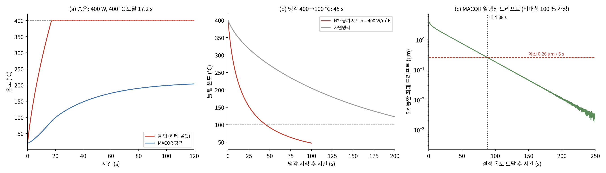

# 7. 열 설계 (Thermal Design)

**중간 대비 바뀐 점**

- 히터·단열·냉각 설계는 유지하되 #4의 PI 설명을 실제 on/off 계산 조건에 맞게 정정했다.
- 같은 플랜트의 원본 on/off와 기본 PI 응답을 별도 비교 표로 제시했다.
- 후진 오일러 적층 열 사슬·역산 접촉 저항·자기 접합 온도 미달과 보정 옵션을 추가했다.
- 신규 척 150 W·냉각 FAIL/REVIEW·순차 전원과 #2 팽창 속도의 계산/가정 구분을 반영했다.

## 7.1 목적과 기준

| 구분 | 항목 | 목표 | 출처 |
|---|---|---|---|
| 원문 KPI | 헤드 펄스 히터 최고 온도 | 400 ℃ | PBL 7쪽 |
| 설계 목표 | 승온 속도 | ≥ 20 K/s | 2장 2.4절 |
| 설계 목표 | 400→100 ℃ 냉각 | ≤ 60 s | 2장 2.4절 |
| 파생 요구 | 정렬→접촉 5 s 동안 열드리프트 | ≤ 0.26 μm | 5장 #6 |
| 파생 요구 | 스테이지·가이드 온도 상승 | ≤ 0.5 K | 5장 #6 |
| 파생 요구 | 광학 채널 오프셋 잔차 | σ ≤ 0.10 μm | 5장 #3 |

PBL 8쪽은 "400 ℃ 가열 블록과 정밀 가이드 레일 사이에 세라믹 단열재(MACOR)와 쿨링 자켓"을 배치하라고 했다. 이 장에서는 그 구성이 위 목표를 만족하려면 어떤 치수와 조건이 필요한지 계산한다.

## 7.2 해석 모델

**헤드 모델 (과도 해석).**

- **툴 팁:** AlN 히터와 콜렛을 하나의 열용량으로 묶은 집중 질량이다.
  - AlN: k 170 W/mK, ρc = 2.41 MJ/m³K
  - 콜렛(스테인리스 10×10×10 mm): ρc = 3.95 MJ/m³K
- **MACOR 단열 블록:** 40×40×16 mm를 두께 방향 16개 절점으로 나눈 1차원 전도 모델이다. k 1.46 W/mK, α 9.3 ppm/K.
- **경계조건:** 수냉 재킷 면은 냉각수 온도(20 ℃)로 고정한다. 툴 팁 표면은 대류(정지 공기 10 W/m²K, 냉각 시 제트 추가)와 복사(방사율 0.3)로 열을 잃는다.
- **히터 제어 — Issue #4 정정:** 중간 원고는 “도달 후 PI 제어로 유지”라고 설명했지만, `calc/midterm/thermal.json`을 만든 실제 조건은 **Kp=10⁶, Ki=0**으로 전력 포화에 의해 사실상 on/off로 동작한다. 7.3절의 승온·약 65 W 유지 전력과 그림 7-1은 이 원본 조건의 결과다. 기본 PI 이득의 별도 비교는 7.2.1절에 구분한다.

**척 모델 (정상상태).** 200 ℃ 척 → 단열층 → 수냉판 순서로 열이 흐르는 1차원 열저항 모델이다.

### 7.2.1 Issue #4: 원본 on/off와 기본 PI 조건의 결과 비교

중간 원고 `docs/report/midterm/07_열설계.md`의 7.2절(25행)은 설명과 결과 생성 조건이 달랐다. 원본 결과와 golden 입력은 보존하고, `thermal.py` 함수 기본 이득을 사용한 비교 결과를 함께 기록한다. 결과에 맞춰 이득을 조정하지 않았다.

공통 조건은 `ch7_16node`, 20→400 ℃ 설정 스텝, 최대 400 W, 적분 간격 0.005 s, 종료 300 s, 기록 간격 0.1 s다(원본 해석 조건·설계값). 도달 시간은 **399 ℃ 이상인 첫 기록**이므로 정확한 400 ℃ 교차 시각을 뜻하지 않는다. 유지 전력은 마지막 200개 기록의 평균, 오버슈트는 전체 기록의 max(T)−400 ℃다. 원본은 해당 시각에서 Euler 한 스텝 갱신 후 온도를 기록한다.

| 제어 조건 Kp / Ki | 400 ℃ 설정 도달 시간 s (399 ℃ 이상 첫 기록) | 유지 전력 W | 기록 기준 오버슈트 ℃ | 최종 재킷 열류 W |
|---|---|---|---|---|
| 10⁶ / 0, 원본 on/off 근사 | 17.2 | 65.4335 | 0.1890 | 55.4614 |
| 40 / 8, 함수 기본 PI | 17.2 | 67.6979 | 3.6682 | 55.4510 |

*표의 모든 응답 수치는 계산 결과이며 새 KPI가 아니다. 출처: `docs/sim_port_report.md`의 “#4 — 7장 PI 유지 설명과 on/off 결과 불일치” 비교 표. 원본 함수·결과 근거는 `calc/midterm/thermal.py`·`thermal.json`, 이식은 `sim/thermal.js`다.*

도달 시간이 같아도 유지 전력과 오버슈트는 다르다. **약 65 W를 Kp=40, Ki=8 PI의 유지 결과로 설명하지 않는다.** 이 비교는 같은 플랜트의 제어 조건 차이를 보여 준다. 10장·펌웨어의 온도 PI는 별도 `ch10_3node` 플랜트와 이득을 쓰므로 이 표를 그 제어 성능으로 옮기지 않는다(`docs/sim_port_report.md` #3·#4, `firmware/README.md`).

## 7.3 히터 설계: 승온과 냉각

*그림 7-1. 중간 원본 on/off 조건(Kp=10⁶, Ki=0)의 계산. (a) 400 W 히터 승온, (b) 냉각, (c) 설정 도달 후 경과 시간에 따른 5초 열드리프트 상한. 기본 PI 비교는 7.2.1절 표를 따른다.*

**히터 크기를 줄였다.** 3장 초안의 30×30×12 mm 히터는 콜렛을 합친 열용량이 약 30 J/K다. 20 K/s로 올리려면 손실을 빼고도 600 W가 필요해 데스크톱 전원으로 감당하기 어렵다. 펄스 히터는 열용량이 작아야 빨리 오르내린다. 그래서 히터를 **20×20×5 mm AlN 세라믹**으로 줄였다. 콜렛을 포함한 열용량은 8.8 J/K로 약 1/3이 된다.

| 항목 | 결과 | 목표 | 판정 |
|---|---|---|---|
| 최고 온도 (원문 KPI) | 400 ℃ 도달·유지 | 400 ℃ | 통과 |
| 승온 (최대 400 W) | 20 → 400 ℃ 17.2 s, 평균 22 K/s | ≥ 20 K/s | 통과 |
| 400 ℃ 유지 전력 | 65 W | — | — |
| MACOR를 통해 재킷으로 가는 열 | 55 W (정상상태) | — | 재킷 용량 산정 기준 |
| 냉각 400→100 ℃, N₂·공기 제트 (h = 400 W/m²K) | 45 s | ≤ 60 s | 통과 |
| 냉각 400→100 ℃, 자연냉각 | 243 s | — | 제트 필요 |

**히터 전원.** 400 W를 24 V로 공급하면 17 A가 흐른다. 그래서 48 V DC 전원(8.3 A)과 MOSFET PWM 구동으로 정했다(10장 회로).

**냉각 제트.** 히터 주위 노즐로 N₂ 또는 압축공기를 분사한다. 솔더 TCB에서는 3장의 N₂ 쉴드 가스를 그대로 냉각에 쓸 수 있다. 수냉 재킷이 받는 55 W는 냉각수 0.5 L/min이면 출구 온도가 1.6 K만 오른다.

## 7.4 헤드 열드리프트

원본 on/off 조건에서 툴 팁 온도는 설정점 부근으로 유지된다(7.2.1절). 그런데 그 위의 MACOR 블록은 시정수 약 175초로 천천히 데워진다. MACOR가 데워지는 동안 블록이 팽창하면서 콜렛을 옆으로 밀 수 있다.

**최악 조건 추정.** 블록 중심에서 가장자리까지 20 mm가 전부 한쪽으로만 팽창한다고 가정했다(비대칭 100 %). 이때 드리프트는 다음과 같다.

δ = α · 20 mm · ΔT(5 s)

이 값을 5장 예산 0.26 μm 이하로 묶으려면, MACOR 평균 온도의 변화율이 0.28 K/s 이하여야 한다.

| 설정 온도 도달 후 경과 시간 | 5 s 드리프트 상한 | 판정 |
|---|---|---|
| 0 s | 4.5 μm | 초과 |
| 30 s | 1.3 μm | 초과 |
| 60 s | 0.57 μm | 초과 |
| **88 s** | **0.26 μm** | **경계** |
| 120 s | 0.11 μm | 통과 |

**운전 규칙.** 히터가 설정 온도에 도달한 뒤 **90초 이상 기다린 후 정렬**한다. 3장 3.6절의 정렬 준비에 이 대기 조건을 적용한다. 같은 정렬 온도를 유지하는 중간 실습에서는 첫 시편 준비 때 대기한다. 기말에 정렬 온도를 바꾸면 다시 안정화하며, MR 리플로우 단계에서는 순차 전원에 따라 헤드 가열을 해제한다. 대칭 구조의 실제 비대칭 정도는 미측정이다. 이 대기는 비대칭 100 % 상한 모델의 보수적 절차이며 신규 척의 실물 열평형 보증은 아니다.

## 7.5 척 단열과 스테이지 온도

**MACOR 6 mm로는 단열이 부족하다.** 3장 초안의 척 아래 MACOR 6 mm로 200 ℃ 척을 받치면 Q = kAΔT/t = 1.46 × 0.0121 × 180 / 0.006 = **530 W**가 수냉판으로 빠진다. 척 히터 용량도, 냉각 용량도 감당할 수 없다.

| 단열재 (110 × 110 mm) | 열전도율 | 수냉판으로 가는 열 |
|---|---|---|
| MACOR 6 mm (초안) | 1.46 W/mK | 530 W |
| **규산칼슘 보드 10 mm (채택)** | 0.12 W/mK | **26 W** |
| 규산칼슘 보드 15 mm | 0.12 W/mK | 17 W |

규산칼슘 보드는 압축강도가 수 MPa이다. 50 N 가압의 평균 압력(110×110 mm 기준 4 kPa)을 충분히 견딘다. 다만 평면도 유지를 위해 척 둘레에 MACOR 스페이서 4개를 함께 둔다.

**수냉판만으로는 스테이지 온도 목표를 못 지킨다.** 26 W를 냉각수 1 L/min으로 받으면 판 온도가 두 가지 이유로 오른다.

| 원인 | 온도 상승 |
|---|---|
| 냉각수 온도 상승 (평균) | 0.2 K |
| 유로 벽 경막 온도차 (h ≈ 3,000 W/m²K, 유로 면적 60 cm²) | 1.5 K |
| **합계 (냉각수 온도 고정 시)** | **약 1.6 K** |

목표(0.5 K)를 넘는다. 그래서 **수냉판 아랫면에 온도센서를 붙이고, 칠러의 냉각수 설정 온도를 피드백 제어**해 판 아랫면을 실내 온도 ±0.2 K로 유지한다. 이는 스테이지·가이드로 가는 열유입을 줄이기 위한 설계 목표다. 센서 부착 상태·열교·실제 칠러 제어 성능은 제작 후 확인해야 한다.

## 7.6 광학 프리즘 홀더 재질

빔스플리터 상·하 채널의 오프셋은 프리즘 홀더(유효 길이 약 20 mm)의 열팽창에 따라 변한다.

| 재질 | 열팽창계수 | 오프셋 변화 | 하루 허용 온도 변화 (σ 0.10 μm 예산의 1/2 기준) |
|---|---|---|---|
| 알루미늄 6061 | 23 ppm/K | 0.46 μm/K | 0.1 K (불가능) |
| 스테인리스 304 | 17 ppm/K | 0.34 μm/K | 0.15 K |
| **인바 36 (채택)** | 1.2 ppm/K | 0.024 μm/K | **2 K** |

실험실 하루 온도 변화(±1~2 K) 안에서 매일 하는 오프셋 보정만으로 예산을 지키려면 인바가 필요하다.

## 7.7 설계 변경 요약

| 항목 | 3장 초안 | 7장 결과 | 이유 |
|---|---|---|---|
| 헤드 히터 | AlN 30×30×12 mm | **AlN 20×20×5 mm, 400 W, 48 V** | 열용량 1/3, 20 K/s 달성 |
| 헤드 냉각 | 공랭 노즐 | **N₂·공기 제트 h ≈ 400 W/m²K** | 냉각 60 s 이내 |
| 정렬 시점 | 설정 온도 도달 즉시 | **도달 후 90 s 이상 대기** | MACOR 드리프트 0.26 μm/5 s 이내 |
| 척 단열 | MACOR 6 mm | **규산칼슘 보드 10 mm + MACOR 스페이서** | 열손실 530 → 26 W |
| 수냉판 | 개루프 | **판 온도 피드백 칠러 (±0.2 K)** | 스테이지 온도 상승 ≤ 0.5 K |
| 프리즘 홀더 | 미정 | **인바 36** | 광학 오프셋 0.024 μm/K |

## 7.8 한계

- 헤드 모델은 1차원 집중정수 모델이다. 3차원 온도 분포와 실제 비대칭 정도는 향후 해석·실측 확인 항목이다. 현재 CAD 완성이나 정적 해석을 열해석 완료로 간주하지 않는다.
- 대류 계수 h는 문헌상 일반적인 범위(자연대류 5~25, 충돌 제트 100~1,000 W/m²K) 안에서 정했다. 시제품을 만들면 측정해서 보정할 값이다.
- 툴 팁 열전대 온도와 실제 접합부 온도의 차이는 3장 3.4절의 더미 다이 보정 절차로 처리한다.

*중간 계승 근거·구분: 7.1~7.8절 입력 형상·전력·제어 조건은 중간 설계값, 승온·냉각·안정화·단열·홀더 허용치는 설계 목표·파생 요구다. 재료 물성·대류·방사율·냉각수 경계는 중간 모델 입력 및 가정이다. 시간·열류·온도 상승·팽창 표는 계산 결과다. 출처: `docs/report/midterm/07_열설계.md`, `calc/midterm/thermal.py`·`thermal.json`, `docs/model_inventory.md` thermal 항목. 실물 시험 완료를 뜻하지 않는다.*

## 7.9 적층 열 사슬과 접촉 열저항

중간 헤드 모델과 별도로 N개 Si 다이 중심에 열용량을 둔 1차원 적층 사슬을 계산한다. 각 C_i에는 Si와 바로 아래 접합층 열용량을 합치고, Si 저항은 위·아래 절반씩 나누되 접합층 저항 전체는 해당 다이 아래에 둔다. 접합층 독립 온도는 풀지 않는다. 툴·척의 면적 접촉 저항 R″는 다이 면적 A로 나누어 R=R″/A로 변환한다(`docs/thermal_history_report.md`, `sim/thermal.js`).

C_i (T_iⁿ⁺¹−T_iⁿ)/Δt = G_{i−1}(T_{i−1}ⁿ⁺¹−T_iⁿ⁺¹) + G_i(T_{i+1}ⁿ⁺¹−T_iⁿ⁺¹) + P_iⁿ⁺¹ − Q_loss,iⁿ⁺¹

후진 오일러로 끝점 온도에서 열류를 평가하고 삼중대각 연립식을 푼다. 층 추가 시 기존 온도를 보존하며 새 다이는 주위 온도로 넣는다. 척은 온도 경계이고, 툴 접촉 중 상면 대류는 제외한다. 잠열·경화 발열·복사·기판 열용량은 이 적층 모델에 없다. 헤드 경계는 레시피를 이상 추종하므로 400 W 제한과 wasm 폐루프가 직접 결합된 결과가 아니다.

| 항목 | 현재 값 | 구분·근거 |
|---|---|---|
| 툴↔다이 면적 접촉 저항 | 2×10⁻⁴ m²K/W | **역산 추정값**, `sim/params.json:thermal_stack.tool_contact_R_area` |
| 다이↔척 면적 접촉 저항 | 2×10⁻⁴ m²K/W | **역산 추정값**, `thermal_stack.chuck_contact_R_area` |
| 적층 시간 간격 | 0.05 s | 수치 적분 가정값, `thermal_stack.dt` |

*표 근거: `docs/stage4_model_update.md` 파라미터 변경 표와 `sim/params.json` 각 source. 접촉 저항은 공개 온도차 등을 모델로 역산한 **estimate**이며 직접 측정 물성이 아니다. 이전 C1 기록의 10⁻⁵ m²K/W·열 이력은 단계 3 기준이므로 현 결과와 섞지 않는다.*

접촉 저항 불확실성은 접합 온도·휨·NCF 유동에 함께 영향을 준다. 후진 오일러의 안정성이 시간 정확도까지 보장하지 않으므로 시간 간격 수렴 결과와 파라미터 민감도를 별도로 본다. 전체 T(t)·가정 민감도는 **15장 15.2절과 15장 15.9절**과 `sim/test/stage4_c1_results.json`·`stage4_results.json`에 둔다.

## 7.10 층별 열 이력·접합 온도 미달과 헤드 보정

TC-NCF의 아래층은 위층 접합 때마다 재가열된다. **재가열은 자기 접합 이후의 접합 이벤트 수**, **재용융은 액상선 상향 교차 수**다. `remelt_count`는 첫 용융을 포함하고, 추가 교차는 별도로 센다. MR-MUF는 전체 리플로우 외에도 후속 tack 열 노출이 있으므로 “열 노출이 한 번뿐”이라고 설명하지 않는다(`docs/thermal_history_report.md` 지표 정의).

현재 기본 12단·100 μm 조건에서 TC-NCF 자기 접합 최고는 1층 **208.540 ℃**, 2층 **215.848 ℃**다. SnAg 액상선 **221 ℃(문헌값)**보다 각각 **12.460 / 5.152 ℃** 부족하다. 이 두 층은 미달 알람이며 후속 층 재가열로 자기 접합 판정을 바꾸지 않는다(계산 결과, `docs/requirements.md` S1, `docs/stage4_model_update.md` Issue #29, `sim/test/bond_temp_results.json`).

| 항목 | 기본 TC-NCF | 헤드 보정 TC-NCF | 구분·근거 |
|---|---|---|---|
| 자기 접합 최고 | 1·2층 208.540 / 215.848 ℃ | 전 층 230.993~231.011 ℃ | 계산 결과, `docs/requirements.md` S1 |
| 목표 | 액상선 미달 검사 | 액상선+10 ℃=231 ℃ | 액상선 문헌값 / +10 ℃ 설계값, `sim/params.json:judgement.bond_temp_margin_C` |
| 필요 헤드 최고 | 기본 레시피 | 341.39 ℃ (약 341.4 ℃) | 계산 결과, `docs/stage4_model_update.md` Issue #29 |
| 헤드 원문 400 ℃까지 최소 여유 | — | 58.61 ℃ (약 58.6 ℃) | 계산 결과, 같은 출처 |
| 접합 온도 미달 알람 | 1·2층 발생 | 없음 | 모델 판정 결과, 같은 출처 |

보정은 앞선 층의 설정을 고정하고 층 순서대로 자기 접합 최고를 목표에 맞추는 옵션이다. 승온 속도·유지 시간·접촉 열저항을 바꾸지 않는다. 필요 헤드가 400 ℃를 넘으면 레시피를 거부한다. 기본 보정은 꺼짐이며, 온도 충족만으로 범프 젖음·금속간화합물·강도·NCF 결함이 해결됐다고 판정하지 않는다(`docs/requirements.md` Issue #29).

기본 TC-NCF 5~9층의 액상선 상향 교차는 2/3/3/4/4회, 보정 후는 1/1/2/2/2회다(첫 용융 포함 계산 결과, `docs/requirements.md` S1). 헤드 보정은 열 이력 전체를 바꾸므로 부족 온도만 메우는 단순 표시가 아니다. MR 기본은 전 층 리플로우 최고 약 250 ℃, 첫 용융 포함 각 1회다. 전체 층별 온도·재가열·재용융 비교는 **15장 15.2절**에서 다룬다.

## 7.11 리플로우 척 히터와 강제 냉각

신규 척은 헤드 400 ℃ 원문 KPI와 별도로 리플로우 피크 250 ℃·승온 1~3 K/s라는 문헌 프로파일 기반 공정 목표를 둔다. 히터 150 W는 설계값이다. 열용량 35.446 J/K, 유지 14.348 W, 3 K/s 필요 120.687 W로 계산되어 승온 전력 여유는 29.313 W다(계산 결과, `calc/hardware/reflow_heater.json:results`, `calc/hardware/README.md`).

| 냉각 구간 | 시간 s | 최소 / 평균 속도 K/s | 구분·판정 |
|---|---|---|---|
| 피크 250→180 ℃ | 17.0723 | 3.3932 / 4.1002 | 전 구간 4 K/s 이상 설계 목표: **FAIL/REVIEW** |
| 180→100 ℃ | 32.7647 | 1.6891 / 2.4417 | 관찰 항목, 판정 없음 |

*표는 최대 강제 냉각 조건의 계산 결과이며 `calc/hardware/reflow_heater.json:results.forced_cooling_design_segment`·`forced_cooling_observation_segment`에서 옮겼다. 원문 KPI 판정과 구분한다.*

평균 속도가 목표보다 높아도 최소 속도가 부족하므로 “4 K/s 유지 통과”로 쓰지 않는다. **풍량 100 L/min·면적평균 h=400 W/m²K는 실측 전 가정값**이다. 풍량에서 h를 유도하지 않고 가스 열용량률과 hA를 직렬 열저항으로 반영한다. 탑재물·열교·노즐 분포를 포함한 실물 온도 프로파일은 제작 후 확인한다(`calc/hardware/README.md`, JSON `results.cooling_assumptions`). 중간 헤드의 400→100 ℃ 냉각 약 45 s와 신규 척 냉각을 같은 시험 결과로 섞지 않는다.

헤드 400 W와 척 150 W는 **두 히터 동시 통전 금지**에 따라 순차 사용한다. 보조를 포함한 헤드 단계 500 W / 척 단계 250 W는 48 V 600 W 안이며, 인터락은 수락 지령 기준의 SW 검증이다(`calc/hardware/README.md`, `firmware/README.md` W7). 척의 실제 온도 폐루프·PWM·센서는 bring-up 전이며 이상 경계 프로파일의 구현 완료로 해석하지 않는다.

## 7.12 Issue #2: 헤드 축방향 열팽창 속도의 출처

7.4절은 측면 비대칭 상한이며, 이 절은 하중 경로의 **축방향** 팽창이다. dL/dt=Σα_i L_i dT_i/dt로 구하고, CAD 외형 높이를 유효 직렬 길이로 쓰는 가정을 둔다. 중간 on/off 헤드에서 첫 399 ℃ 이상 기록 17.2 s 뒤 90 s 대기한 107.2 s를 정렬 시점으로 잡아, 그 중심 10 s의 온도 기울기를 회귀했다(해석 조건·계산 결과, `docs/thermal_history_report.md` Issue #2, `sim/head_drift.js`).

| 항목 | 속도 μm/s | 구분·근거 |
|---|---|---|
| 부품별 합산 축방향 팽창 | 0.03934790 (약 0.039) | 계산 결과, `docs/thermal_history_report.md` Issue #2 표·`sim/test/c1_results.json` |
| 원본 하중 모델 상수 | 2.6 | 비교용 보수적 가정값, `calc/midterm/control_sim.py`의 원본 입력 |

2.6 μm/s를 7장 열 모델에서 계산한 값으로 설명할 근거는 확인되지 않았다. 하중 golden 재현용 상수는 유지하되 **보수적 가정값**으로 구분한다. 계산값 약 0.039 μm/s로 원본 하중 시험을 몰래 바꿔 유리한 제어 결과를 만들지 않는다.

계산은 팁·AlN·MACOR의 동적 온도만 반영하고 재킷 위 부품을 20 ℃ 고정 경계로 둔다. 따라서 상부 부품의 0 기여는 실측 결론이 아니다. MACOR는 각 절점 기울기를 길이 가중 합산하며, flexure 외형 높이는 실제 유효 경로와 다를 수 있다. 실제 전체 헤드 팽창 속도는 제작 후 측정할 항목이다. 한계와 부품별 전체 표는 **15장 15.9절**, 제어 상수의 이력은 **17장 17.2절**에 연결한다.

