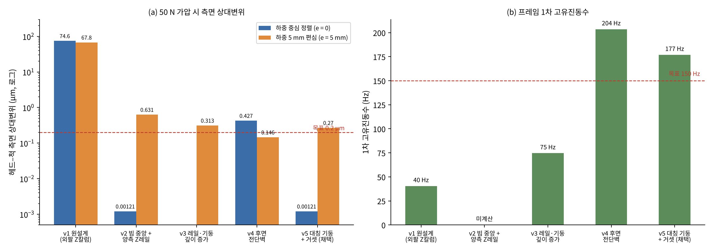
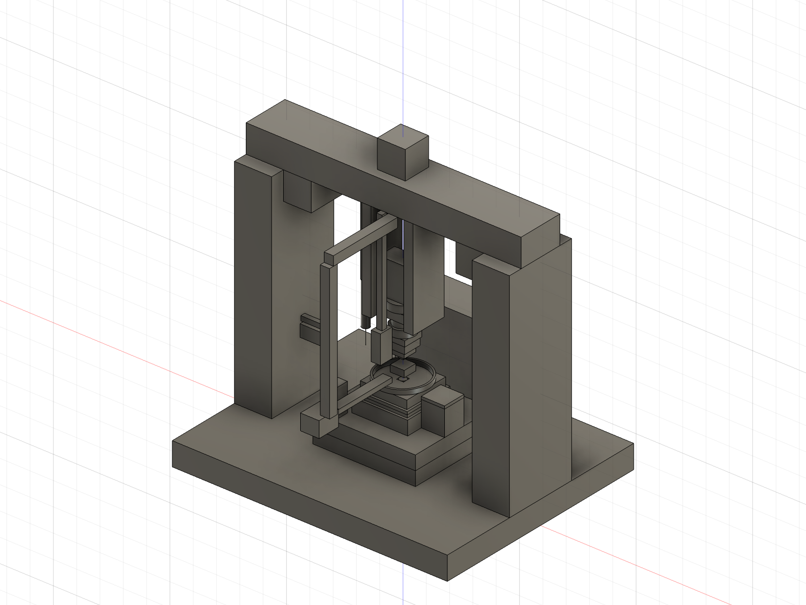

# 8. 구조·진동 해석 (Stiffness & Modal)

**중간 대비 바뀐 점**

- 중간 v1~v5 프레임 해석과 대칭 하중 경로를 유지했다.
- 기말 적층 척의 하중 전달과 처짐 손계산을 추가했다.
- 범프 접촉응력을 문헌 굽힘 파괴강도와 비교하되 조건부 판정과 한계를 명시했다.

**중간 해석의 구분·출처.** 8.1~8.6절의 치수·물성은 중간 모델 입력값, 변위·강성·진동수는 계산 결과이며 목표는 설계 목표다. 원문 KPI는 풋프린트·최대 하중에 한정한다. 근거는 `calc/midterm/fea_summary.json`, `docs/report/midterm/08_구조진동해석.md`이다. 기말 신규 부품을 포함한 전체 조립체 FEA를 다시 수행한 결과는 아니다.

## 8.1 목적과 기준

5장 오차 예산은 프레임 구조에 두 가지 목표를 줬다.

| 항목 | 목표 | 5장 근거 |
|---|---|---|
| 50 N 가압 시 헤드–척 측면 상대변위 | ≤ 0.2 μm | #7 가압 변형 (선형 보정 후 잔차 ±0.12 μm) |
| 1차 고유진동수 | > 150 Hz | #9 진동, 서보 구동 주파수와의 분리 |

**하중 경로.** 본딩할 때 헤드는 다이를 50 N으로 누른다. 같은 크기의 반력이 다음 순서로 돌아 다시 헤드로 닫힌다.

헤드 → Z 가이드 → 브리지 → 기둥 → 베이스 → 스테이지 → 척

이 고리 안에서 어느 부재든 굽으면 헤드와 척이 옆으로 어긋난다.

## 8.2 해석 방법

- **해석 도구:** 3D 선형 탄성 유한요소해석을 Python(NumPy·SciPy)으로 직접 구현했다. 형상은 Fusion 3D 모델과 같은 치수를 5 mm 정육면체 요소(8절점 육면체, 2×2×2 가우스 적분)로 나눴다.
- **모델 규모와 풀이:** 요소 약 6만~13만 개, 자유도 약 23만~38만이다. 정적 해석은 대각 전처리 공액구배법(CG)으로 풀었다.
- **모달 해석:** 계산량을 줄이기 위해 10 mm 요소와 단순화한 헤드·스테이지 블록으로 풀었다(시프트-역 고유치 해석).
- **재료:**
  - 알루미늄: E 69 GPa, ρ 2.70 g/cm³
  - 강: E 200 GPa, ρ 7.85 g/cm³
  - MACOR: E 66.9 GPa, ρ 2.52 g/cm³
  - AlN: E 330 GPa, ρ 3.26 g/cm³
  - 푸아송비 0.3 공통
- **경계조건과 하중:**
  - 화강암 베이스 윗면(z = 50 mm)을 완전 고정했다. 베이스는 50 mm 두께 화강암이라 다른 부재보다 훨씬 강하다고 가정했다.
  - 헤드는 본딩 높이(콜렛 끝이 척 위 5 mm)까지 내린 상태다.
  - 콜렛 아랫면에 +50 N(반력), 척 윗면 중앙 30×30 mm에 −50 N을 걸었다.
- **편심 하중:** 다이가 기울어 한쪽 모서리부터 닿는 경우를 모사했다. 콜렛 하중을 5 mm 편심(e = 5 mm, 10×10 mm 다이의 모서리) 위치에 건 경우도 함께 풀었다.
- **결과 지표:** 콜렛 면과 척 면의 평균 변위 차이(상대변위)다.

## 8.3 결과: 원설계는 크게 미달

원설계(v1, 3장의 첫 배치)는 헤드를 외팔 Z칼럼(70×20 mm 판)에 매달고, 그 칼럼을 브리지 빔에서 앞으로 120 mm 돌출한 암에 붙인 구조였다.

| 항목 | v1 결과 | 목표 | 판정 |
|---|---|---|---|
| 측면 상대변위 (e = 0) | **74.6 μm** | ≤ 0.2 μm | 373배 초과 |
| 수직 강성 | 2.3 N/μm | — | — |
| 1차 고유진동수 | **40 Hz** | > 150 Hz | 미달 |

**원인.** 하중선(헤드 축)과 지지 부재(Z칼럼, 암)가 30~120 mm 어긋나 있다. 그래서 50 N이 굽힘 모멘트로 바뀐다. 50 N × 30 mm = 1.5 N·m의 모멘트가 얇은 칼럼을 앞뒤로 휘게 하고, 돌출 암은 이 회전을 더 키운다. 하중의 크기가 아니라 하중 경로의 비대칭이 문제였다.

## 8.4 설계 반복

*그림 8-1. 프레임 설계 반복에 따른 (a) 50 N 가압 시 측면 상대변위(로그 축)와 (b) 1차 고유진동수. 붉은 점선이 목표다.*

| 버전 | 변경 내용 | 측면 변위 e = 0 | 측면 변위 e = 5 mm | 1차 고유진동수 | 판단 |
|---|---|---|---|---|---|
| v1 | 원설계 (외팔 칼럼 + 돌출 암) | 74.6 μm | 67.8 μm | 40 Hz | 하중 경로 비대칭 |
| v2 | 빔을 헤드 바로 위로 옮기고 Z 레일을 헤드 좌우 대칭으로 배치 | 0.001 μm | 0.63 μm | — | 대칭으로 모멘트 제거. 편심에는 약함 |
| v3 | 레일 깊이 40→80 mm, 기둥 깊이 100 mm | — | 0.31 μm | 75 Hz | 기둥의 X 방향 흔들림이 1차 모드 |
| v4 | 뒤쪽 전단벽 추가 | 0.43 μm | 0.15 μm | 204 Hz | 진동은 해결됐지만 벽이 비대칭이라 다시 측면 변위 발생 |
| **v5 (채택)** | 대칭 기둥(80×160 mm) + 빔–기둥 모서리 거셋 + 대칭 Z 레일 | **0.001 μm** | **0.27 μm** | **177 Hz** | 대칭 유지, 진동 목표 충족 |

v4는 고유진동수만 보면 가장 좋다. 하지만 뒤쪽에만 벽을 달면 구조가 앞뒤로 비대칭이 된다. 그러면 중심 하중에서도 0.43 μm가 밀린다. 이 결과에서 얻은 설계 원칙은 하나다. **가압 하중 경로는 헤드 축에 대해 대칭이어야 한다.** v5는 강성을 대칭인 부재(두꺼운 기둥, 양쪽 거셋)로만 보강했다.

## 8.5 채택안(v5) 평가

*그림 8-2. 해석 결과를 반영한 v5 프레임의 Fusion 조립 모델. 부품 간 간섭 0건, 풋프린트 590×480 mm.*

| 항목 | 결과 | 목표 | 판정 |
|---|---|---|---|
| 측면 상대변위, 하중 중심 정렬 | 0.001 μm | ≤ 0.2 μm | 통과 |
| 측면 상대변위, 편심 e = 5 mm | 0.27 μm | ≤ 0.2 μm | 조건부 |
| 편심 1 mm당 측면 변위 (선형) | 0.054 μm/mm | — | — |
| 허용 편심 | ≤ 3.7 mm | — | 레벨링으로 관리 |
| 1차 고유진동수 | 177 Hz (X 방향 흔들림) | > 150 Hz | 통과 |
| 수직 강성 | 157 N/μm | — | — |
| 풋프린트 (원문 KPI) | 590 × 480 mm | 가로·세로 ≤ 600 mm | 통과 |

**편심 조건을 지키는 방법.** 측면 변위는 편심에 비례한다(0.054 μm/mm). 그래서 편심을 3.7 mm 이하로 묶으면 목표를 지킨다. 편심은 툴과 척이 기울어 다이 한쪽 모서리부터 닿을 때 생긴다. 이것은 3장의 잠금형 짐벌 레벨링(평행도 ≤ 2 μm/10 mm)이 막는다. 평행도가 지켜지면 접착층이 다이 전면에 고르게 눌리므로 하중 중심은 다이 중심과 거의 일치한다. 실제 편심을 1 mm 이하로 보면 측면 변위는 0.05 μm다. 목표 대비 약 4배 여유다.

**참고값.**

| 항목 | v5 값 | 비고 |
|---|---|---|
| Fusion 조립 모델 질량 | 100.7 kg | 중간 모델 참고값; 기말 질량은 11.2절 |
| 높이 | 630 mm | Z 모터를 빔 위로 옮긴 결과 |

원문 기준이 아니므로 판정하지 않는다. 다만 상세 설계에서는 기둥을 상자 단면(벽 두께 10~15 mm)으로 바꾸면 굽힘 강성은 대부분 유지하면서 질량을 크게 줄일 수 있다.

## 8.6 해석의 한계와 다음 확인

1. **이상적인 결합:** 모든 부품이 완전히 붙어 있다고 가정했다. 실제 볼트 체결부와 크로스 롤러 가이드는 이보다 유연하므로 실제 변위는 더 크다. 그래서 편심 1 mm 기준 4배 여유를 이 불확실성의 몫으로 둔다.
2. **요소 크기:** 5 mm 선형 육면체 요소는 굽힘에서 실제보다 약간 뻣뻣하게 계산되는 경향이 있다. 결과는 하한값(낙관값)으로 읽는다.
3. **모달 단순화:** 모달 해석은 헤드와 스테이지를 단순 블록으로 바꾼 10 mm 모델이다. 1차 모드(프레임 X 흔들림)는 프레임 부재가 결정하므로 영향이 작다.
4. **교차 검증 미완료:** Fusion에서 확인한 것은 형상·간섭이며, 정적·모달 해석 교차 검증 완료를 뜻하지 않는다. 기말 신규 부품은 아래 손계산으로 검토했다.

*해석 스크립트: `calc/midterm/fea_struct.py` (실행 예: `python3 fea_struct.py 5 static v5 5`, 결과 `calc/midterm/fea_*.json`, 요약 `calc/midterm/fea_summary.json`).*

## 8.7 적층 하중 경로와 척 처짐

기말 하중은 콜렛 → 맨 위 다이 → 범프·접합 계면 → 아래 다이 → 전면 석영 창 → 적층 척 → 단열 지지 → 스테이지 → 베이스로 전달되고, 프레임을 통해 헤드로 닫힌다. 계면들은 직렬이므로 층 수만큼 범프 접촉면적을 늘려 응력을 낮추지 않는다. 석영 창은 다이 전면을 지지하는 구성이며 무지지 박형 다이를 누르는 구성은 허용하지 않는다.

| 항목 | 값 | 구분·근거 |
|---|---|---|
| 다이·기본 하중 | 5 × 5 mm, 40 N | 설계 목표 / 설계값; `docs/requirements.md` 3·6절 |
| 다이 평균 압력 | 40 N에서 1.6 MPa, 50 N에서 2.0 MPa | 계산 결과; `calc/hardware/load_path.json` |
| 척 처짐 | 0.127 μm | 손계산 결과; 같은 JSON, 지지 조건은 `calc/hardware/README.md` |
| 척 평면도 | 2 μm | 설계 목표; `docs/drawings/dimensions.json` |
| 판정 | 조건부 PASS | 처짐은 목표 이내이나 제작 평면도·고온 변형·체결 변형까지 보증하지 않음 |

## 8.8 범프 접촉응력과 파손 검토

범프 수는 배열 면적 근사 `N = A_die / pitch²`, 접촉면적은 `Nπd²/4`, 응력은 `F/(Nπd²/4)`로 구했다. 외곽 배열과 더미 범프를 세어 얻은 실제 개수는 아니다.

| 항목 | 값 | 구분·출처 |
|---|---|---|
| 피치 / 지름 | 55 / 25 μm | 문헌값; `sim/params.json`의 `geometry.bump_pitch`, `geometry.bump_diameter` |
| 면적 기반 범프 수 | 약 8,264개 | 계산 결과; `load_path.json`, 정수 배열 수와 구분 |
| 범프 접촉면적 합 | 4.05681 mm² | 계산 결과; 같은 JSON |
| 접촉응력, 40 / 50 N | 9.9 / 12.3 MPa (원계산 9.85997 / 12.32496) | 계산 결과; 같은 JSON |
| Si 평균 굽힘 파괴강도 | 261 MPa, 두께 51 μm 시험편 | 문헌값; Gupta et al., 2024, J. Micromech. Microeng. 34 105012, Table 3; `calc/hardware/README.md` |
| 비교값 / 접촉응력 비 | 26.47 / 21.18 | 계산 결과; 같은 JSON. 보증 안전율이 아님 |

**조건부 PASS의 범위.** 전면 석영 지지와 균일 범프 하중에서 접촉응력의 크기는 문헌 비교값보다 작다. 그러나 261 MPa는 45° 패턴 시험편의 평균 3점 굽힘 파괴강도이며 실제 다이 최소 보증값이 아니다. 접촉 압축응력과 굽힘 인장 파괴강도의 비교로 파손확률·피로수명을 인증할 수 없다. 표면 결함, 범프 높이 편차, 일부 범프만 접촉하는 초기 과정, 접착·밀봉층 및 조인트 유연성은 제작 후 확인한다. AlN/MACOR 탄성계수의 Si 대리 입력 한계도 남아 있다.

*기말 출처: `calc/hardware/load_path.json`, `calc/hardware/README.md`, `calc/hardware/hw_params.json`, `cad/stacker/spec_stacker.py`, `sim/params.json`. 문헌 원출처와 시험편 조건은 계산 README에 보존했다.*
