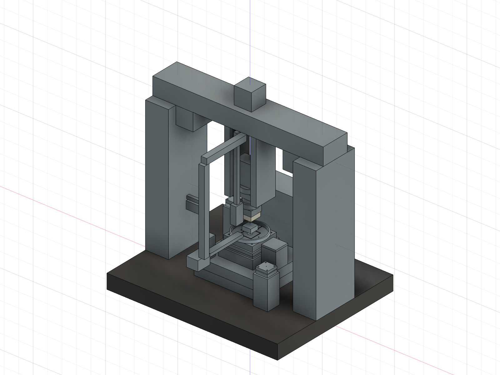
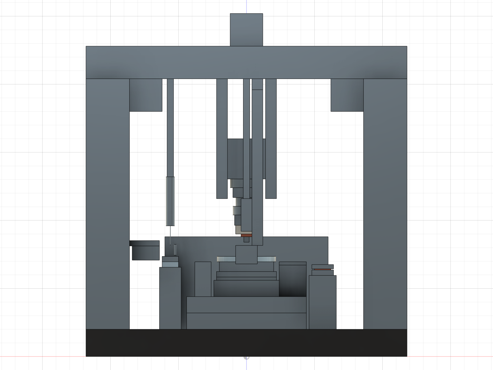
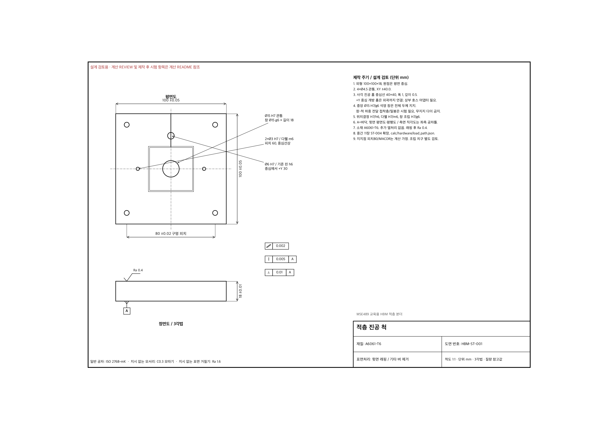
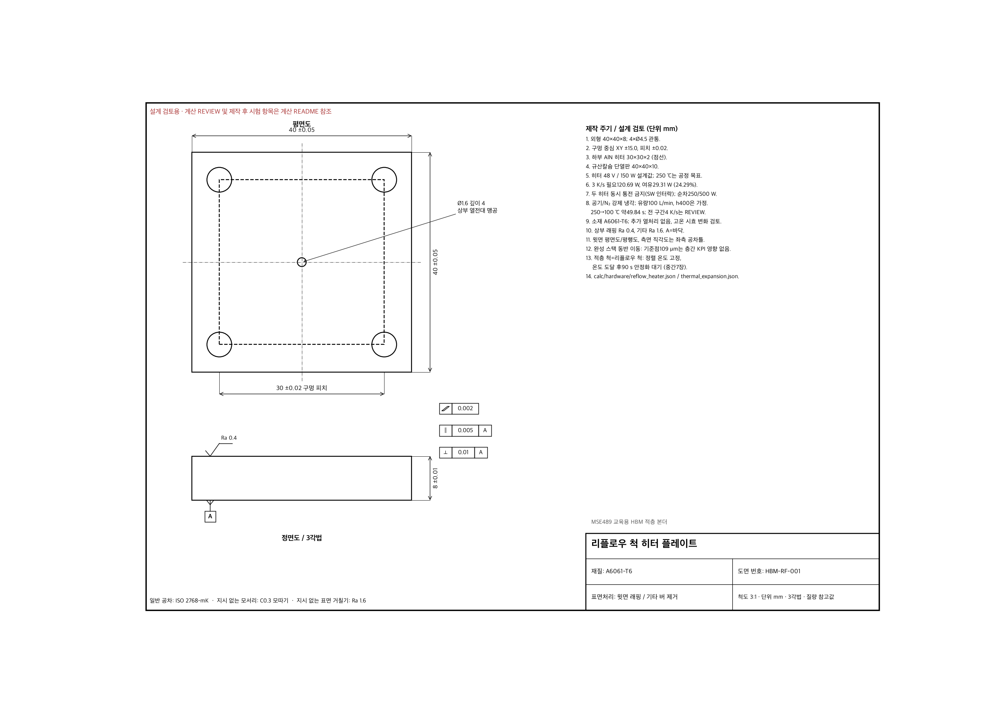
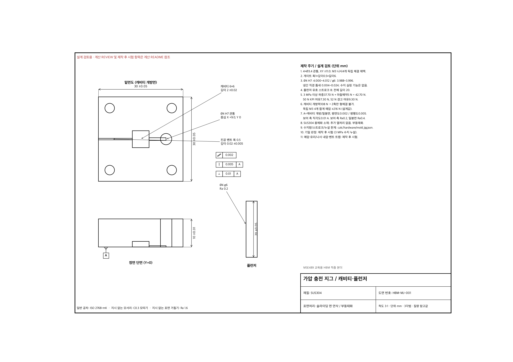
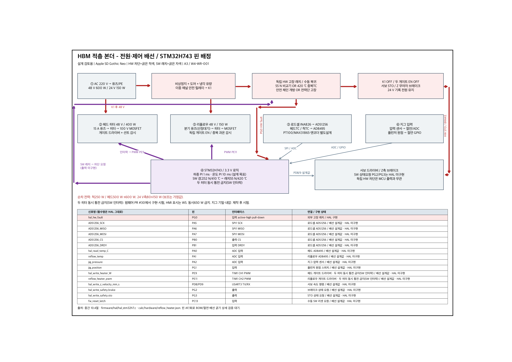

# 11. 3D 모델링과 부품 도면 (CAD & Drawings)

**중간 대비 바뀐 점**

- 중간 프레임·헤드·광학계의 자동 생성 방법을 이어 썼다.
- 기말 Fusion 조립 결과와 GLB 이름 규칙을 반영했다.
- 적층 척·리플로우 척·가압 지그 도면으로 제작 검토 대상을 갱신했다.
- 배선도와 제작 후 시험 항목을 연결했다.

## 11.1 원문 요구와 모델링 방법

PBL 8쪽의 조립 모델·제작 도면·공차 요구에 맞춰 중간 43부품을 재사용하고 적층용 부품을 추가했다. 프레임의 대칭 하중 경로, 헤드, 조동·미동 스테이지, 듀얼 비전 광학계를 유지한다. 중간 `cad/midterm/spec.py`와 기말 `cad/stacker/spec_stacker.py`를 읽는 Fusion API 스크립트가 형상을 생성하며, 도면·손계산은 같은 치수 원본을 읽는다. 사양 공유는 입력 불일치를 줄이지만 제조성·구동 간섭·고온 조립성을 자동 보증하지 않는다.

## 11.2 기말 Fusion 조립 결과

*그림 11-1. 기말 Fusion 조립 모델. 원본 `cad/stacker/out/view_iso.png`를 복사했다. 리플로우 척과 지그는 교환 장착을 설명하는 대기 배치다.*

*그림 11-2. 기말 Fusion 정면도. 원본 `cad/stacker/out/view_front.png`를 복사했다.*

| 확인 항목 | 기말 결과 | 구분·판정·출처 |
|---|---|---|
| 부품 수 | 51개 (중간 43개 + 신규 8개) | 모델 구성값; `summary.json` parts, `cad/stacker/README.md` |
| 외형 | 590 × 480 × 630 mm | X·Y는 원문 KPI ≤ 600 mm 통과; Z 높이는 참고값 |
| 간섭 | 0건 | Fusion 형상 검사 결과; `interference_count=0` |
| 밀도 기반 질량 | 101.88 kg | 참고값; `summary.json`의 `mass_kg` |
| Fusion 재질 질량 | 135.14 kg | 참고값; `fusion_mass_kg`, 라이브러리 대체 재질 영향 |
| 모델 상태 | 대기 공구가 포함된 개념 조립체 | `model_state`, 제작 승인본 아님 |

질량 차이는 전장함·카메라 등 대체 재질과 내부 형상 생략의 영향을 받는다. 높이·질량에는 원문 판정 기준이 없다. 간섭 0은 저장된 자세의 형상 검사로 전 스트로크 충돌·배관·케이블 간섭·볼트 접근성 확인을 대체하지 않는다. 출처는 `cad/stacker/out/summary.json`이며 중간 질량을 기말 값으로 재사용하지 않았다.

## 11.3 부품 이름과 GLB

개별 부품명은 Fusion 하위 컴포넌트와 `summary.json`의 parts에 유지한다. 그룹 STL 파일명 = 컴포넌트 그룹명 = GLB 노드명으로 연결한다. `frame`, `head`, `z_carriage`, `stack_chuck`, `reflow_chuck`, `mold_jig`, `plunger`, `dispenser`, `ncf_tray`, `camera_bottom`의 10그룹이다(`cad/stacker/README.md`).

`cad/web/hbm_stacker.glb`는 179,472 B(약 179 KB)의 경량 표시 산출물이다(파일 크기 관찰값). STL mm를 GLB m로 바꾸고 Z-up을 Y-up으로 회전한다. 이름은 그룹 수준으로 유지하며 개별 51부품 이름을 GLB에서 각각 조작한다는 뜻은 아니다. STEP은 원형상 보관, GLB는 웹 표시용이며 GLB는 Pages가 읽도록 일반 Git 파일로 관리한다. 표시·애니메이션은 16장 16.4절을 참조한다.

Fusion 내장 Python의 ASCII 기본 인코딩으로 파일 읽기가 실패한 Issue #33은 입출력 UTF-8 명시와 인코딩 검사로 수정했다(`README.md` 트러블슈팅, PR #34).

## 11.4 신규 제작 도면

기말 제작 검토 도면은 적층 척·리플로우 척·가압 충전 지그의 3장이다. A3·3각법·ISO 2768-mK 표기를 사용한다. 다음 값은 **제작 설계값**이며 실측 결과가 아니다. 단위는 치수·공차 mm, 조도 Ra μm다. 출처는 `docs/drawings/dimensions.json`, `generate.py`, `cad/stacker/spec_stacker.py`다.

| 도면 | 재질·크기 | 공차·기하공차·조도·끼워맞춤 |
|---|---|---|
| HBM-ST-001 적층 척 | A6061-T6, 100 × 100 × 18 | 외형 ±0.05, 두께 ±0.01, 윗면 평면도 0.002, 바닥 A 대비 평행도 0.005·측면 직각도 0.01, 래핑 Ra 0.4; 창 Ø15 H7/g6, 기준 핀 Ø6 H7/h6, 다웰 Ø3 H7/m6 |
| HBM-RF-001 리플로우 척 | A6061-T6, 40 × 40 × 8 | 외형 ±0.05, 두께 ±0.01, 구멍 피치 ±0.02, 평면도 0.002·평행도 0.005 A·직각도 0.01 A, 상부 Ra 0.4·기타 Ra 1.6; 볼트 Ø4.5 여유공, 슬라이딩 끼워맞춤 대상 없음 |
| HBM-MJ-001 가압 지그 | SUS304 용체화 소재·부동태화, 30 × 30 × 10 | 캐비티 깊이 2 ±0.02, 벤트 깊이 0.02 ±0.005, 밀봉면 평면도 0.002·평행도 0.005 A·보어 직각도 0.01 A, 밀봉면 Ra 0.4·보어/축 Ra 0.2; Ø4 H7/g6 |

*그림 11-3. 적층 진공 척 제작 도면(HBM-ST-001). 원본 `docs/drawings/stack_chuck.png` 복사.*

*그림 11-4. 리플로우 척 히터 플레이트 제작 도면(HBM-RF-001). 원본 `docs/drawings/reflow_chuck.png` 복사.*

*그림 11-5. 가압 충전 지그·플런저 제작 도면(HBM-MJ-001). 원본 `docs/drawings/mold_jig.png` 복사.*

**끼워맞춤의 역할.** 중간의 용도별 선정 원칙을 유지한다. H7/g6는 미끄럼·조립 여유가 필요한 곳에 쓰고, 위치 기준은 H7/h6, 고정 다웰은 H7/m6로 구분한다. Ø4 H7/g6 보어 4.000~4.012 / 축 3.988~3.996의 냉간 직경 틈새는 4~24 μm다(`calc/hardware/README.md`). 이 틈새를 수지 씰로 간주하지 않는다. 지그는 독립 M3 나사 4개 합계 예압 ≥216 N 설계값을 채택했으며, 기밀·예압·유리와 나사의 내압·벤트 트랩은 제작 후 시험이다.

## 11.5 배선도와 조립 검토

*그림 11-6. 전원·안전 체인·두 히터·센서·STM32H743 배선 설계. 원본 `wiring/hbm_wiring.png` 복사. PG0 이외 핀은 배선 설계값이며 HAL 미구현이다.*

안전 릴레이·K1·독립 비교기와 MCU 소프트웨어 래치를 분리한다. 48 V 600 W 전원에서 헤드 400 W와 척 150 W는 순차 사용하며 두 히터 동시 통전 금지를 지킨다. 세부 핀은 10장 10.8절·`wiring/pinmap.csv`를 따른다. 아날로그 차폐선·전력선 분리, 접지·퓨즈·절연·배선 굵기와 부품 BOM은 제작 검토 대상이다.

도면의 상온 평면도는 고온 평면도를 보증하지 않는다. 적층 척=리플로우 척 운전은 고정 정렬 온도 도달 후 90 s 안정화를 절차로 적용한다(`calc/hardware/thermal_expansion.json`). 완성 스택의 강체 동반 이동 해석과 실제 미끄러짐·열 휨을 나눠 검증해야 한다. 리플로우 척 냉각은 14장에 FAIL/REVIEW로 남겼다.

*그림은 모두 final/fig의 ch11_ 접두어 복사본을 사용하며 CAD·도면·배선 원본을 수정하지 않았다. 그림 11-4의 원본 주기에 표시된 전 구간 냉각 REVIEW는 최신 `calc/hardware/README.md`의 피크→180 ℃ 판정과 180 ℃ 아래 관찰 구분으로 읽는다.*
