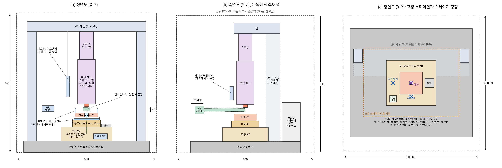
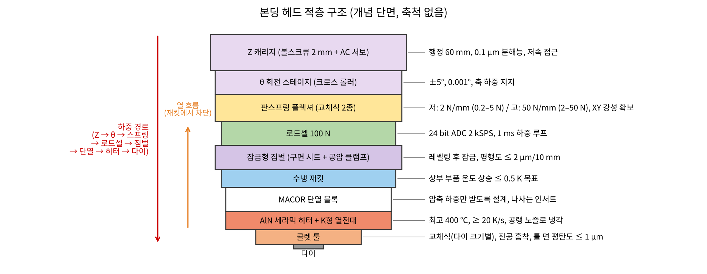
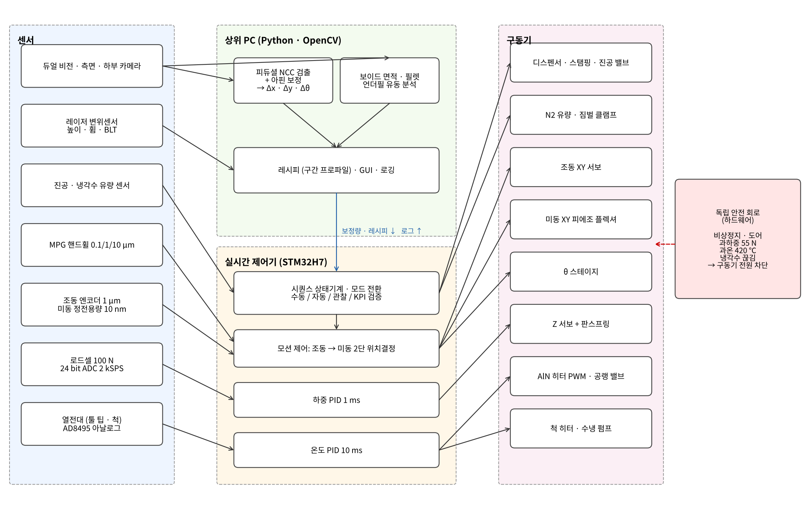
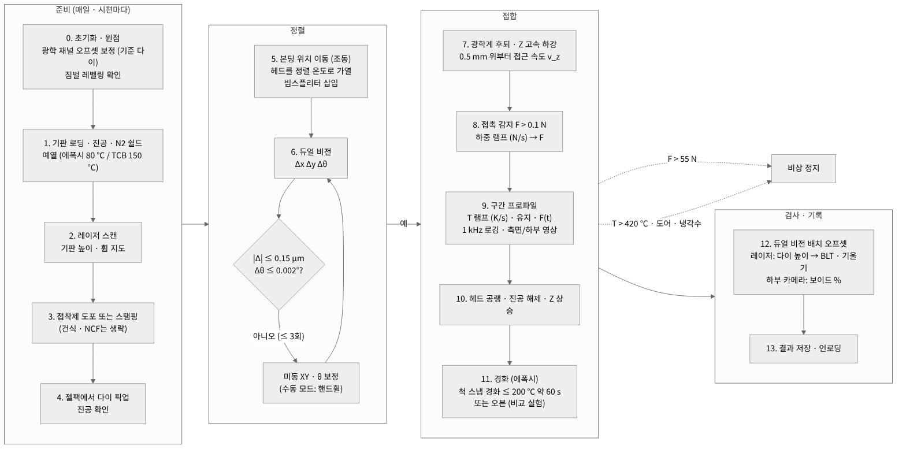

# 3. 시스템 구성 (System Architecture)

## 3.1 실제 R&D 본더 조사와 설계 위치

설계 수치의 근거를 확보하기 위해 대학 연구실에서 쓰는 데스크톱 다이본더·플립칩 본더의 공개 사양과 운전 지침을 조사했다.

| 항목 | Finetech FINEPLACER lambda | Finetech FINEPLACER sigma | Tresky T-3000-FC3 | SET FC150 | **본 설계** |
|---|---|---|---|---|---|
| 배치 정확도 | ±0.5 μm | ±0.5 μm | 2 μm | ±1 μm | **±1 μm (3σ)** |
| 하중 | 0.1–200 N (수동 암 0.1–20 N) | 0.2–40 N / 1–500 N | 0.2–490 N | — | **0.2–5 N / 2–50 N** |
| 가열 | 칩·기판 400 ℃, 승온 6 K/s(칩)·20 K/s(기판) | 450 ℃ | 툴·기판 400 ℃ | — | **헤드 400 ℃ ≥20 K/s, 척 200 ℃** |
| 정렬 | 고정 빔스플리터 오버레이, 카메라 트랙 이동 | FOV 3.8×2.7 mm, 1 μm/px | 빔스플리터, 23× 줌 | 자체 비전 | **빔스플리터 슬라이드, 1.73 μm/px** |
| 이동 | Z 10 mm, θ ±5° | XY 미세 2.5 mm, θ ±15° | XY 200 mm, Z 95 mm | — | **조동 200×100 + 미동 ±0.5 mm, Z 60, θ ±5°** |
| 공정 보조 | 포밍가스·포름산, 디스펜서, 다이 플립, 측면 영상 | — | 디스펜서·스탬핑, 젤팩, 공정 카메라 | 평행도 제어, 포름산 | **N₂ 쉴드, 디스펜서·스탬핑, 측면·하부 카메라, 레이저 높이** |

조사에서 얻은 설계 원칙은 네 가지다.

1. **하중은 두 레인지로 나눈다.** 하나의 센서·스프링으로 0.2 N과 50 N을 모두 정밀하게 다루기 어렵다.
2. **정밀도와 행정을 분리한다.** sigma는 수 mm 미동 축으로 정밀도를 내고, 넓은 작업 영역은 따로 처리한다.
3. **승온 속도는 수~20 K/s급이다.** 이 이상은 열해석으로 확인해야 한다.
4. **운전 순서가 표준화되어 있다.** Finetech 운전 지침의 순서는 정렬 → 카메라 후퇴 → 미세 포지셔너로 천천히 접촉 → "승온 K/s · 유지 ℃ · 시간 s" 구간 프로파일 → 자동 냉각이다. 본 장비의 동작 순서(3.6절)와 레시피 형식은 이 방식을 따른다.

본 장비의 목표 정확도 ±1 μm는 상용 R&D 장비 범위(±0.5~2 μm) 안에 있다. 차별점은 교육 기능이다. 공정 중 관찰(측면·하부 카메라), 측정(레이저 높이, 하중·온도 로그), 수동·자동 비교를 한 장비 안에서 할 수 있다.

## 3.2 설계 개념과 주요 결정

본 장비는 **고정 헤드 + 이동 기판** 구조다. 화강암 베이스 위 브리지에 본딩 헤드(Z·θ)가 고정되고, 기판은 아래의 2단(조동+미동) XY 스테이지가 옮긴다.

| 결정 | 선택 | 검토한 대안 | 선택 이유 |
|---|---|---|---|
| 운동 분배 | 헤드 Z·θ 고정, 기판 XY | 갠트리로 헤드 XYZ 이동 | 하중 경로가 짧고 열원이 한곳에 고정됨 |
| 헤드 형식 | 수직 직선 Z + 슬라이드 광학계 (Tresky형) | 회전 힘 암 + 고정 빔스플리터 + 추 하중 (Finetech형) | 1 ms 하중 폐루프 제어와 하중 프로파일에 유리. 회전 암은 구조가 단순하지만 하중이 추 위치로 고정됨 |
| XY 스테이지 | 조동 200×100 mm(1 μm) + 미동 피에조 플렉셔 ±0.5 mm(10 nm) | 단일 장행정 0.1 μm 스테이지 / 100 mm 단일 스테이지 | 디스펜서·트레이·레이저까지 닿는 행정과 서브마이크론 정밀도를 분리해 오차 예산이 단순해짐 |
| 하중 발생 | Z 서보 위치제어 + 교체식 판스프링 + 로드셀 | 공압 실린더, 보이스코일 | 스프링이 위치를 하중으로 바꿈. 저 레인지 2 N/mm에서 Z 분해능 0.1 μm는 0.2 mN 지령 분해능에 해당 |
| 평행도 | 잠금형 셀프레벨링 짐벌 | 수동 2축 고니오미터, 전동 틸트 | 기준 평면에 눌러 자동으로 맞춘 뒤 잠금. 반복이 빠르고 학생 조작 오류가 적음 |
| 가열 | 헤드 AlN 세라믹 히터 400 ℃ + 척 200 ℃ | 금속 블레이드 펄스 서모드 | 세라믹 히터는 툴 면 온도 균일도가 높음. 척 온도는 스테이지 열드리프트 때문에 200 ℃로 제한하고, 고온 공정은 헤드가 담당 |
| 경화 | 헤드는 수 초 택(가접합) → 척 스냅 경화 약 60 s | 헤드 유지 경화(30분), 외부 오븐 | 헤드가 30분간 묶이지 않음. 오븐 경화는 비교 실험 조건으로 둠 |

**프레임 구조 갱신 (8장 반영).** 위 표와 그림 3-1의 브리지는 처음 배치안이다. 8장 구조 해석에서 외팔 Z칼럼과 돌출 암 구조는 50 N 가압 시 74.6 μm 밀리는 것으로 나와 폐기했다. 대신 헤드 바로 위의 빔, 헤드 좌우 대칭 Z 레일, 80×160 mm 대칭 기둥과 거셋으로 바꿨다. 최종 형상은 그림 8-2와 11장 그림 11-1(Fusion 조립 모델)에 있다.

**척 온도를 200 ℃로 정한 근거.** PBL 4쪽 예시는 핫플레이트 350 ℃ 이상이다. 하지만 척은 서브마이크론 스테이지 바로 위에 있어 온도가 높을수록 열드리프트가 커진다. 실습 공정의 기판 측 요구는 DAF 150 ℃(공정 강의 38쪽)와 스냅 경화 최고 200 ℃(Loctite Ablestik 8601S25)다. 이를 모두 200 ℃로 충족하고, 400 ℃가 필요한 TCB는 헤드에서 가열한다.

## 3.3 배치와 모듈 구성

*그림 3-1. 장비 배치. (a) 정면, (b) 측면, (c) 평면과 스테이지 행정. 모든 모듈이 가로·세로 600 mm 풋프린트 안에 들어가고(초기안 높이 565 mm, 참고값), 디스펜서·젤팩·레이저가 모두 조동 행정 안에 있다.*

| 모듈 | 기능 | 구성 | 목표 사양 |
|---|---|---|---|
| ① 베이스·브리지 | 지지, 진동·열 안정 | 화강암 540×480×50 mm, 리브 보강 브리지 | 1차 고유진동수 > 150 Hz |
| ② 조동 XY | 스테이션 간 이동 | 크로스 롤러 가이드, 볼스크류 5 mm 리드, AC 서보, 광학 엔코더 1 μm | 행정 200×100 mm, 위치결정 ±5 μm |
| ③ 미동 XY | 최종 정렬 | 피에조 구동 플렉셔 스테이지, 정전용량 센서 폐루프, 중앙 관통 구멍 | ±0.5 mm, 분해능 10 nm, 하중 50 N 지지 |
| ④ 척 | 기판 고정·예열 | 수냉판 → 세라믹 단열 → 진공 척(링 히터, 중앙 석영 창 Ø15 mm) | 최고 200 ℃, 스테이지 온도 상승 ≤ 0.5 K |
| ⑤ 본딩 헤드 | 픽업·가압·가열 | 그림 3-2 적층 구조 | 하중 0.2–50 N, 400 ℃, ≥20 K/s |
| ⑥ 듀얼 비전 | 칩·기판 피듀셜 동시 촬영 | 빔스플리터 프리즘 슬라이드(후퇴 60 mm), 2× 텔레센트릭, 5 MP(3.45 μm 픽셀), 동축 LED | 1.73 μm/px, 서브픽셀 반복성 σ ≤ 0.04 px (0.07 μm) |
| ⑦ 측면 카메라 | 필렛·접촉 관찰 | 매크로 렌즈 + 링 조명, 석영 쉴드 너머 촬영 | 10 μm 단위 판독 |
| ⑧ 하부 카메라 | 보이드·언더필 유동 관찰 | 조동 스테이지 내장, 45° 미러로 척 석영 창을 통해 위로 촬영 | 유리 기판 사용 시 |
| ⑨ 레이저 변위센서 | 높이·휨·BLT | 브리지 장착(헤드에서 Y −60 mm), 스테이지로 스캔 | 분해능 ≤ 1 μm |
| ⑩ 도포 | 접착제 공급 | 시간-압력 디스펜서 + 스탬핑 핀 (헤드에서 X −80 mm) | 0.1–0.6 MPa, 0.05–1 s, 반복성 ±5 % |
| ⑪ 가스 쉴드 | 산화 방지·관찰 창 | 척 둘레 석영 측벽(상부 개방) + N₂ 유량 제어 | 솔더·Cu TCB용 |
| ⑫ 다이 공급 | 픽업 | 2" 젤팩·와플팩 (스테이지 위, 척에서 X +80 mm). FC는 뒤집어 적재 | 이젝터 핀 미사용 |
| ⑬ 수동 조작 | 수동 정렬 실습 | MPG 핸드휠 (0.1/1/10 μm/눈금) + 화면 오버레이 십자선 | — |
| ⑭ 제어·전장 | 실시간 제어, 안전 | STM32H7, 서보·피에조 드라이버, 히터 전원, 독립 안전 회로 (후면) | 하중 1 ms, 온도 10 ms |

**하부 관찰 구조.** 미동 스테이지와 척 중앙에 관통 구멍과 석영 창을 두고, 그 아래 조동 스테이지 안에 45° 미러와 카메라를 넣었다. 카메라가 척과 함께 움직이므로 창 위 본딩 위치를 항상 아래에서 볼 수 있다. 유리 기판을 쓰면 에폭시 보이드 분포와 언더필 유동 선단을 직접 촬영할 수 있다. 실제 장비에서도 업룩킹 카메라를 옵션 모듈로 제공한다(FINEPLACER pico 2).

**투명 창 재질.** 400 ℃ 헤드와 200 ℃ 척 근처의 창은 석영이다. 폴리카보네이트는 외곽 커버(도어 인터록 포함)에만 쓰고 열원에서 떨어뜨린다.

## 3.4 본딩 헤드

*그림 3-2. 본딩 헤드 적층 구조. 하중은 위에서 아래로 전달되고, 열은 수냉 재킷에서 차단된다.*

- **판스프링 플렉셔(교체식 2종):** 저 레인지 2 N/mm(0.2–5 N, 에폭시)와 고 레인지 50 N/mm(2–50 N, TCB)로 나뉜다. 평행 판스프링은 Z 방향으로만 유연하고 XY 방향 강성은 높게 유지해, 가압 중 다이가 옆으로 밀리지 않게 한다.
- **잠금형 짐벌:** 레벨링 절차는 세 단계다. 잠금을 풀고, 척 위 광학 평판에 5 N으로 누른 뒤, 공압 클램프로 잠근다. 결과는 감압 필름 자국과 레이저로 측정한 테스트 다이 기울기로 확인한다(목표 ≤ 2 μm / 10 mm).
- **MACOR:** 단열 성능은 좋지만 취성이 있다. 압축으로만 하중을 받도록 배치하고, 나사는 금속 인서트로 체결한다.
- **헤드 열팽창과 하중:** 히터 블록(약 10 mm)이 375 K 오르면 약 45 μm 팽창한다. 고 레인지 스프링에서는 이것이 약 2.3 N의 하중 증가가 된다. 이것을 1 ms 하중 루프가 Z를 되돌려 보상한다.
- **온도 보정:** 툴 팁 열전대는 실제 접합부 온도와 다르다(공정 강의: 설정 온도 ≠ 제품 온도). 열전대를 넣은 더미 다이로 툴 온도와 접합부 온도의 관계를 측정해 레시피에 반영한다.

## 3.5 센서–제어기–구동기

*그림 3-3. 제어 구조. 영상 처리는 상위 PC, 시간이 중요한 루프는 실시간 제어기가 맡고, 안전 회로는 소프트웨어와 무관하게 구동기 전원을 끊는다.*

| 루프 | 센서 → 제어기 → 구동기 | 주기 | 근거 |
|---|---|---|---|
| 하중 | 로드셀 + 24 bit ADC → PID → Z 서보 | 1 ms | 접촉 순간 충격과 헤드 열팽창에 따른 하중 변화를 억제. KPI 10 ms의 10배 |
| 온도 | 열전대 + AD8495 → PID → MOSFET PWM 20 kHz | 10 ms | KPI 충족. 디지털 변환 IC(변환 약 100 ms)는 느려서 제외 |
| 위치 | 조동 엔코더 → 서보 / 정전용량 센서 → 피에조 | 0.1 ms (드라이버 내부) | 조동이 ±5 μm까지 옮기면 미동이 최종 정렬. 개루프 스테핑 펄스로는 백래시 때문에 서브마이크론 보장 불가 |
| 정렬 | 듀얼 비전 → NCC 검출 → 아핀 보정 → 미동·θ 지령 | 1회 약 150 ms | 정지 상태에서 반복 수렴 (|Δ| ≤ 0.15 μm) |

**안전 계층.** ① 소프트웨어 한계(52 N, 410 ℃에서 감속·경고), ② 하드웨어 차단(55 N 비교기, 420 ℃ 열 퓨즈, 냉각수 끊김), ③ 비상정지·도어 인터록. 히터가 50 ℃ 이상이면 경고등이 켜진다.

## 3.6 운전 모드와 동작 순서

| 모드 | 목적 | 특징 |
|---|---|---|
| 수동 | 정렬 원리 체험 (PBL 4쪽) | 핸드휠로 미동 XY·θ 조작, 화면 오버레이로 판단. 자동 결과와 오차 비교 |
| 자동 | 공정 실습·DoE | 비전 자동 정렬 + 레시피 프로파일 실행 |
| 관찰 | 보이드·언더필·휨 관찰 (PBL 3쪽) | 유리 기판 + 하부 카메라, 레이저 스캔, 측면 영상 녹화 |
| KPI 검증 | ±1 μm 반복정밀도 측정 | 양면 피듀셜 유리 테스트 다이, 건식 배치 n ≥ 30 |

*그림 3-4. 본딩 1회 동작 순서. 점선은 비상 정지 경로.*

정렬은 공정 온도(또는 정해진 정렬 온도)에서 한다. 상온에서 정렬한 뒤 가열하면 헤드 팽창으로 위치가 밀리기 때문이다. 빔스플리터 상·하 채널 사이의 기계적 오프셋은 텔레센트릭 렌즈로도 없어지지 않는 가장 큰 오차원이다. 그래서 매일 기준 다이로 이 오프셋을 측정해 보정한다(0단계).

## 3.7 실습 변수와 기록

| 실습 변수 | 입력 단계 | 범위 | 장비가 기록하는 값 |
|---|---|---|---|
| 온도 T, 승온 속도 | 1, 9, 11 | 척 25–200 ℃, 헤드 25–400 ℃, 1–20 K/s | 툴 팁·척 온도 이력 (100 Hz) |
| 유지 시간 | 9 | 0.5–600 s | 실제 유지 시간 |
| 하중 F, 하중 램프 | 8–9 | 0.2–50 N (다이 크기별 상한), 0.1–20 N/s | 하중 이력 (1 kHz), 접촉 시점 |
| 접근 속도 v_z | 7 | 1–500 μm/s | Z 위치·하중 동시 기록 |
| 도포량·방식 | 3 | 0.1–0.6 MPa × 0.05–1 s, 또는 스탬핑 | 측면·하부 영상 |
| 경화 조건 | 11 | 척 스냅 경화 / 오븐 | 경화 후 오프셋 변화 |

PBL 3쪽의 "속도" 변수는 접근 속도·하중 램프·승온 속도 세 가지로 구체화했다. 강의의 TC-NCF 공정도 높이별 가압 프로파일과 승온 속도를 제어한다(2.5D·3D 강의 95~97쪽).

품질 지표는 다섯 가지다.

- 배치 오프셋 Δx·Δy·Δθ (듀얼 비전)
- BLT와 기울기 (레이저: 다이 상면 높이 − 기판 높이 − 다이 두께)
- 보이드 면적률 (하부 카메라)
- 필렛 형상 (측면 카메라)
- 다이 전단 강도 (외부 시험기, 공정 강의 39쪽)

목표 기준은 접착제 데이터시트 권장값인 습식 BLT 25 μm, 필렛 20~50 %로 둔다.

## 3.8 이후 장에서 검증할 항목

| 이 장의 가정 | 검증 장 |
|---|---|
| X·Y 각 ±1 μm(3σ): 항목별 배분 합 | 5장 정합 오차 예산 |
| 조동·Z·θ 구동력, 볼스크류·가이드 정밀도와 수명 | 6장 구동부 |
| 히터 ≥ 20 K/s, 400 ℃ 도달, 척·헤드에서 스테이지·가이드로의 온도 상승 ≤ 0.5 K | 7장 열 설계 |
| 브리지 고유진동수 > 150 Hz, 50 N 가압 시 측면 변위 ≤ 0.2 μm | 8장 구조·진동 |
| 피듀셜 검출 σ ≤ 0.04 px, 아핀 보정 | 9장 비전 |
| 하중·온도 루프 안정성 (지연 포함) | 10장 제어·회로 |

## 참고 자료

- Finetech FINEPLACER lambda 2 제품 정보, U-Michigan LNF·Purdue BNC 장비 페이지, Stanford Finetech 운전 지침
- NUS E6NanoFab FINEPLACER sigma, Finetech FINEPLACER pico 2 제품 페이지
- U-Waterloo QNFCF·Princeton MNFC Tresky 장비 페이지, Tresky T-3002 PRO 카탈로그
- DKSH SET FC150 제품 페이지, Henkel Loctite Ablestik 8601S25 기술 자료
