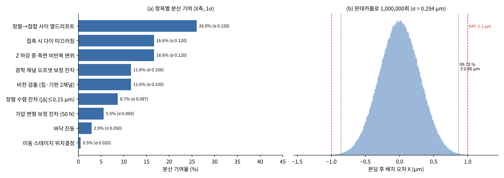

# 5. 정합 오차 예산 (Alignment Error Budget)

## 5.1 목적과 방법

KPI "X·Y 각 ±1 μm (3σ)"를 달성하려면 오차를 만드는 각 요인에 허용치를 나눠 줘야 한다. 이렇게 나눈 허용치가 6~10장의 구동부·열·구조·비전·제어 설계 목표가 된다. 그래서 이 장은 이후 계산의 기준표 역할을 한다.

- **대상:** 광학 정렬이 끝난 순간이 아니라 본딩을 마친 뒤 측정한 다이 중심의 배치 오차. 측정은 2장의 KPI 검증 모드(유리 테스트 다이, 건식 배치) 조건을 따른다.
- **축:** X와 Y는 구조가 대칭이므로 같은 예산을 적용한다. 각도는 5.4절에서 따로 다룬다.
- **합산:** 항목들이 서로 독립이라고 보고 분산을 더한다(RSS, σ_total = √Σσᵢ²). 정규분포가 아닌 항목(균일분포)이 섞여 있으므로 몬테카를로 100만 회로 실제 분포의 99.73 % 구간도 확인했다.
- **보정 가능한 성분:** 매번 같은 크기로 나타나는 계통 오차(가이드 진직도 형상, 정상상태 열변형, 하중에 비례하는 처짐)는 보정표로 제거한다. 예산에는 보정 후 남는 잔차만 넣는다.

## 5.2 오차 항목과 배분

| # | 오차 항목 | 분포 | 허용치 | 1σ (μm) | 분산 기여 | 원인과 대책 |
|---|---|---|---|---|---|---|
| 1 | 비전 검출 (칩·기판 두 채널) | 정규 | σ 0.10 | 0.100 | 11.6 % | 채널당 σ 0.07 μm = 0.04 px (1.73 μm/px). NCC 서브픽셀 보간, 고대비 Cr 피듀셜 |
| 2 | 정렬 수렴 잔차 | 균일 | ±0.15 | 0.087 | 8.7 % | 판정 기준 \|Δ\| ≤ 0.15 μm에서 정렬 반복 종료 |
| 3 | 광학 채널 오프셋 보정 잔차 | 정규 | σ 0.10 | 0.100 | 11.6 % | 빔스플리터 상·하 채널 사이의 기계적 오프셋. 매일 기준 다이로 보정 |
| 4 | 미동 스테이지 위치결정 | 정규 | σ 0.02 | 0.020 | 0.5 % | 정전용량 센서 폐루프, 분해능 10 nm |
| 5 | Z 하강 중 측면 비반복 변위 | 정규 | σ 0.12 | 0.120 | 16.6 % | 40 mm 하강 동안 가이드 진직도의 비반복 성분. 반복 성분은 보정표로 제거 |
| 6 | 정렬→접합 사이 열드리프트 | 균일 | ±0.26 | 0.150 | 26.0 % | 정렬부터 접촉까지 약 5 s 동안 툴과 척의 상대 이동. 공정 온도에서 열평형 후 정렬 |
| 7 | 가압 변형 보정 잔차 (50 N) | 균일 | ±0.12 | 0.069 | 5.5 % | 원래 측면 변위 ≤ 0.2 μm. 하중에 비례하는 성분을 선형 보정한 뒤 남는 값 |
| 8 | 접촉 시 다이 미끄러짐 | 정규 | σ 0.12 | 0.120 | 16.6 % | 콜렛 진공 유지력, 툴 면 평탄도, 평행도, 접촉 속도 |
| 9 | 바닥 진동 | 정규 | σ 0.05 | 0.050 | 2.9 % | 화강암 베이스 + 방진 패드, 구조 고유진동수 > 150 Hz |
| | **합계 (RSS)** | | | **0.294** | 100 % | **3σ = 0.88 μm ≤ 1 μm (여유 12 %)** |

*그림 5-1. (a) 항목별 분산 기여. (b) 몬테카를로 100만 회의 배치 오차 분포. 99.73 % 구간은 ±0.86 μm이고, ±1 μm 안에 들어오는 비율은 99.96 %다.*

몬테카를로 결과(σ = 0.294 μm, 99.73 % 구간 ±0.86 μm)는 RSS 계산과 일치한다. 균일분포 항목이 섞여 있어 분포 꼬리가 정규분포보다 조금 짧고, 그래서 99.73 % 구간이 3σ보다 약간 좁다.

**상위 세 항목이 전체 분산의 59 %를 차지한다.** 열드리프트(26 %), 다이 미끄러짐(17 %), Z 하강 변위(17 %)다. 셋 다 "정렬이 끝난 뒤 접촉할 때까지" 생기는 오차다. 비전 성능을 아무리 높여도 이 구간을 관리하지 못하면 KPI를 달성할 수 없다. 이것이 PBL 9쪽의 "광학 정합 정밀도"와 실제 배치 정밀도가 다른 이유다.

## 5.3 민감도: 무엇이 KPI를 깨는가

| 시나리오 | 바뀐 항목 | 3σ (μm) | 판정 |
|---|---|---|---|
| 기준 설계 | — | 0.88 | 통과 |
| 열드리프트 2배 | #6 σ 0.15 → 0.30 | 1.18 | **실패** |
| 다이 미끄러짐 2배 | #8 σ 0.12 → 0.24 | 1.08 | **실패** |
| 광학 오프셋을 매일 보정하지 않음 | #3 σ 0.10 → 0.30 | 1.22 | **실패** |
| 미동 스테이지 없이 조동만 사용 (v1 설계, ±0.5 μm) | #2·#4 → σ 0.29 | 1.49 | **실패** |

어느 한 항목만 두 배가 되어도 KPI를 넘는다. 특히 미동 스테이지 없는 단일 스테이지(v1 설계)는 1.49 μm로 실패한다. 이것이 3장에서 조동+미동 2단 구조로 바꾼 정량 근거다. 매일 하는 광학 오프셋 보정도 선택 사항이 아니라 필수 절차다.

## 5.4 각도 예산

각도는 원문 KPI가 아니라 설계 목표 ±0.005° (3σ)로 둔다(2.4절). 피듀셜 두 개(간격 4 mm, 5×5 mm 테스트 다이)를 한 프레임만 찍으면 비전만으로 σ 0.002°가 나와 예산을 혼자 다 쓴다. 그래서 각도는 네 모서리 피듀셜과 4프레임 평균으로 측정한다. 이렇게 하면 비전 오차가 σ 0.0005°로 줄어든다.

| 항목 | 1σ (°) |
|---|---|
| 비전 (4 피듀셜 × 4프레임 평균) | 0.0005 |
| 정렬 수렴 잔차 (Δθ ≤ 0.002°, 균일) | 0.0012 |
| θ 스테이지 위치결정 | 0.0003 |
| 접촉 시 회전 미끄러짐 | 0.0008 |
| **합계** | **0.0015 → 3σ 0.0046° (통과)** |

10×10 mm 다이의 모서리(중심에서 7.1 mm)에서 0.005°는 0.62 μm 변위다. 중심 위치 오차와 합쳐도 모서리 범프가 2 μm 안에 들어온다.

## 5.5 파생 요구사항 (이후 장의 설계 목표)

| 오차 항목 | 설계 목표 | 검증 방법 | 검증 장 |
|---|---|---|---|
| #1 비전 | 피듀셜 검출 반복성 σ ≤ 0.04 px (채널당 0.07 μm) | 합성 영상(잡음·초점 이탈 포함)으로 NCC 서브픽셀 정확도 시험 | 9장 |
| #3 광학 오프셋 | 프리즘 홀더를 인바(Invar, 약 1.2 ppm/K)로 제작. 홀더 20 mm 기준 0.024 μm/K이므로 하루 ±2 K 변화를 허용. 알루미늄이면 약 0.46 μm/K라서 0.2 K만 변해도 예산 초과 | 열팽창 계산 | 7장 |
| #5 Z 하강 | Z 가이드 측면 진직도의 비반복 성분 σ ≤ 0.12 μm / 40 mm. 반복 성분은 높이별 보정표로 제거 | 가이드 사양, 보정표 절차 | 6장 |
| #6 열드리프트 | 정렬→접촉 약 5 s 동안 툴–척 상대 이동 ≤ ±0.26 μm (≈ 0.05 μm/s). 툴 온도 변화율 < 0.1 K/s가 된 뒤 정렬. 스테이지·가이드 온도 상승 ≤ 0.5 K | 과도 열해석(FEA) | 7장 |
| #7 가압 변형 | 50 N에서 헤드–척 상대 측면 변위 ≤ 0.2 μm (측면 강성 ≥ 250 N/μm). 하중 비례 성분은 선형 보정 | 구조 FEA | 8장 |
| #8 미끄러짐 | 접촉 직전 접근 속도 ≤ 20 μm/s, 하중 램프 ≤ 5 N/s, 툴 면 평탄도 ≤ 1 μm, 평행도 ≤ 2 μm/10 mm (기울어진 접촉은 미끄러짐을 만든다) | 접촉 동역학 계산, 레벨링 절차 | 6·10장 |
| #9 진동 | 헤드–척 상대 진동 ≤ 0.05 μm rms, 1차 고유진동수 > 150 Hz | 모달 해석 | 8장 |

## 5.6 측정 방법과 한계

KPI 검증 모드에서 본딩 후 오차를 측정하는 도구도 같은 듀얼 비전이다. 그래서 측정값에는 비전 오차(#1)와 광학 오프셋(#3)이 다시 들어간다. 이를 분리하기 위해 두 가지를 한다.

1. 처음 몇 개 시편은 외부 측정 현미경이나 좌표측정기로 교차 검증한다.
2. 시편을 180° 돌려 다시 측정하는 반전법으로 광학 오프셋을 상쇄한다.

에폭시 다이 부착에서는 경화 중 다이가 접착제 위에서 떠 움직이며, 이것이 장비 오차보다 클 수 있다(팬아웃 공정의 die shift 개념, 플립칩·WLP 강의 92쪽). 이 이동량은 장비 KPI에 넣지 않는다. 대신 관찰 모드에서 경화 전·후 오프셋 차이로 측정하는 실습 항목으로 쓴다.

*계산 스크립트: `calc/error_budget.py` (난수 시드 고정, 결과 `calc/error_budget.json`).*
