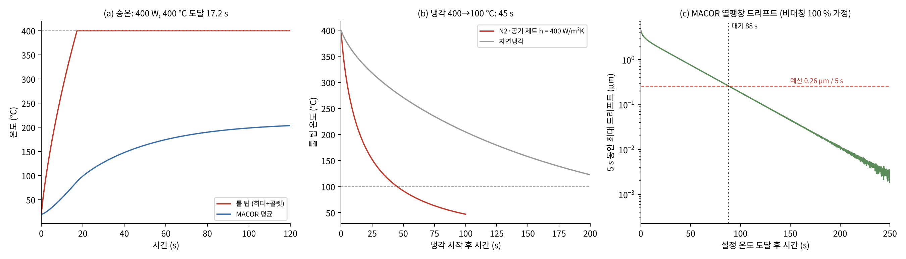

# 7. 열 설계 (Thermal Design)

## 7.1 목적과 기준

| 구분 | 항목 | 목표 | 출처 |
|---|---|---|---|
| 원문 KPI | 헤드 펄스 히터 최고 온도 | 400 ℃ | PBL 7쪽 |
| 설계 목표 | 승온 속도 | ≥ 20 K/s | 2.4절 |
| 설계 목표 | 400→100 ℃ 냉각 | ≤ 60 s | 2.4절 |
| 파생 요구 | 정렬→접촉 5 s 동안 열드리프트 | ≤ 0.26 μm | 5장 #6 |
| 파생 요구 | 스테이지·가이드 온도 상승 | ≤ 0.5 K | 5장 #6 |
| 파생 요구 | 광학 채널 오프셋 잔차 | σ ≤ 0.10 μm | 5장 #3 |

PBL 8쪽은 "400 ℃ 가열 블록과 정밀 가이드 레일 사이에 세라믹 단열재(MACOR)와 쿨링 자켓"을 배치하라고 했다. 이 장에서는 그 구성이 위 목표를 만족하려면 어떤 치수와 조건이 필요한지 계산한다.

## 7.2 해석 모델

**헤드 모델 (과도 해석).**

- **툴 팁:** AlN 히터와 콜렛을 하나의 열용량으로 묶은 집중 질량이다.
  - AlN: k 170 W/mK, ρc = 2.41 MJ/m³K
  - 콜렛(스테인리스 10×10×10 mm): ρc = 3.95 MJ/m³K
- **MACOR 단열 블록:** 40×40×16 mm를 두께 방향 16개 절점으로 나눈 1차원 전도 모델이다. k 1.46 W/mK, α 9.3 ppm/K.
- **경계조건:** 수냉 재킷 면은 냉각수 온도(20 ℃)로 고정한다. 툴 팁 표면은 대류(정지 공기 10 W/m²K, 냉각 시 제트 추가)와 복사(방사율 0.3)로 열을 잃는다.
- **히터 제어:** 설정 온도까지 최대 전력을 넣고, 도달 후에는 PI 제어로 유지한다(상세 튜닝은 10장).

**척 모델 (정상상태).** 200 ℃ 척 → 단열층 → 수냉판 순서로 열이 흐르는 1차원 열저항 모델이다.

## 7.3 히터 설계: 승온과 냉각

*그림 7-1. (a) 400 W 히터의 승온 곡선, (b) 냉각 곡선, (c) 설정 온도 도달 후 경과 시간에 따른 5초 열드리프트 상한.*

**히터 크기를 줄였다.** 3장 초안의 30×30×12 mm 히터는 콜렛을 합친 열용량이 약 30 J/K다. 20 K/s로 올리려면 손실을 빼고도 600 W가 필요해 데스크톱 전원으로 감당하기 어렵다. 펄스 히터는 열용량이 작아야 빨리 오르내린다. 그래서 히터를 **20×20×5 mm AlN 세라믹**으로 줄였다. 콜렛을 포함한 열용량은 8.8 J/K로 약 1/3이 된다.

| 항목 | 결과 | 목표 | 판정 |
|---|---|---|---|
| 최고 온도 (원문 KPI) | 400 ℃ 도달·유지 | 400 ℃ | 통과 |
| 승온 (최대 400 W) | 20 → 400 ℃ 17.2 s, 평균 22 K/s | ≥ 20 K/s | 통과 |
| 400 ℃ 유지 전력 | 65 W | — | — |
| MACOR를 통해 재킷으로 가는 열 | 55 W (정상상태) | — | 재킷 용량 산정 기준 |
| 냉각 400→100 ℃, N₂·공기 제트 (h = 400 W/m²K) | 45 s | ≤ 60 s | 통과 |
| 냉각 400→100 ℃, 자연냉각 | 243 s | — | 제트 필요 |

**히터 전원.** 400 W를 24 V로 공급하면 17 A가 흐른다. 그래서 48 V DC 전원(8.3 A)과 MOSFET PWM 구동으로 정했다(10장 회로).

**냉각 제트.** 히터 주위 노즐로 N₂ 또는 압축공기를 분사한다. 솔더 TCB에서는 3장의 N₂ 쉴드 가스를 그대로 냉각에 쓸 수 있다. 수냉 재킷이 받는 55 W는 냉각수 0.5 L/min이면 출구 온도가 1.6 K만 오른다.

## 7.4 헤드 열드리프트

툴 팁 온도는 PI 제어로 설정점에 붙어 있다. 그런데 그 위의 MACOR 블록은 시정수 약 175초로 천천히 데워진다. MACOR가 데워지는 동안 블록이 팽창하면서 콜렛을 옆으로 밀 수 있다.

**최악 조건 추정.** 블록 중심에서 가장자리까지 20 mm가 전부 한쪽으로만 팽창한다고 가정했다(비대칭 100 %). 이때 드리프트는 다음과 같다.

δ = α · 20 mm · ΔT(5 s)

이 값을 5장 예산 0.26 μm 이하로 묶으려면, MACOR 평균 온도의 변화율이 0.28 K/s 이하여야 한다.

| 설정 온도 도달 후 경과 시간 | 5 s 드리프트 상한 | 판정 |
|---|---|---|
| 0 s | 4.5 μm | 초과 |
| 30 s | 1.3 μm | 초과 |
| 60 s | 0.57 μm | 초과 |
| **88 s** | **0.26 μm** | **경계** |
| 120 s | 0.11 μm | 통과 |

**운전 규칙.** 히터가 설정 온도에 도달한 뒤 **90초 이상 기다린 후 정렬**한다. 3장 동작 순서 5단계의 "헤드를 정렬 온도로 가열"에 이 대기 조건을 추가한다. 실습에서는 헤드를 정렬 온도로 계속 켜 두고 시편만 바꾸므로, 첫 본딩에만 대기 시간이 생긴다. 실제 헤드는 대칭 구조라서 비대칭은 100 %보다 훨씬 작다. 따라서 이 대기 시간은 보수적인 값이다.

## 7.5 척 단열과 스테이지 온도

**MACOR 6 mm로는 단열이 부족하다.** 3장 초안의 척 아래 MACOR 6 mm로 200 ℃ 척을 받치면 Q = kAΔT/t = 1.46 × 0.0121 × 180 / 0.006 = **530 W**가 수냉판으로 빠진다. 척 히터 용량도, 냉각 용량도 감당할 수 없다.

| 단열재 (110 × 110 mm) | 열전도율 | 수냉판으로 가는 열 |
|---|---|---|
| MACOR 6 mm (초안) | 1.46 W/mK | 530 W |
| **규산칼슘 보드 10 mm (채택)** | 0.12 W/mK | **26 W** |
| 규산칼슘 보드 15 mm | 0.12 W/mK | 17 W |

규산칼슘 보드는 압축강도가 수 MPa이다. 50 N 가압의 평균 압력(110×110 mm 기준 4 kPa)을 충분히 견딘다. 다만 평면도 유지를 위해 척 둘레에 MACOR 스페이서 4개를 함께 둔다.

**수냉판만으로는 스테이지 온도 목표를 못 지킨다.** 26 W를 냉각수 1 L/min으로 받으면 판 온도가 두 가지 이유로 오른다.

| 원인 | 온도 상승 |
|---|---|
| 냉각수 온도 상승 (평균) | 0.2 K |
| 유로 벽 경막 온도차 (h ≈ 3,000 W/m²K, 유로 면적 60 cm²) | 1.5 K |
| **합계 (냉각수 온도 고정 시)** | **약 1.6 K** |

목표(0.5 K)를 넘는다. 그래서 **수냉판 아랫면에 온도센서를 붙이고, 칠러의 냉각수 설정 온도를 피드백 제어**해 판 아랫면을 실내 온도 ±0.2 K로 유지한다. 그러면 미동 스테이지와 가이드로 가는 열흐름이 사실상 0이 된다. 실제 정밀 장비에서도 쓰는 방식이다.

## 7.6 광학 프리즘 홀더 재질

빔스플리터 상·하 채널의 오프셋은 프리즘 홀더(유효 길이 약 20 mm)의 열팽창에 따라 변한다.

| 재질 | 열팽창계수 | 오프셋 변화 | 하루 허용 온도 변화 (σ 0.10 μm 예산의 1/2 기준) |
|---|---|---|---|
| 알루미늄 6061 | 23 ppm/K | 0.46 μm/K | 0.1 K (불가능) |
| 스테인리스 304 | 17 ppm/K | 0.34 μm/K | 0.15 K |
| **인바 36 (채택)** | 1.2 ppm/K | 0.024 μm/K | **2 K** |

실험실 하루 온도 변화(±1~2 K) 안에서 매일 하는 오프셋 보정만으로 예산을 지키려면 인바가 필요하다.

## 7.7 설계 변경 요약

| 항목 | 3장 초안 | 7장 결과 | 이유 |
|---|---|---|---|
| 헤드 히터 | AlN 30×30×12 mm | **AlN 20×20×5 mm, 400 W, 48 V** | 열용량 1/3, 20 K/s 달성 |
| 헤드 냉각 | 공랭 노즐 | **N₂·공기 제트 h ≈ 400 W/m²K** | 냉각 60 s 이내 |
| 정렬 시점 | 설정 온도 도달 즉시 | **도달 후 90 s 이상 대기** | MACOR 드리프트 0.26 μm/5 s 이내 |
| 척 단열 | MACOR 6 mm | **규산칼슘 보드 10 mm + MACOR 스페이서** | 열손실 530 → 26 W |
| 수냉판 | 개루프 | **판 온도 피드백 칠러 (±0.2 K)** | 스테이지 온도 상승 ≤ 0.5 K |
| 프리즘 홀더 | 미정 | **인바 36** | 광학 오프셋 0.024 μm/K |

## 7.8 한계

- 헤드 모델은 1차원 집중정수 모델이다. 3차원 온도 분포와 실제 비대칭 정도는 Fusion 열 해석으로 확인할 항목이다(11장).
- 대류 계수 h는 문헌상 일반적인 범위(자연대류 5~25, 충돌 제트 100~1,000 W/m²K) 안에서 정했다. 시제품을 만들면 측정해서 보정할 값이다.
- 툴 팁 열전대 온도와 실제 접합부 온도의 차이는 3.4절의 더미 다이 보정 절차로 처리한다.

*계산 스크립트: `calc/thermal.py` (결과 `calc/thermal.json`).*
