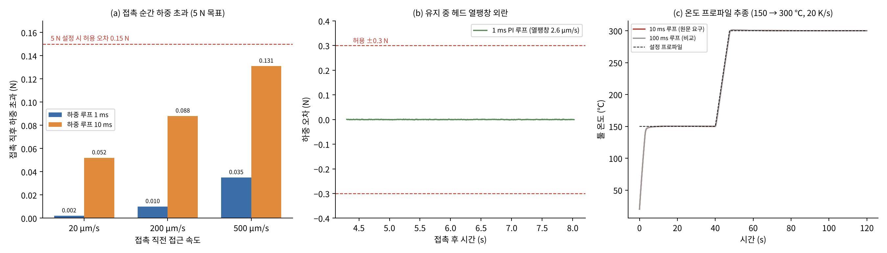
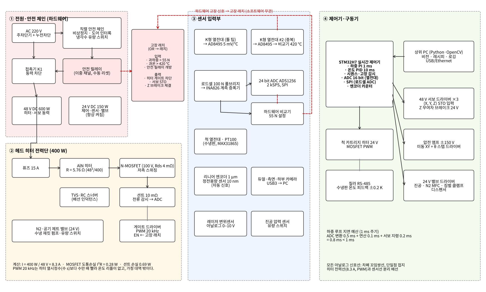

# 10. 제어와 회로 (Control & Electronics)

## 10.1 원문 요구와 목표

PBL 9쪽은 "로드셀 하중 데이터와 열전대(TC) 온도 신호를 10 ms 단위로 피드백 받아 안정적인 접합 품질을 보장"하는 임베디드 PID 다중 루프 제어를 요구한다. 11쪽 일정에는 "회로 설계"가 들어 있다.

| 구분 | 항목 | 목표 |
|---|---|---|
| 원문 요구 (9쪽) | 하중·온도 피드백 주기 | ≤ 10 ms |
| 설계 목표 (2.4절) | 하중 제어 오차 | 저 레인지 ±(0.05 N + 1 %), 고 레인지 ±(0.1 N + 1 %) |
| 설계 목표 (2.4절) | 온도 안정도 | ±2 ℃, 승온 ≥ 20 K/s |
| 설계 목표 (2.4절) | 하중 루프 주기 | 1 ms |
| 파생 요구 (5장 #8) | 접촉 직전 접근 속도 | ≤ 20 μm/s |

## 10.2 하중 제어 루프

**모델.**

- **구동부:** Z 서보는 위치 지령을 받아 내부 루프로 따라간다. 이 동작을 시정수 0.8 ms의 1차 지연으로 모델링했다.
- **하중 발생:** 헤드와 다이 사이에 교체식 판스프링(저 2 N/mm, 고 50 N/mm)과 접촉 강성(2,000 N/mm)이 직렬로 있다. 접촉 후 하중은 F = k_eff × (Z 위치 − 접촉 위치)다.
- **측정:** 로드셀 측정에는 ADC 지연 0.5 ms와 노이즈 σ 0.002 N을 넣었다.

**제어기.** 하중 오차로 Z 속도 지령을 만든다. 비례 이득은 루프 교차 주파수가 약 20 Hz가 되도록 정했다(Kp = 2π·20 / k_eff). 적분 이득은 헤드 열팽창 같은 느린 외란을 없애기 위한 것이다. 시퀀스는 3장과 같다.

1. 20 μm/s로 접근한다.
2. 0.1 N이 넘으면 접촉으로 판정한다.
3. 하중을 5 N/s로 올려 목표값까지 간다.
4. 목표값을 유지한다.

*그림 10-1. (a) 접근 속도와 루프 주기에 따른 접촉 순간 하중 초과, (b) 하중 유지 중 헤드 열팽창 외란에 대한 오차, (c) 온도 프로파일 추종.*

| 경우 | 초과량 | 정상상태 오차 | 허용 오차 | 판정 |
|---|---|---|---|---|
| 저 레인지 1 N, 1 ms 루프 | 0.032 N | 0.002 N | 0.06 N | 통과 |
| 고 레인지 20 N, 1 ms 루프 | 0.035 N | 0.002 N | 0.30 N | 통과 |
| 고 레인지 20 N, 10 ms 루프 | 0.059 N | 0.009 N | 0.30 N | 통과 |
| 고 레인지 20 N, 1 ms, 헤드 열팽창 2.6 μm/s | 0.035 N | 0.002 N | 0.30 N | 통과 |

**1 ms가 필요한 이유.** 위 표만 보면 원문 요구인 10 ms 루프로도 목표를 지킨다. 차이는 접촉 순간에 생긴다. 고 레인지 5 N 목표에서 접근 속도별 하중 초과량은 다음과 같다(그림 10-1 a).

| 접근 속도 | 1 ms 루프 | 10 ms 루프 |
|---|---|---|
| 20 μm/s | 0.002 N | 0.052 N |
| 200 μm/s | 0.010 N | 0.088 N |
| 500 μm/s | 0.035 N | 0.131 N |

10 ms 루프는 하중을 늦게 보기 때문에 접근 속도가 같아도 초과량이 6~26배 크다. 저 레인지 1 N의 허용 오차는 0.06 N이다. 그런데 10 ms 루프에서는 가장 느린 20 μm/s로 접근해도 초과량(0.052 N)이 허용 오차와 거의 같아진다. 반면 1 ms 루프는 500 μm/s로 25배 빨리 접근해도 0.035 N이다. 그래서 1 ms 루프는 저하중 에폭시 실습의 하중 정확도를 지키는 동시에, 접근 시간을 줄여 본딩 1회 시간도 단축한다. 원문 10 ms는 온도 루프와 상위 감시 주기로 쓴다.

**헤드 열팽창 외란.** 7장에서 히터가 데워지는 동안 헤드가 약 2.6 μm/s로 늘어난다는 결과가 나왔다. 고 레인지 스프링(50 N/mm)에서는 이것이 0.13 N/s의 하중 증가로 나타난다. 적분 동작이 이 외란을 없애서 유지 중 오차는 ±0.002 N 이내다(그림 10-1 b).

## 10.3 온도 제어 루프

**모델.** 7장의 헤드 열 모델을 그대로 썼다. 툴 팁(8.8 J/K)과 MACOR 3개 절점, 대류·복사 손실로 구성된다. 측정은 열전대(응답 5 ms, 노이즈 σ 0.2 ℃)이고, 출력은 400 W PWM이다. 제어기는 10 ms 주기 PI이고, 적분 포화 방지 기능을 넣었다.

**프로파일.** TC-NCF 실습을 가정한 구간 프로파일이다.

1. 150 ℃까지 올려 정렬 온도로 유지한다.
2. 20 K/s로 300 ℃까지 올린다.
3. 300 ℃로 유지한다.

| 항목 | 10 ms 루프 (원문) | 100 ms 루프 (비교) | 목표 | 판정 (10 ms) |
|---|---|---|---|---|
| 150 ℃ 유지 편차 | ±0.30 ℃ | ±0.46 ℃ | ±2 ℃ | 통과 |
| 300 ℃ 유지 편차 | ±0.42 ℃ | ±0.49 ℃ | ±2 ℃ | 통과 |
| 승온 추종 | 20.3 K/s | 20.3 K/s | ≥ 20 K/s | 통과 |
| 램프 종료 후 초과 | 1.3 ℃ | 1.4 ℃ | — | — |
| 300 ℃ 유지 전력 | 66 W | 66 W | — | — |

**해석.** 툴 팁의 열시정수는 수 초다. 그래서 10 ms 루프는 온도를 충분히 따라가고, 100 ms 루프도 이 모델에서는 크게 나빠지지 않는다. 그러나 실제 접합에서는 툴이 차가운 다이에 닿는 순간 온도가 급히 떨어진다. 이 급변을 빨리 회복하려면 짧은 루프가 유리하다. 그래서 원문 요구대로 10 ms를 채택한다.

## 10.4 회로 구성

*그림 10-2. 회로 구성도. ① 전원·안전 체인, ② 헤드 히터 전력단, ③ 센서 입력부, ④ 제어기·구동기. 붉은 점선은 소프트웨어를 거치지 않는 하드웨어 고장 신호다.*

**① 전원·안전 체인.**

- **전원:** AC 220 V를 두 갈래로 나눈다. 48 V DC 600 W는 히터·서보 동력, 24 V DC 150 W는 제어·센서용이다.
- **안전 체인:** 비상정지, 도어 인터록, 냉각수 유량 스위치가 직렬로 연결된다. 이 체인이 이중 채널 안전 릴레이를 거쳐 동력 접촉기 K1을 붙잡고 있다. 어느 하나가 열리면 48 V 동력이 끊긴다.
- **제어 전원:** 24 V 제어 전원은 끊지 않는다. 고장 기록과 상태 표시를 유지하기 위해서다.

**② 헤드 히터 전력단.**

| 항목 | 값 | 근거 |
|---|---|---|
| 전원 전압 | 48 V | 7장: 400 W를 24 V로 공급하면 17 A가 필요 |
| 히터 저항 | 5.76 Ω (= 48² / 400) | 최대 전력 400 W |
| 최대 전류 | 8.3 A → 퓨즈 15 A | — |
| 스위치 | N-MOSFET 저측, 100 V / Rds 4 mΩ | 도통손실 I²R = 0.28 W → 소형 방열판으로 충분 |
| 전류 감시 | 션트 10 mΩ (손실 0.69 W) | 히터 단선·단락 감지 |
| PWM | 20 kHz | 열시정수(수 s)보다 수만 배 빨라 온도 리플이 없고 가청 대역 밖 |
| 게이트 드라이버 EN 핀 | 고장 래치에 연결 | 소프트웨어가 멈춰도 히터 차단 |

**③ 센서 입력부.**

| 센서 | 신호 처리 | 비고 |
|---|---|---|
| 툴 팁 열전대 | AD8495 (5 mV/℃ 아날로그) → MCU ADC | 디지털 변환 IC(약 100 ms)보다 빠름 |
| 중복 열전대 | AD8495 → 420 ℃ 비교기 | 소프트웨어 고장 시 과온 감시 |
| 로드셀 | INA826 계측 증폭기 → 두 갈래: (1) 24 bit ADS1256 2 kSPS → MCU, (2) 55 N 하드웨어 비교기 | 비교기는 과하중 감시 |
| 수냉판 PT100 | MAX31865 | 칠러 피드백용 (7장) |
| 엔코더·정전용량 센서 | 차동 신호 | 노이즈 내성 |

**고장 래치.** 과하중, 과온, 안전 릴레이 개방 중 하나라도 들어오면 래치가 걸린다. 그러면 세 가지가 동시에 일어난다.

- 히터 게이트 차단
- 서보 드라이버의 STO(Safe Torque Off) 입력 작동
- Z축 무여자 브레이크 체결

래치는 수동으로 리셋해야 풀린다. 이렇게 하면 3장의 3단 안전 계층(소프트웨어 한계 → 하드웨어 차단 → 비상정지)이 회로에서 실제로 구현된다.

**④ 제어기·구동기.** STM32H7이 1 ms 하중 루프, 10 ms 온도 루프, 시퀀스, 고장 감시를 맡는다. 하중 루프의 지연은 ADC 변환 0.5 ms + 연산 0.1 ms + 서보 지령 0.2 ms = 0.8 ms로 1 ms 주기 안에 들어간다. 구동기는 다음과 같다.

| 구동기 | 사양 |
|---|---|
| 서보 드라이버 (X, Y, Z) | 48 V, 3대 |
| 압전 앰프 | ±150 V, 미동 XY |
| θ 스테핑 드라이버 | 웜기어 구동 |
| 척 히터 | 24 V 카트리지 히터 + MOSFET PWM |
| 칠러 | RS-485로 냉각수 온도 지령 |
| 24 V 밸브 드라이버 | 진공, N₂ 유량, 짐벌 클램프, 디스펜서 |

**배선 원칙.** 아날로그 신호선은 차폐 꼬임쌍선과 단일점 접지로 배선한다. PWM 8.3 A 히터 전력선은 센서선과 다른 경로로 분리해 로드셀·열전대 신호에 스위칭 노이즈가 섞이지 않게 한다.

## 10.5 5장·2장 목표와의 대응

| 목표 | 결과 | 판정 |
|---|---|---|
| 피드백 주기 ≤ 10 ms (원문) | 하중 1 ms, 온도 10 ms | 통과 |
| 하중 제어 오차 (설계 목표) | 저 0.032 N / 고 0.035 N (최악 초과량) | 통과 |
| 온도 안정도 ±2 ℃ (설계 목표) | ±0.42 ℃ | 통과 |
| 접근 속도 ≤ 20 μm/s (5장 #8) | 1 ms 루프로 500 μm/s까지 허용 가능. 운전값은 20 μm/s 유지 | 통과 |

*시뮬레이션: `calc/control_sim.py`, `calc/contact_speed_study.py` (결과 `calc/control.json`). 회로 구성도: `fig/fig10b.py`.*
