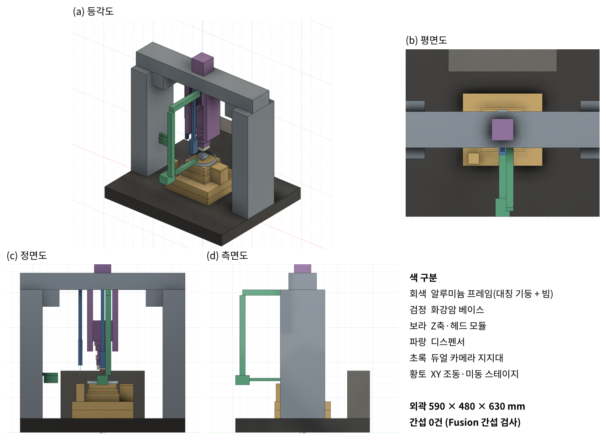
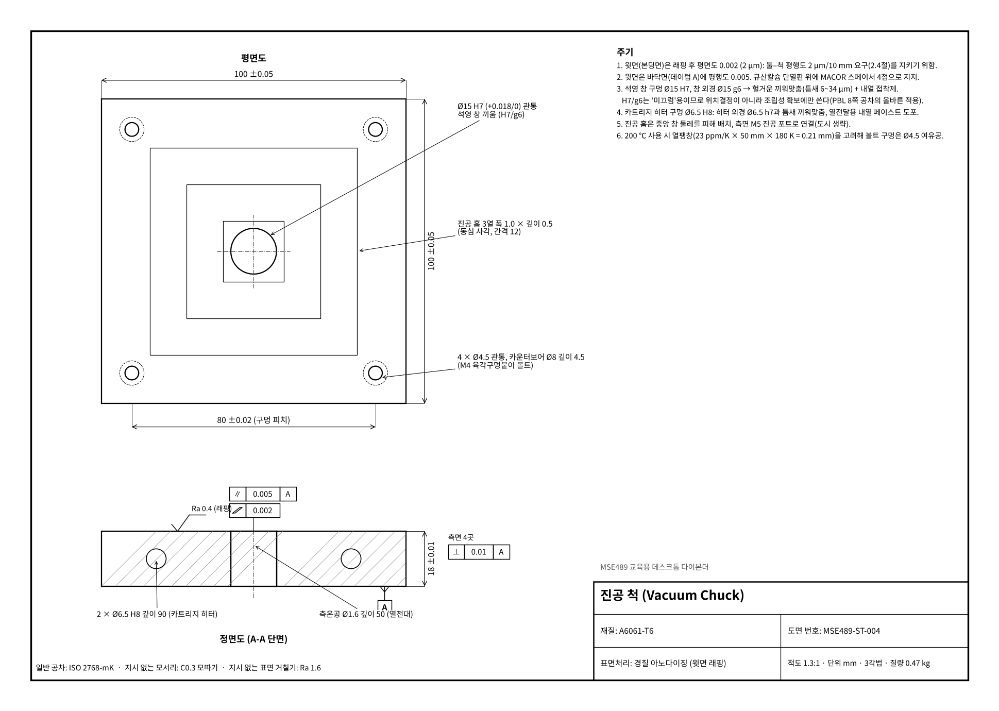
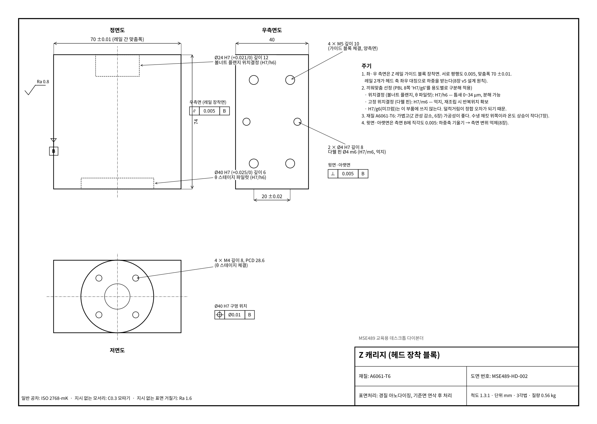
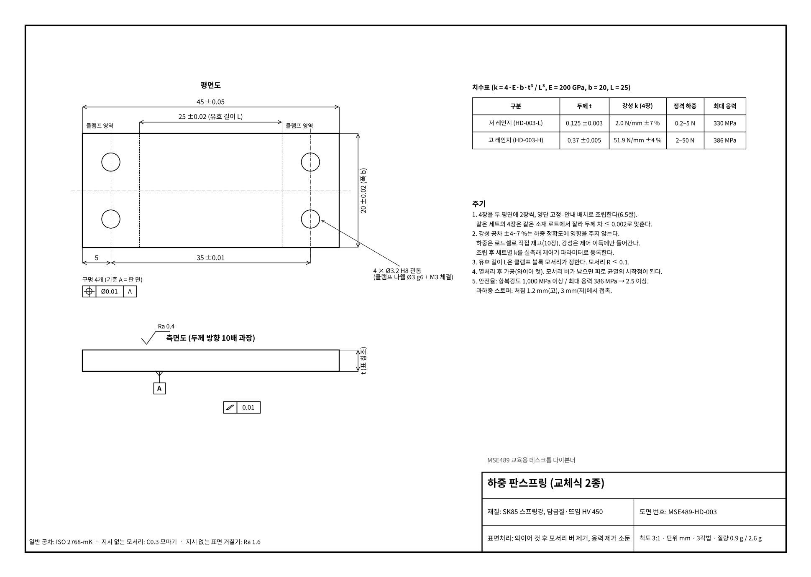

# 11. 3D 모델링과 부품 도면 (CAD & Drawings)

## 11.1 원문 요구와 진행 방법

PBL 8쪽은 3D 모델링, 2D 상세 도면, 공차 지정(H7/g6 등)을 요구한다. 11쪽 일정에는 "CAD 모델링 및 도면"이 들어 있다. 이 장에서는 두 가지를 정리한다.

- **조립 모델:** 3~10장에서 정한 치수를 모두 반영한 장비 전체 모델
- **부품 도면:** 정밀도에 직접 영향을 주는 부품 3개의 상세 도면

**모델링 방법.** 모든 치수는 Python 사양 파일(`cad/spec.py`) 하나에 모았다. 이 사양 파일에서 Autodesk Fusion API 스크립트(`DieBonderModel.py`)를 자동으로 만들고, Fusion에서 실행해 모델을 생성했다. 이렇게 하면 앞 장 계산에서 치수가 바뀔 때 사양 파일만 고치면 된다. 계산과 모델의 치수가 어긋날 수 없다. 실제로 7장(히터·단열재)과 8장(프레임)의 변경을 반영할 때 이 방식으로 모델을 다시 만들었다.

## 11.2 조립 모델

*그림 11-1. Autodesk Fusion 조립 모델(최종 v5 프레임). 이 그림이 3장 그림 3-1의 초기 배치안을 대체한다.*

모델은 6개 모듈, 부품 43개로 구성된다. 부품마다 실제 재질을 Fusion 물리 재질로 지정했다(알루미늄 6061, 스테인리스강, 화강암, 질화알루미늄, 석영, MACOR).

| 확인 항목 | 결과 | 기준 | 판정 |
|---|---|---|---|
| 풋프린트 가로 × 세로 (원문 KPI) | 590 × 480 mm | ≤ 600 × 600 mm | 통과 |
| 부품 간 간섭 (Fusion 간섭 검사) | 0건 | 0건 | 통과 |
| 7장 변경 반영 | 히터 20×20×5, MACOR 16, 수냉 재킷 19, 규산칼슘 10 mm | — | 반영 |
| 8장 변경 반영 | 대칭 기둥 80×160, 거셋, 헤드 좌우 대칭 Z 레일 | — | 반영 |
| 높이 (참고값) | 630 mm | 원문 기준 없음 | — |
| 질량 (참고값) | 약 101 kg | 원문 기준 없음 | — |

**질량에 대한 설명 (참고값).** 질량은 원문 KPI가 아니라서 판정하지 않는다. 각 부품의 부피에 밀도를 곱한 값은 100.6 kg이다. 이 가운데 화강암 베이스가 37.5 kg, 알루미늄 프레임이 43 kg으로 80 %를 차지한다. 8장에서 강성과 대칭을 위해 기둥을 키운 결과다. Fusion이 계산한 질량은 133.7 kg으로 더 크다. 전장 박스·카메라·플라스틱 부품은 Fusion 재질 라이브러리에 맞는 재질이 없어 기본값(강철)이 들어갔기 때문이다. 특히 내부가 대부분 빈 전장 박스가 꽉 찬 강철로 계산되어 약 30 kg이 더해졌다.

| 모듈 | 질량 (밀도 기준) | 주요 부품 |
|---|---|---|
| 프레임 | 80.8 kg | 화강암 베이스 590×480×50, 알루미늄 기둥 2개, 빔, 거셋 |
| 헤드 | 8.0 kg | Z 레일 2개, 캐리지, θ 스테이지, 판스프링, 로드셀, 짐벌, 수냉 재킷, MACOR, AlN 히터 |
| 스테이지 | 9.1 kg | 조동 X·Y, 미동 압전 XY, 수냉판, 규산칼슘, 진공 척, 석영 창·쉴드 |
| 광학 | 0.7 kg | 빔스플리터 프리즘과 레일, 듀얼 카메라, 측면 카메라 |
| 공정·전장 | 2.0 kg | 디스펜서, 레이저 변위계, 전장 박스 |

## 11.3 부품 도면

정밀도에 가장 크게 영향을 주는 부품 3개를 골라 상세 도면을 그렸다. 모든 도면은 KS·ISO 표기법(3각법, ISO 2768-mK 일반 공차, 기하 공차 기호)을 따른다.

| 도면 | 부품 | 고른 이유 |
|---|---|---|
| MSE489-ST-004 | 진공 척 | 툴–척 평행도(설계 목표 2 μm/10 mm)를 결정하는 면 |
| MSE489-HD-002 | Z 캐리지 | 하중축 기울기와 측면 변위(8장)를 결정하는 기준면 |
| MSE489-HD-003 | 하중 판스프링 | 하중 레인지와 제어 이득(6장, 10장)을 결정하는 부품 |

*그림 11-2. 진공 척 도면(MSE489-ST-004).*

**진공 척의 핵심 공차.**

- **윗면 평면도 0.002 mm:** 래핑으로 만든다. 툴과 척의 평행도가 다이 한쪽 쏠림(BLT 기울기)을 만들기 때문이다.
- **윗면–바닥면 평행도 0.005 mm (데이텀 A):** 척을 바꿔 끼워도 기울기가 짐벌 조정 범위 안에 들도록 한다.
- **볼트 구멍 Ø4.5 여유공:** 200 ℃에서 척이 0.21 mm 늘어난다(23 ppm/K × 50 mm × 180 K). 구멍에 여유가 없으면 볼트가 척을 붙잡아 휘게 만든다.

*그림 11-3. Z 캐리지 도면(MSE489-HD-002).*

**Z 캐리지의 핵심 공차.**

- **레일 장착 좌우 측면 평행도 0.005 mm, 맞춤폭 70 ±0.01:** 8장의 대칭 원칙이다. 두 레일이 헤드 축 좌우에서 똑같이 하중을 받아야 측면 변위가 생기지 않는다.
- **윗면·아랫면 직각도 0.005 mm:** 하중축이 기울면 50 N의 일부가 옆으로 작용한다. 기울기 0.005/74 rad이면 옆 방향 힘은 3.4 mN으로 무시할 수 있다.
- **θ 스테이지 파일럿 위치도 Ø0.01:** 헤드 회전 중심과 Z축을 맞춘다. 9장 각도 보정에서 회전 중심이 어긋나면 각도를 고칠 때 위치도 함께 움직인다.

*그림 11-4. 하중 판스프링 도면(MSE489-HD-003). 두께만 다른 2종을 한 도면에 표로 정리했다.*

**판스프링의 핵심 공차.**

- **두께 0.37 ±0.005 / 0.125 ±0.003 mm:** 강성은 두께의 세제곱에 비례한다(k = 4Ebt³/L³). 그래서 두께 공차 ±1.4 %가 강성 ±4 %가 된다. 하지만 하중은 로드셀로 직접 측정하므로(10장) 강성 오차는 하중 정확도에 영향을 주지 않는다. 강성은 제어 이득 계산에만 쓰이므로, 조립 후 세트별로 실측해 제어기에 입력한다.
- **유효 길이 25 ±0.02:** 클램프 블록의 모서리가 정한다. 모서리 반지름이 크면 유효 길이가 흐려진다.
- **와이어 컷 후 버 제거:** 판스프링은 반복 하중을 받는 부품이다. 모서리의 버는 피로 균열의 시작점이 된다.

## 11.4 끼워맞춤 선정

PBL 8쪽은 공차 예로 "H7/g6"를 들었다. 그러나 H7/g6는 **헐거운 끼워맞춤**이다. 구멍(H7)과 축(g6) 사이에 늘 틈새가 있어서 부품이 미끄러질 수 있다. 미끄럼이 필요한 곳에는 맞지만, 위치결정에 쓰면 틈새만큼 부품이 덜컥거린다. 그 덜컥거림은 그대로 정합 오차가 된다. 그래서 이 설계에서는 용도에 따라 세 가지 끼워맞춤을 구분해 썼다.

| 끼워맞춤 | 구분 | 틈새·죔새 (Ø10 기준) | 적용 위치 | 이유 |
|---|---|---|---|---|
| **H7/g6** | 헐거움 (미끄럼) | 틈새 5~29 μm | 석영 창–척 구멍, 프리즘 슬라이드 레일 | 조립성 확보. 위치는 다른 기준으로 잡는다 |
| **H7/h6** | 헐거움 (위치결정) | 틈새 0~24 μm | 볼너트 플랜지, θ 스테이지 파일럿, 칼럼–빔 맞춤 | 분해가 가능하면서 틈새가 최소 |
| **H7/m6** | 중간 (억지 쪽) | 틈새 9 ~ 죔새 15 μm | 다웰 핀 (캐리지, 판스프링 클램프, 척 기준 핀) | 재조립해도 같은 위치로 돌아온다 |
| H8/h7 | 헐거움 | 틈새 0~37 μm | 카트리지 히터 구멍, 판스프링 다웰 구멍 | 열팽창 여유와 조립성 |

정리하면, PBL의 H7/g6는 "공차를 지정하라"는 예시다. 정밀 장비에서는 위치를 정하는 곳에 미끄럼 끼워맞춤을 쓰지 않는다. 위치결정은 h6·m6로, 미끄럼이 필요한 곳만 g6로 지정했다. 이 구분이 5장 오차 예산의 기계 반복성 항목을 지키는 조건이다.

## 11.5 검증 상태와 한계

| 항목 | 상태 |
|---|---|
| 풋프린트 (원문 KPI) | 통과 (590 × 480 mm) |
| 간섭 | 통과 (0건) |
| 툴–척 평행도 2 μm/10 mm (설계 목표) | 부품 공차로는 척 평면도 0.002 + 평행도 0.005를 지정했다. 조립 누적 기울기는 짐벌 레벨링으로 없앤다(3장). 레벨링 후 측정 절차는 13장에서 다룬다 |

- 조립 모델은 블록 수준의 형상이다. 볼트·배선·배관은 그리지 않았다.
- 3장 그림 3-1과 표의 배치안은 초기 v1 프레임이다. 최종 형상은 그림 11-1이다.
- 7장 한계에서 언급한 Fusion 열 해석은 하지 않았다. 대신 대칭 구조(8장)와 90초 대기 규칙(7장)으로 열드리프트를 보수적으로 관리한다.

*모델 사양: `cad/spec.py`, 스크립트 생성: `cad/build_script.py`, Fusion 스크립트: `cad/DieBonderModel/DieBonderModel.py`. 도면: `fig/dwg/dwg1_chuck.py`, `dwg2_carriage.py`, `dwg3_flexure.py`.*
