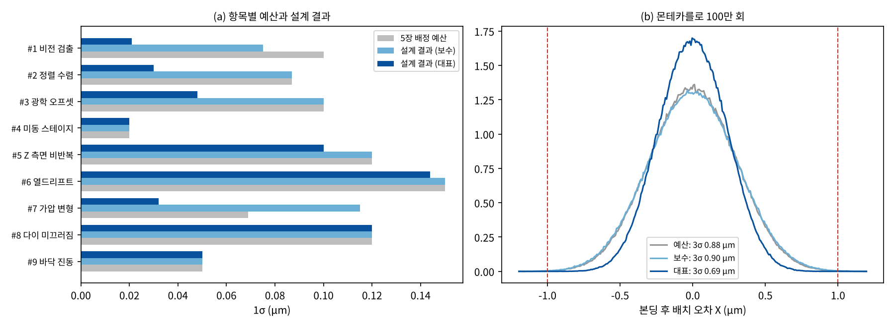

# 12. 통합 검증 (Integrated Verification)

## 12.1 목적

PBL 7쪽은 KPI를 "시뮬레이션 및 데이터로 검증"하라고 하고, 11쪽 일정은 마지막 단계로 "통합 모의 검증"을 둔다. 이 장에서는 세 가지를 확인한다.

1. **정합 종합:** 5장에서 나눠 준 오차 예산 대신 6~10장의 실제 설계 결과를 넣어 다시 합산했을 때도 ±1 μm를 지키는가
2. **검증표:** 원문 KPI, 원문 요구, 설계 목표, 파생 요구 18개 항목의 최종 판정
3. **요구 충족:** PBL 3~11쪽의 요구가 보고서 어디에서 어떻게 다뤄졌는가

## 12.2 정합 종합: 설계 결과로 다시 합산

5장의 0.88 μm는 각 항목에 "이만큼 허용한다"고 나눠 준 예산의 합이었다. 이제 각 장의 계산 결과로 그 예산을 바꿔 넣는다. 결과가 없는 항목은 예산값을 그대로 쓴다. 두 경우로 나눠 계산했다.

- **대표:** 각 장의 기준 조건 결과
- **보수:** 각 장의 최악 조건 결과. 결과가 예산보다 작아도 근거가 약하면 예산값을 쓴다

*그림 12-1. (a) 오차 항목별 5장 예산과 설계 결과(1σ), (b) 몬테카를로 100만 회의 본딩 후 배치 오차 분포. 붉은 점선은 KPI ±1 μm.*

| 항목 | 5장 예산 (1σ) | 설계 결과: 대표 | 근거 | 설계 결과: 보수 | 근거 |
|---|---|---|---|---|---|
| #1 비전 검출 | 0.100 | 0.021 | 9장 기준 조건 | 0.075 | 9장 최악 복합 + 평탄화 |
| #2 정렬 수렴 | 0.087 | 0.030 | 9장 폐루프 5,000회 | 0.087 | 판정 기준 그대로 |
| #3 광학 오프셋 | 0.100 | 0.048 | 7장 인바 홀더 | 0.100 | 예산 유지 |
| #4 미동 스테이지 | 0.020 | 0.020 | 6장 센서 10 nm | 0.020 | — |
| #5 Z 측면 비반복 | 0.120 | 0.100 | 6장 가이드 사양 환산 | 0.120 | 예산 유지 |
| #6 열드리프트 | 0.150 | 0.144 | 7장 90 s 대기 후 | 0.150 | — |
| #7 가압 변형 | 0.069 | 0.032 | 8장 v5, 편심 1 mm | 0.115 | 8장 v5, 편심 3.7 mm, 보정 없음 |
| #8 다이 미끄러짐 | 0.120 | 0.120 | 계산 모델 없음 | 0.120 | — |
| #9 바닥 진동 | 0.050 | 0.050 | 8장 177 Hz, 진폭은 미계산 | 0.050 | — |
| **합계 3σ (RSS)** | **0.88 μm** | **0.69 μm** | | **0.90 μm** | |
| 몬테카를로 99.73 % 구간 | ±0.86 μm | ±0.66 μm | | ±0.88 μm | |
| ±1 μm 안에 들어오는 비율 | 99.96 % | 99.9997 % | | 99.95 % | |

**판정: 원문 KPI ±1 μm 통과 (모의 검증).** 대표 조건에서는 31 %의 여유가 있다. 보수 조건에서도 0.90 μm로 KPI 안에 있다.

**결과를 읽는 방법.**

- 비전·정렬·광학 오프셋(#1~#3)은 계산 결과가 예산보다 2~5배 작다. 비전 쪽은 여유가 크다.
- 남은 큰 항목은 열드리프트(#6), Z 측면 비반복(#5), 다이 미끄러짐(#8)이다. 5장에서 예측한 대로 "정렬이 끝난 뒤 접촉까지" 생기는 오차다.
- **다이 미끄러짐(#8)은 계산으로 검증하지 못했다.** 콜렛 진공 유지력과 접촉 순간의 마찰을 다루는 모델이 없기 때문이다. 대신 10장에서 접촉 순간의 하중 초과를 0.035 N 이하로 줄였고, 13장의 평행도 절차로 기울어진 접촉을 막는다. 이 항목이 2배(σ 0.24 μm)가 되면 대표 조건에서도 3σ 0.93 μm로 KPI 경계에 가까워진다. 그래서 장비를 만들면 가장 먼저 측정해야 할 항목이다(13장 실습 4).

## 12.3 검증표

| No | 항목 | 기준 | 결과 | 판정 | 구분 | 검증 장 |
|---|---|---|---|---|---|---|
| 1 | 정합 반복정밀도 X·Y (3σ) | ≤ 1 μm | 0.69 μm (대표) / 0.90 μm (보수) | 통과 | 원문 KPI | 5, 12장 |
| 2 | 헤드 펄스 히터 최고 온도 | 400 ℃ | 400 ℃ 도달·유지 | 통과 | 원문 KPI | 7장 |
| 3 | 최대 본딩 하중 | 50 N | Z 소요 토크 0.053 N·m (정격 이내), 판스프링 55 N 응력 386 MPa (안전율 2.5 이상) | 통과 | 원문 KPI | 6장 |
| 4 | 풋프린트 가로·세로 | ≤ 600 mm | 590 × 480 mm | 통과 | 원문 KPI | 11장 |
| 5 | 하중·온도 피드백 주기 | ≤ 10 ms | 하중 1 ms, 온도 10 ms | 통과 | 원문 요구 | 10장 |
| 6 | 각도 정합 (3σ) | ≤ 0.005° | 0.0017° | 통과 | 설계 목표 | 5, 9장 |
| 7 | 헤드 승온 속도 | ≥ 20 K/s | 22 K/s | 통과 | 설계 목표 | 7장 |
| 8 | 400→100 ℃ 냉각 | ≤ 60 s | 45 s | 통과 | 설계 목표 | 7장 |
| 9 | 하중 루프 주기 | ≤ 1 ms | 1 ms (지연 0.8 ms) | 통과 | 설계 목표 | 10장 |
| 10 | 정렬→접촉 5 s 열드리프트 | ≤ 0.26 μm | 0.25 μm (90 s 대기 후) | 통과 | 파생 요구 | 7장 |
| 11 | 스테이지·가이드 온도 상승 | ≤ 0.5 K | ±0.2 K (칠러 피드백) | 통과 | 파생 요구 | 7장 |
| 12 | 50 N 가압 측면 변위 | ≤ 0.2 μm | 0.054 μm (편심 1 mm) | 통과 | 파생 요구 | 8장 |
| 13 | 1차 고유진동수 | ≥ 150 Hz | 177 Hz | 통과 | 파생 요구 | 8장 |
| 14 | Z 측면 비반복 변위 (1σ) | ≤ 0.12 μm | 0.10 μm (가이드 사양 환산) | 조건부 통과 | 파생 요구 | 6장 |
| 15 | 광학 오프셋 잔차 (1σ) | ≤ 0.10 μm | 0.048 μm | 통과 | 파생 요구 | 7장 |
| 16 | 피듀셜 검출 반복성 (1σ) | ≤ 0.04 px | 0.031 px (최악 복합) | 통과 | 파생 요구 | 9장 |
| 17 | 접촉 직전 접근 속도 | ≤ 20 μm/s | 20 μm/s 운전 (500 μm/s까지 허용) | 통과 | 파생 요구 | 10장 |
| 18 | 툴–척 평행도 | ≤ 2 μm/10 mm | 측정 절차의 불확도 0.27 μm/10 mm | 절차 확정, 제작 후 측정 | 파생 요구 | 11, 13장 |

**요약.** 18개 항목 중 16개 통과, 1개 조건부 통과, 1개는 제작 후 측정이다. 원문 KPI 4개와 원문 요구 1개는 모두 통과했다.

**조건부·미측정 항목의 처리.**

- **No 14 (Z 측면 비반복):** 6장에서 고른 크로스 롤러 가이드의 반복성 ≤ 0.2 μm/50 mm를 2σ 폭으로 보수적으로 보고 σ 0.10 μm로 환산했다. 실제 부품을 고를 때 제조사 사양서에서 반복성의 정의(σ인지 범위인지)를 확인해야 한다. 정의가 더 나쁘면 높이별 보정표로 반복 성분을 더 줄인다.
- **No 18 (평행도):** 평행도는 조립한 뒤에야 측정할 수 있다. 이 보고서에서는 부품 공차(척 평면도 0.002, 평행도 0.005, 11장)를 정하고, 짐벌 레벨링 절차와 측정 절차(13.5절)를 만들었다. 그 측정 절차가 2 μm를 판정할 만큼 정밀하다는 것(불확도 0.27 μm)까지 모의로 확인했다.

**참고값 (판정하지 않음).** 질량 약 101 kg(부품 부피 × 밀도), 높이 630 mm. 원문에 기준이 없다(2장).

## 12.4 PBL 요구 충족 확인

| 요구 (PBL 쪽) | 대응 내용 | 장 | 상태 |
|---|---|---|---|
| 양산 장비 한계와 교육 장비의 강점 (2~3) | 블랙박스·고정 레시피 → 가시화·가변·정량 KPI | 1 | 반영 |
| 공정 가시화: 광학 현미경, 투명 챔버 (3) | 석영 쉴드, 유리 기판 + 하부 카메라, 측면 카메라 | 3, 13 | 반영 |
| 미접합·보이드·휨 불량 유도 (3) | 공정 물리 모델, DoE에서 미충전·필렛 과다 조건 포함 | 4, 13 | 반영 |
| 진공 픽업·콜렛, X/Y/θ 정렬, 로드셀, 가열, 디스펜서 (4) | 시스템 구성 14개 모듈 | 3 | 반영 |
| 수동 정렬 실습 (4) | 수동 모드, 실습 1 (수동·자동 비교) | 3, 13 | 반영 |
| 4대 파라미터 DoE (5) | 2⁴⁻¹ 부분요인설계, 모델 예측표 | 4, 13 | 반영 |
| 칩 두께·크기별 가압력 (5) | p = F/A 하중 상한표 | 4, 13 | 반영 |
| BLT·필렛 검사 (5) | 레이저 BLT, 측면 카메라 필렛 | 3, 4 | 반영 |
| KPI 4개 (7) | 12.3절 No 1~4 | 2, 12 | 통과 |
| 열팽창 구조 변형 FEA (7) | 열드리프트 계산(7장), 3차원 FEA(8장) | 7, 8 | 반영 |
| 모터 토크·가이드 레일 정밀도 계산 (7) | 3축 토크·관성, 볼스크류·가이드 선정 | 6 | 반영 |
| 히터 블록 열전달 해석 (7) | 승온·냉각·유지 전력, 척 단열 | 7 | 반영 |
| 3D CAD 간섭·조립성 (8) | Fusion 조립 모델, 간섭 0건. 모듈별 하위 조립(헤드·스테이지·광학)과 다웰 핀(H7/m6) 재조립 위치 | 11 | 반영 |
| 2D 도면: 공차, 기하공차, 조도, 재질 (8) | 도면 3장, 끼워맞춤 선정표 | 11 | 반영 |
| MACOR 단열·쿨링 재킷 (8) | MACOR 16 mm + 수냉 재킷, 척은 규산칼슘으로 변경 | 7 | 반영 |
| 강성·모달 해석, 리브 보강 (8) | v1~v5 비교, 거셋 보강, 177 Hz | 8 | 반영 |
| 듀얼 비전, 빔스플리터, 텔레센트릭 (9) | 1.73 μm/px 빔스플리터 광학계 | 3, 9 | 반영 |
| NCC 피듀셜 검출, Δx·Δy·Δθ (9) | NCC + 서브픽셀 + 평탄화, 합성 영상 검증 | 9 | 반영 |
| 아핀 캘리브레이션 (9) | 5×5 격자, 잔차 0.028 μm | 9 | 반영 |
| PID 10 ms 피드백 (9) | 하중 1 ms PI, 온도 10 ms PI | 10 | 반영 |
| 회로 설계 (11) | 전원·안전 체인, 히터 전력단, 센서, 고장 래치 | 10 | 반영 |
| 교육 적합성·안전 (10) | 실습 5개, 위험 대책, 표준 운전 절차 | 13 | 반영 |
| 실습 매뉴얼 (11) | 13.2~13.7절 | 13 | 반영 |
| 통합 모의 검증 (11) | 이 장 | 12 | 반영 |
| 최종 결과 발표 (11) | 발표 자료 | — | 별도 |

## 12.5 설계 변경 이력

검증 과정에서 처음 설계가 바뀐 주요 내용이다. 각 변경은 계산 결과가 목표를 넘었기 때문에 생겼다.

| 변경 | 처음 설계 | 최종 설계 | 계기 | 장 |
|---|---|---|---|---|
| 스테이지 | 단일 XY 스테이지 | 조동 + 미동 압전 2단 | 단일 스테이지는 3σ 1.49 μm로 KPI 실패 | 5 |
| 헤드 히터 | AlN 30×30×12 mm | AlN 20×20×5 mm, 48 V | 열용량이 커서 20 K/s 불가 | 7 |
| 척 단열 | MACOR 6 mm | 규산칼슘 10 mm + 칠러 피드백 | 열손실 530 W | 7 |
| 정렬 시점 | 설정 온도 도달 즉시 | 도달 후 90 s 대기 | 초기 열드리프트 4.5 μm/5 s | 7 |
| 프레임 | 외팔 칼럼 + 돌출 암 | 대칭 기둥 + 거셋 + 대칭 Z 레일 | 50 N에서 측면 74.6 μm, 40 Hz | 8 |
| 비전 처리 | NCC만 | NCC + 평탄화 보정 | 최악 조건 0.102 px로 실패 | 9 |
| 하중 루프 | 10 ms | 1 ms (온도는 10 ms) | 저하중 접촉 초과량이 허용 오차와 같아짐 | 10 |
| 끼워맞춤 | H7/g6 일괄 | 용도별 g6·h6·m6 | 미끄럼 끼워맞춤의 틈새가 정합 오차 | 11 |

## 12.6 한계

- **모의 검증이다.** 모든 결과는 계산과 시뮬레이션이다. 볼트 체결부의 유연성, 실제 가이드의 비반복 성분, 접착제의 비뉴턴 거동처럼 모델에 넣지 못한 것들이 있다. 8장의 4배 여유, 9장의 1.3~4배 여유는 이 불확실성의 몫이다.
- **검증하지 못한 항목:** 다이 미끄러짐(#8)과 바닥 진동 진폭(#9)은 계산 모델이 없어 예산값을 그대로 썼다. 평행도는 제작 후 측정한다.
- **장비를 만든다면 먼저 할 일:** ① 실습 4(KPI 검증)로 실제 3σ 측정, ② 접촉 미끄러짐 측정(건식 배치 전·후 오프셋 차), ③ 평행도 측정(13.5절), ④ 열드리프트 실측(정렬 후 5 s 동안 피듀셜 추적).

*계산: `calc/integration.py` (결과 `calc/integration.json`).*
